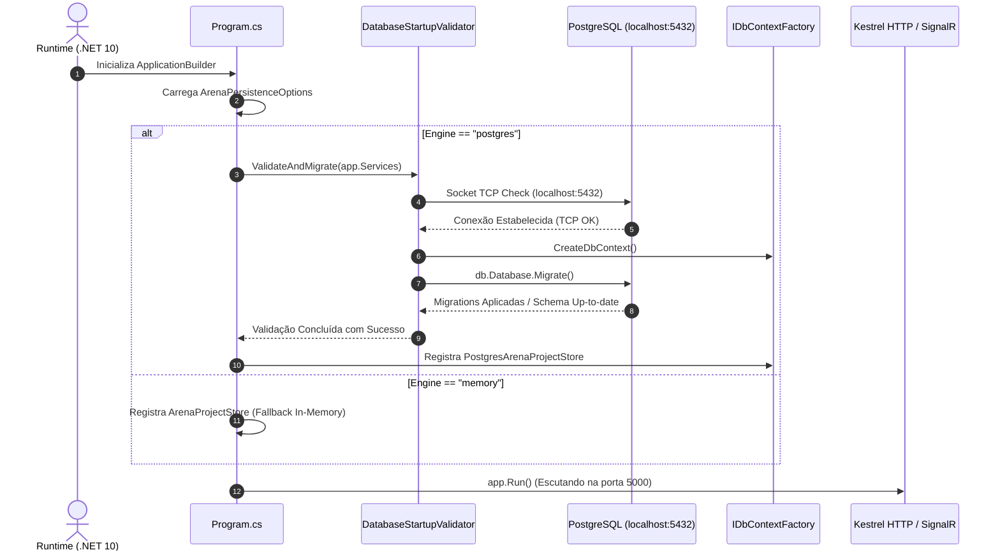

# Resumo Arquitetural — Milestone 4A
## Storage Engine & Relational Schema (PostgreSQL Portable 18.6 + EF Core 10)

> **Documento:** Síntese da Arquitetura de Persistência Relacional  
> **Data:** Novembro de 2026  
> **Status:** Ativo e Homologado  

---

## 1. Evolução Arquitetural: Antes vs Depois do 4A

### Arquitetura Anterior (Fases 1 a 3 — Volátil em Memória)
```text
┌────────────────────────────────────────────────────────┐
│ ASP.NET Core Minimal APIs / SignalR Hub               │
└──────────────────────────┬─────────────────────────────┘
                           │ (singleton)
                           ▼
┌────────────────────────────────────────────────────────┐
│ IArenaProjectStore: ArenaProjectStore (In-Memory)      │
│  - ConcurrentDictionary<string, Event> _events         │
│  - ConcurrentDictionary<string, Project> _projects     │
│  - ConcurrentDictionary<string, Judge> _judges         │
│  - List<EventJuryAssignment> _juryAssignments          │
│  - List<Round> _roundHistory                           │
│  - Memory State: Chairs (1..5), PitchStage, Timers     │
└────────────────────────────────────────────────────────┘
          [Qualquer reinicialização causava perda total]
```

### Arquitetura Atual (Milestone 4A — Híbrida / Relacional)
```text
┌────────────────────────────────────────────────────────┐
│ ASP.NET Core Minimal APIs / SignalR Hub               │
└──────────────────────────┬─────────────────────────────┘
                           │ (singleton)
                           ▼
┌────────────────────────────────────────────────────────┐
│ IArenaProjectStore: PostgresArenaProjectStore          │
│ ┌────────────────────────────────────────────────────┐ │
│ │ Estado de Palco em Memória (Milestone 4B):         │ │
│ │  - ChairStates (1..5), PitchStage, Timers Ativos    │ │
│ └────────────────────────────────────────────────────┘ │
│ ┌────────────────────────────────────────────────────┐ │
│ │ Operações com IDbContextFactory<ArenaDbContext>:   │ │
│ │  - CreateDbContext() por operação (Short-lived)    │ │
│ └─────────────────────────┬──────────────────────────┘ │
└───────────────────────────┼────────────────────────────┘
                            │ EF Core 10 / Npgsql 10
                            ▼
┌────────────────────────────────────────────────────────┐
│ PostgreSQL Portable 18.6 (localhost:5432)              │
│  - Database: arena_voice                               │
│  - Tabelas: events, projects, judges,                  │
│             event_jury_assignments,                    │
│             round_history_entries,                     │
│             active_session_states                      │
└────────────────────────────────────────────────────────┘
```

---

## 2. Componentes e Responsabilidades da Camada de Persistência

### 2.1. `ArenaDbContext`
Contexto do Entity Framework Core 10 responsável pelo mapeamento das 6 entidades fundamentais do negócio:
- `Events`: Tabela `events` com owned types `BrandingConfig` e `TimerConfig`.
- `Projects`: Tabela `projects` com chaves estrangeiras vinculadas ao evento e owned type `ProjectMedia`.
- `Judges`: Tabela `judges` com coluna nativa `text[]` para `expertise`.
- `EventJuryAssignments`: Tabela `event_jury_assignments` com chave primária composta (`event_id`, `chair_id`) e restrições de unicidade.
- `RoundHistoryEntries`: Tabela `round_history_entries` com coluna nativa `int[]` para `turned_chairs`, coluna `jsonb` para snapshot imutável de `timer_config_snapshot`, índices compostos e check constraints (`ck_round_result`, `ck_round_approval_mode`, `ck_round_last_stage`).
- `ActiveSessionStates`: Tabela singleton `active_session_states` com `singleton_id = 1` para servir de âncora ao mecanismo de reidratação do Milestone 4B.

### 2.2. `DatabaseStartupValidator`
Componente executado de forma síncrona no boot da aplicação:
1. Extrai as opções de `ArenaPersistenceOptions`.
2. Executa um socket TCP check em `localhost:5432` com timeout de 3 segundos.
3. Se indisponível, emite banner explicativo e encerra a aplicação com código de erro amigável, impedindo silent failures.
4. Se disponível, resolve o `IDbContextFactory<ArenaDbContext>` e executa `db.Database.Migrate()` de forma estritamente idempotente.

### 2.3. `PostgresArenaProjectStore`
Implementação de alta fidelidade da interface `IArenaProjectStore`:
- **Isolamento de Contexto**: Utiliza `IDbContextFactory<ArenaDbContext>` criando instâncias de vida curta (`using var context = ...`) para cada método de CRUD.
- **Divisão Híbrida de Responsabilidade**:
  - *Dados Relacionais no PostgreSQL*: Eventos, Projetos, Jurados, Alocação da Banca e Histórico de Rodadas Arquivadas.
  - *Dados Voláteis em Memória*: Estado atual das cadeiras (`_chairStates`), Estágio corrente do pitch (`_pitchStage`), temporizadores de palco e flags de rodada em andamento (escopo do Milestone 4B).

---

## 3. Fluxo de Inicialização do Sistema (Startup Flow)


