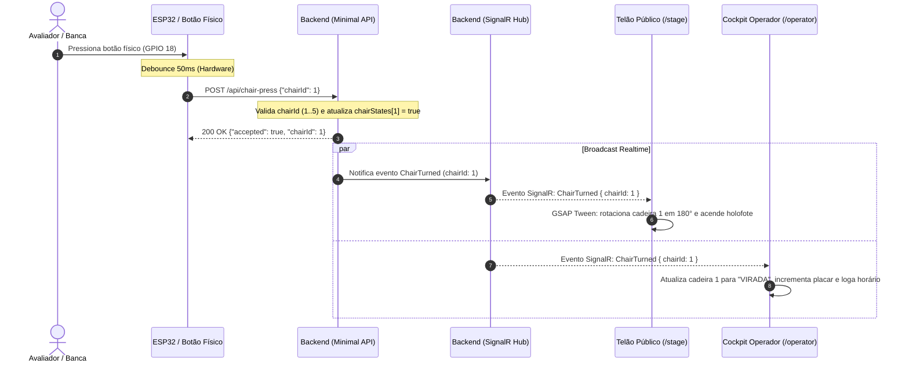
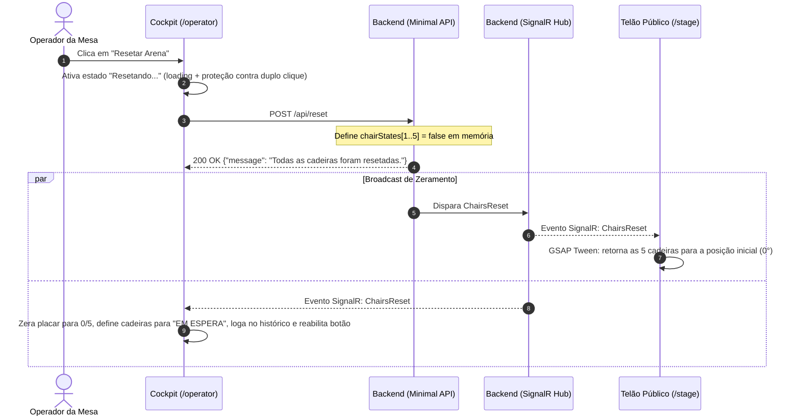
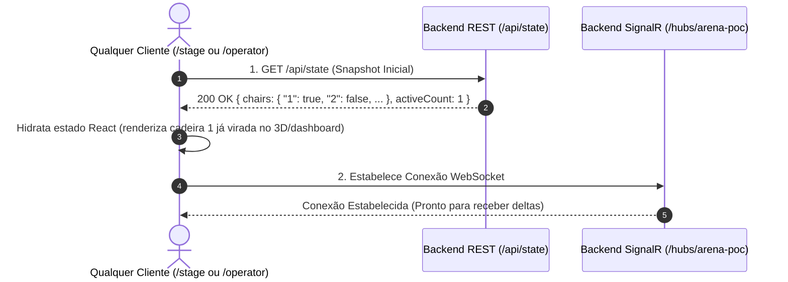

# Arquitetura — Arena Voice

> **Status:** Fase 1 Concluída (Operator + Stage Foundation)  
> **Referência de Produto:** [Roadmap Oficial e Arquitetura de Produto (docs/roadmap.md)](roadmap.md)

---

## 1. Separação Rigorosa dos Quatro Papéis

A arquitetura do Arena Voice baseia-se na segregação estrita de responsabilidades entre quatro entidades funcionais:

```text
Operator Screen (Cockpit Operacional)
    │ (Ações de Negócio: Resetar Arena, Abrir Rodada)
    ▼
Camada de Serviços / Frontend
    │ (Requisições HTTP de comando e consultas de snapshot)
    ▼
Backend / Regras de Negócio / Estado Oficial
    │ (Processamento autoritativo e emissão de eventos)
    ▼
Infraestrutura de Comunicação (SignalR / WebSockets / REST)
    │ (Transporte transparente de eventos)
    ▼
Stage Screen (Telão Público 3D)
```

1. **OPERATOR (Mesa Técnica):**
   - Superfície 2D responsiva voltada à condução e monitoramento da dinâmica;
   - Comunica com o operador através de linguagem pura de produto (*"Sistema Pronto"*, *"Placar da Arena"*, *"Histórico da Sessão"*);
   - Despacha comandos de controle da rodada diretamente para a API do backend;
   - Totalmente desacoplada do motor 3D para garantir consumo mínimo de hardware na máquina de operação.

2. **STAGE (Telão Público 3D):**
   - Experiência cênica e cinematográfica de alta fidelidade visual (Three.js + GSAP);
   - Superfície estritamente passiva e contemplativa: sem botões, sem formulários, sem interações de mouse e sem dados de infraestrutura;
   - Dirigida 100% por eventos autoritativos recebidos do backend em tempo real.

3. **BACKEND (ASP.NET Core .NET 10):**
   - **Única fonte da verdade** oficial do estado da arena (`chairStates`);
   - Valida transições de estado, limites de identificadores (cadeiras 1 a 5) e integridade de payloads;
   - Processa comandos e despacha eventos em broadcast via SignalR Hub (`/hubs/arena-poc`).

4. **INFRAESTRUTURA (Rede e Transporte):**
   - Camada de transporte transparente (WebSockets/SignalR e HTTP REST);
   - Protocolos e detalhes técnicos ficam encapsulados, nunca vazando para o vocabulário da interface.

---

## 2. Fluxo de Acionamento de Voto

Quando uma cadeira é acionada por um avaliador (seja por botão físico com microcontrolador ESP32 ou por script de simulação):



---

## 3. Fluxo de Reset Autoritativo

O reset da arena não é uma mutação cosmética local do frontend; é uma transição de estado de negócio controlada pelo backend:



---

## 4. Sincronização Dupla: Snapshot + Realtime

Para garantir que o telão e o cockpit exibam com fidelidade o estado oficial da arena mesmo quando abertos com uma rodada já em andamento, o sistema implementa uma **estratégia de sincronização dupla**:



---

## 5. Resiliência: Recovery, Reconnect e Resync

O hook de serviço de rede (`frontend/src/services/useSignalR.js`) encapsula políticas de tolerância a falhas:
1. **Reconexão Automática com Backoff:**
   Políticas de tentativas imediatas `[0, 2000, 5000, 10000, 30000]` ms, complementadas por um loop contínuo de reconexão a cada 5 segundos em caso de queda prolongada.
2. **Abstração Semântica de Estados:**
   - Durante a tentativa de reconexão, o operador visualiza *"Reconectando ao sistema..."*.
   - Se o backend cair, o cockpit exibe *"Sistema Indisponível"*.
   - Quando o serviço retorna, o status transiciona automaticamente para *"Sistema Pronto"*.
3. **Resync Automático via Versão de Conexão (`reconnectVersion`):**
   A cada reconexão bem-sucedida, um contador de versão é incrementado internamente. O componente raiz `App.jsx` observa essa versão e consulta imediatamente o snapshot `GET /api/state`, reconciliando qualquer evento que tenha ocorrido durante o período de instabilidade sem necessidade de F5 manual.

---

## 6. Contratos de Interface Auditados

### Endpoints REST (Backend Minimal API)

| Método | Endpoint | Payload | Resposta de Sucesso | Função |
| :--- | :--- | :--- | :--- | :--- |
| `POST` | `/api/chair-press` | `{"chairId": 1}` | `{"accepted": true, "chairId": 1, ...}` | Ingestão oficial de votos de avaliadores. |
| `POST` | `/api/support` | `{"seatNumber": 1}` | `{"accepted": true, "chairId": 1, ...}` | Alias de retrocompatibilidade. |
| `POST` | `/api/reset` | *Vazio* | `{"message": "...", "chairs": {...}}` | Comando autoritativo de reset da arena. |
| `GET` | `/api/state` | *Vazio* | `{"chairs": {...}, "activeCount": X}` | Consulta de snapshot oficial para hidratação. |
| `GET` | `/api/status` | *Vazio* | `{"status": "ONLINE", ...}` | Health check de prontidão da API. |

### Eventos SignalR (Hub `/hubs/arena-poc`)

| Evento | Direção | Payload | Efeito no Frontend |
| :--- | :---: | :--- | :--- |
| `ChairTurned` | Server $\rightarrow$ Client | `{ chairId: int, timestamp: string, source: string }` | Vira a cadeira no 3D e atualiza o placar no Operator. |
| `ChairsReset` | Server $\rightarrow$ Client | *Sem payload* | Retorna todas as cadeiras para de costas em todas as abas. |
