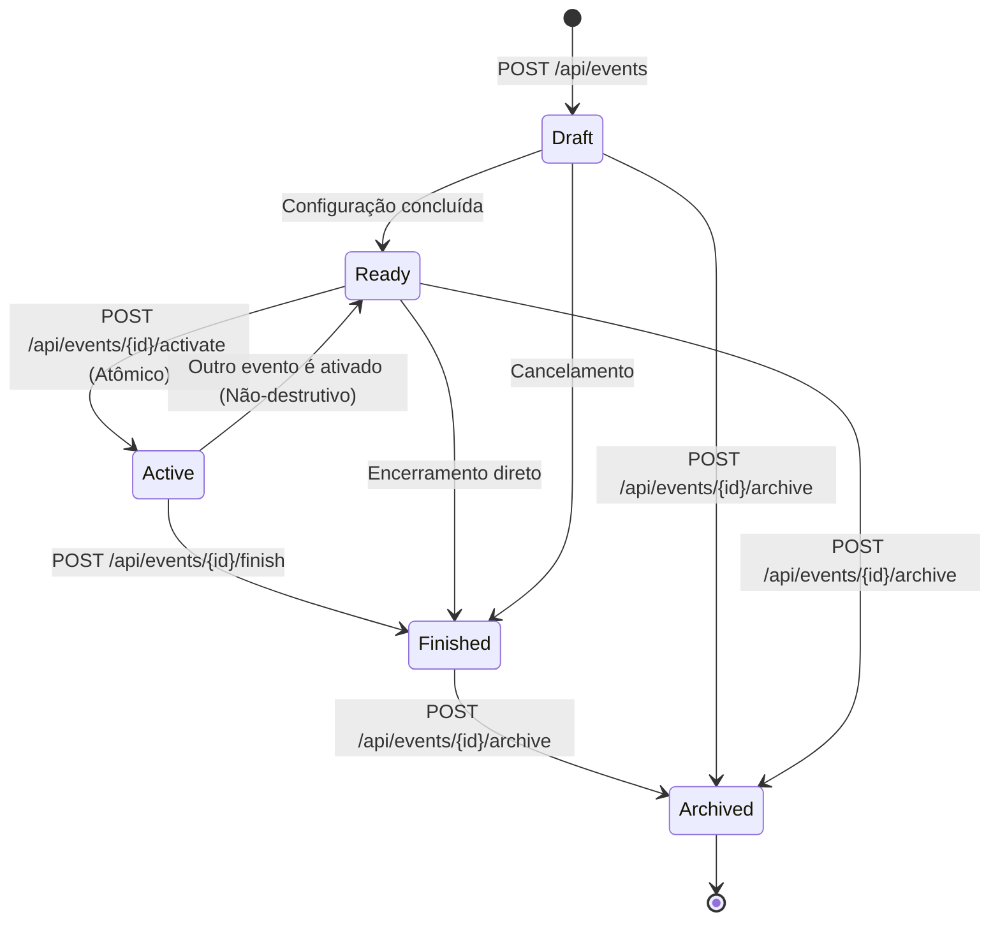
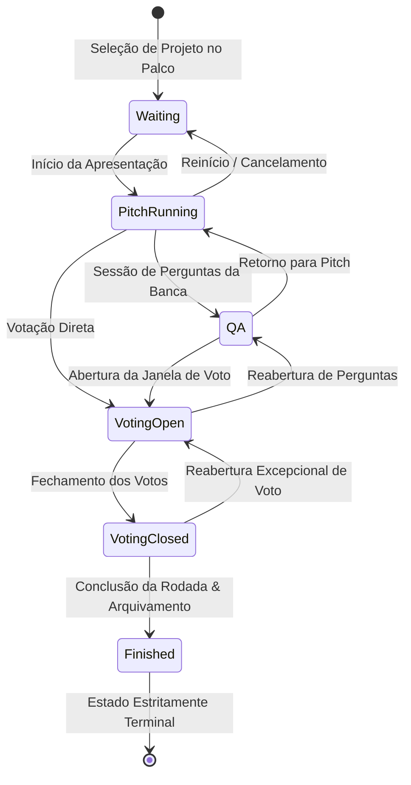
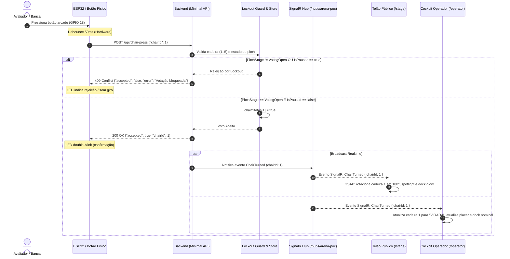
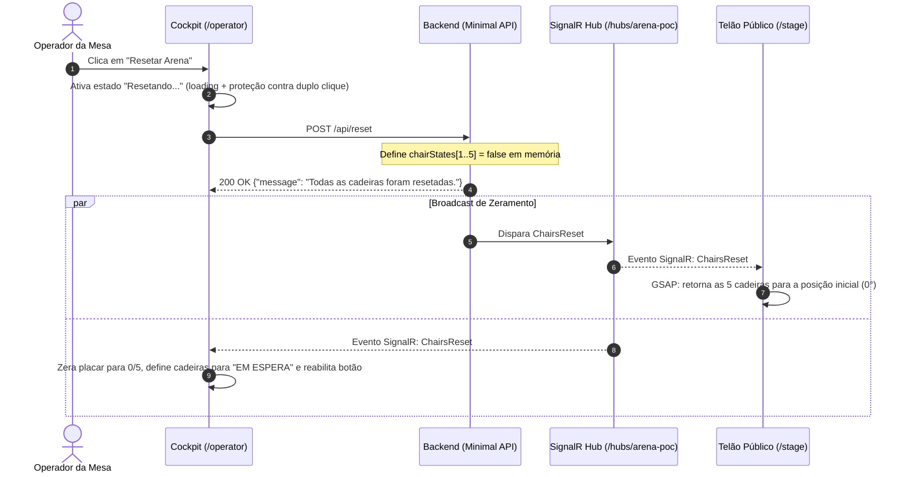
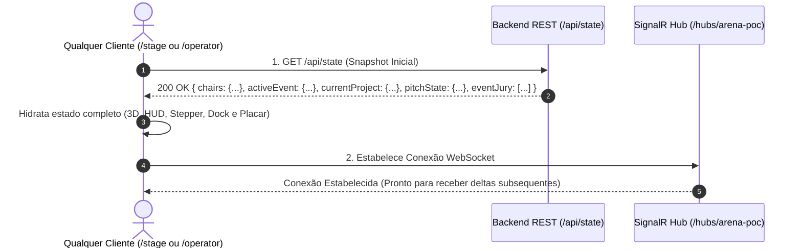

# Arquitetura — Arena Voice

> **Status:** Fase 1, Fase 2 e Fase 3 Concluídas e Homologadas (`v0.3.0-phase3`)  
> **Referência de Produto:** [Roadmap Oficial e Arquitetura de Produto (docs/roadmap.md)](roadmap.md)  
> **Cobertura Automatizada:** 497 verificações em 10 suítes de testes automatizados (100% de aprovação, zero falhas, zero regressões).

---

## 1. Separação Rigorosa dos Quatro Papéis

A arquitetura do Arena Voice baseia-se na segregação estrita de responsabilidades entre quatro entidades funcionais:

```text
Operator Screen (Cockpit Operacional / Mesa Técnica)
    │ (Ações de Negócio: Resetar Arena, Transicionar Pitch, Ajustar Cronômetro, Alocar Jurados)
    ▼
Camada de Serviços / Frontend
    │ (Requisições HTTP de comando e consultas de snapshot)
    ▼
Backend / Regras de Negócio / Estado Oficial (ASP.NET Core .NET 10)
    │ (Validação autoritativa, máquinas de estado, lockout, result engine e emissão de eventos)
    ▼
Infraestrutura de Comunicação (SignalR Hub / WebSockets / REST)
    │ (Transporte transparente de eventos em tempo real)
    ▼
Stage Screen (Telão Público 3D — Three.js + GSAP)
```

1. **OPERATOR (Mesa Técnica — `/operator`):**
   - Superfície 2D responsiva e ergonômica voltada à condução, parametrização e monitoramento da dinâmica;
   - Quatro abas funcionais:
     - **Cockpit (`/operator/cockpit`):** Stepper visual do pitch, cronômetro de palco, grade das 5 cadeiras com identificação nominal dos jurados, placar segmentado e log de auditoria em tempo real;
     - **Projetos (`/operator/projects`):** Gestão da fila de pitches, cadastro/edição/exclusão de startups com modal assistido e ação de seleção atômica no palco;
     - **Eventos (`/operator/event`):** Governança do ciclo de vida dos eventos (Draft, Ready, Active, Finished, Archived), controle de branding e seletor cromático (`ColorSwatch`);
     - **Jurados (`/operator/judges`):** Catálogo global de jurados corporativos e alocação dinâmica nas cadeiras 1 a 5 do evento ativo;
   - Despacha intenções de negócio para as APIs do backend sem expor jargões de infraestrutura ao usuário.

2. **STAGE (Telão Público 3D — `/stage`):**
   - Experiência cênica e cinematográfica de alta fidelidade visual construída em Three.js, React Three Fiber e GSAP;
   - Superfície estritamente passiva e contemplativa: sem botões, sem formulários, sem interações de mouse e sem dados de infraestrutura ou rede;
   - Elementos em tela:
     - Topo: Identidade institucional do evento ativo (`StageHeader`);
     - Centro: Anfiteatro 3D procedural com 5 cadeiras físicas, pódio de pitch laqueado e portal de neons reativos (`primaryColor` / `secondaryColor`);
     - HUD Superior: Cronômetro cênico sincronizado (`StageHUD`) com alerta visual de contagem regressiva (<15s) e indicação de pausa;
     - Rodapé Esquerdo: Card broadcast da startup no palco (`StageProjectBanner`) com badge do estágio operacional;
     - Rodapé Inferior: Dock nominal da banca de jurados (`StageJuryDock`) com cards translúcidos, avatares e anéis de neon reativos ao acionamento das cadeiras;
   - Dirigida 100% por eventos autoritativos e snapshots recebidos do backend.

3. **BACKEND (ASP.NET Core .NET 10):**
   - **Única fonte oficial da verdade** de todo o ecossistema;
   - Mantém e orquestra o `ActiveContext` thread-safe em memória via `ArenaProjectStore`;
   - Controla as máquinas de estados de Eventos (5 estados) e de Pitch (6 estágios);
   - Implementa o **Lockout Autoritativo**: bloqueia fisicamente votos de cadeiras fora de `VotingOpen` ou durante pausas com `HTTP 409 Conflict`;
   - Processa o **Result Engine**: calcula o resultado formal da rodada em dois níveis (`Result` e `ApprovalMode`);
   - Emite deltas em broadcast em tempo real através do Hub SignalR (`/hubs/arena-poc`).

4. **INFRAESTRUTURA (Rede e Transporte):**
   - Camada de transporte transparente (WebSockets/SignalR e HTTP REST Minimal APIs);
   - Protocolos e detalhes técnicos ficam encapsulados nos serviços de frontend (`useSignalR.js`, módulos de API), nunca vazando para o vocabulário das interfaces operacionais.

---

## 2. Motores Centrais de Negócio

### 2.1. ActiveContext & Estado Global Unificado

O `ActiveContext` centraliza em memória o estado operacional em tempo real da arena física:

```text
ActiveContext
├── CurrentEvent: Event (ID, Branding, Configurações de Temporização)
├── CurrentProject: Project (ID, Título, Equipe, Categoria, Mídias)
├── PitchStage: PitchStage (Waiting, PitchRunning, QA, VotingOpen, VotingClosed, Finished)
├── PitchStageStartedAt: DateTimeOffset? (Âncora temporal oficial)
├── CurrentStageDurationSeconds: int (Duração configurada para o estágio atual)
├── IsPaused: bool (Indicador de congelamento do cronômetro)
├── TotalPausedSeconds: int (Compensação acumulada de pausas para evitar drift temporal)
└── Chairs: Dictionary<int, bool> (Estado de virada das cadeiras 1..5)
```

### 2.2. Event Lifecycle Engine (Governança de Eventos)

Os eventos da plataforma possuem um ciclo de vida explícito composto por 5 estados formais:



- **Ativação Atômica Não-Destrutiva:** Apenas 1 evento pode estar `Active` por vez. Ao ativar um novo evento, o evento ativo anterior retorna para `Ready`, preservando a reversibilidade da mesa técnica.
- **Proteção de Arquivamento:** Rejeição com `HTTP 409 Conflict` se houver tentativa de arquivar o evento atualmente ativo na arena.
- **Duplicação Segura:** Permite clonar a estrutura e configurações de temporização de um evento existente em um novo ciclo em estado `Draft`.

### 2.3. Pitch Lifecycle Engine (Máquina de Estados da Apresentação)

Cada apresentação de startup transiciona através de 6 estágios formais estritos:



- **Rejeição Autoritativa (HTTP 422 Unprocessable Entity):** Qualquer tentativa de pular etapas não autorizadas pela matriz de transição é rejeitada pelo backend sem alterar o estado.
- **Estado Terminal (`Finished`):** Uma vez em `Finished`, nenhuma transição direta é aceita. O retorno para `Waiting` ocorre exclusivamente via seleção de um novo projeto no palco (`POST /api/projects/{id}/select`).
- **Conclusão Automática:** Ao atingir `Finished`, o projeto ativo recebe automaticamente o status `ProjectStatus.Completed` e tem seu timestamp `PresentationEndedAt` gravado.

### 2.4. Pitch Timers & Lockout Autoritativo

A dinâmica de contagem de tempo e bloqueio de acionamentos opera de forma autoritativa e sincronizada:

1. **Âncora Temporal no Backend:**
   O tempo decorrido e restante é calculado com precisão a partir de `PitchStageStartedAt`, deduzindo o `TotalPausedSeconds` e o tempo congelado durante pausas (`IsPaused = true`).
2. **Sincronização Contínua Sem Desvio (Drift-Free):**
   Tanto o cockpit do operador quanto o telão 3D utilizam tickers locais sincronizados ancorados em `remainingSeconds` e calibrados via eventos SignalR `PitchTimerUpdated` e `PitchStageChanged`.
3. **Ajustes Dinâmicos em Tempo Real:**
   O operador pode pausar, retomar ou adicionar tempo extra (+30s, +60s, +120s) a qualquer momento através de endpoints dedicados (`POST /api/pitch/pause`, `resume`, `add-time`).
4. **Lockout Físico e Digital (HTTP 409 Conflict):**
   O acionamento de cadeiras (`POST /api/chair-press`) é rigorosamente filtrado pelo backend:
   - Se `PitchStage == VotingOpen` e `!IsPaused`: o voto é aceito (`HTTP 200 OK`), a cadeira vira e o evento `ChairTurned` é emitido.
   - Em qualquer outro estágio (`Waiting`, `PitchRunning`, `QA`, `VotingClosed`, `Finished`) ou com o timer pausado: a requisição é rejeitada com `HTTP 409 Conflict` (`{ accepted: false, error: "..." }`). O hardware recebe resposta de bloqueio e nenhuma mutação de estado ocorre.

### 2.5. Round History & Result Engine

Ao concluir a rodada de apresentação (transição para `Finished` ou fechamento de evento), o sistema invoca o **Result Engine**:

- **Classificação em Dois Níveis:**
  1. `Result`:
     - `Approved`: 3 ou mais votos favoráveis ($\ge 60\%$ da banca de 5 cadeiras);
     - `Rejected`: 2 ou menos votos favoráveis ($< 60\%$ da banca);
     - `Inconclusive`: Condições atípicas de encerramento sem apuração regular.
  2. `ApprovalMode`:
     - `Unanimous`: 5 votos favoráveis (100% de apoio);
     - `Majority`: 3 ou 4 votos favoráveis (maioria qualificada/simples);
     - `Minority`: 1 ou 2 votos favoráveis;
     - `None`: 0 votos favoráveis.
- **Snapshot Imutável da Rodada (`RoundHistoryEntry`):**
  A rodada é arquivada com integridade histórica completa contendo ID do evento, ID do projeto, dados da startup, histórico de estágios percorridos, composição da banca com nomes de jurados e registro individual de cada cadeira.
- **Proteção Contra Duplo Arquivamento (Idempotência):**
  Mecanismo de proteção impede que a mesma rodada de um projeto seja arquivada em duplicidade caso múltiplas chamadas de encerramento ocorram concorrentemente.

### 2.6. Judge Catalog & Event Jury Assignment

A plataforma formaliza a segregação canônica entre **Avaliador** (identidade individual) e **Cadeira** (posição física/lógica 1 a 5 no palco):

- **Catálogo Global de Jurados (`Judge`):**
  Armazena cadastro completo de jurados (`Id`, `Name`, `Company`, `Role`, `Specialty`, `Bio`, `PhotoUrl`, `IsActive`, `Email`).
- **Alocação por Evento (`EventJuryAssignment`):**
  O operador mapeia jurados ativos do catálogo às cadeiras 1 a 5 do evento selecionado via `PUT /api/events/{id}/jury`.
- **Dock Cênico de Palco (`StageJuryDock`):**
  O telão 3D exibe os cartões da banca alocada em tempo real com avatares, nomes e cargos, iluminando um anel de neon pulsante e ativando o badge "APOIADO" quando a cadeira correspondente é acionada.
- **Trilha de Auditoria Histórica:**
  O relatório e histórico da rodada vinculam o voto da cadeira nominalmente ao jurado que a ocupava.

---

## 3. Fluxos de Sequência Auditados

### 3.1. Acionamento de Voto com Lockout Autoritativo



### 3.2. Fluxo de Reset Autoritativo



### 3.3. Sincronização Dupla: Snapshot + Realtime



---

## 4. Contratos de Interface da Plataforma

### 4.1. Endpoints REST (34 Endpoints Canônicos)

| Grupo | Método | Endpoint | Descrição / Regra de Negócio |
| :--- | :--- | :--- | :--- |
| **Cadeiras** | `POST` | `/api/chair-press` | Acionamento oficial de cadeira com bloqueio por lockout (`409 Conflict` fora de `VotingOpen`). |
| | `POST` | `/api/support` | Alias de compatibilidade para protótipos de hardware legados (`seatNumber`). |
| | `POST` | `/api/reset` | Reset autoritativo zerando as 5 cadeiras para 0° e emitindo `ChairsReset`. |
| **Sistema** | `GET` | `/api/state` | Snapshot completo de hidratação (cadeiras, evento ativo, projeto ativo, pitch, banca). |
| | `GET` | `/api/status` | Health check básico de liveness da API. |
| **Eventos** | `GET` | `/api/events` | Catálogo geral de eventos com suporte a filtro `?status=...`. |
| | `GET` | `/api/events/current` | Consulta do evento ativo atual da arena. |
| | `GET` | `/api/events/{id}` | Detalhes de um evento específico por ID. |
| | `POST` | `/api/events` | Criação de novo evento em estado `Draft`. |
| | `PUT` | `/api/events/{id}` | Edição de metadados, branding e timers (bloqueia promoção direta para `Active`). |
| | `PUT` | `/api/events/current` | Atualização direta de metadados e branding do evento ativo. |
| | `POST` | `/api/events/{id}/activate` | Ativação atômica e não-destrutiva de evento na arena. |
| | `POST` | `/api/events/{id}/finish` | Encerramento formal do evento e arquivamento de rodada pendente. |
| | `POST` | `/api/events/{id}/archive` | Arquivamento protegido (rejeita evento ativo com `409 Conflict`). |
| | `POST` | `/api/events/{id}/duplicate` | Duplicação de evento para novo ciclo em `Draft`. |
| **Projetos** | `GET` | `/api/projects` | Listagem de pitches do evento (`?includeCompleted=true` opcional). |
| | `GET` | `/api/projects/{id}` | Detalhes de um projeto específico. |
| | `POST` | `/api/projects` | Cadastro de projeto na fila do evento ativo. |
| | `PUT` | `/api/projects/{id}` | Edição dos dados e mídias de um projeto. |
| | `DELETE` | `/api/projects/{id}` | Exclusão de projeto (bloqueia exclusão do projeto ativo com `409 Conflict`). |
| | `POST` | `/api/projects/{id}/select` | Seleção autoritativa do projeto no palco com reset das cadeiras e inicialização em `Waiting`. |
| **Pitch Lifecycle** | `GET` | `/api/pitch/state` | Consulta do estado atual da máquina de estados do pitch e transições permitidas. |
| | `POST` | `/api/pitch/transition` | Transição formal de estágio (`422 Unprocessable` para transições inválidas). |
| | `POST` | `/api/pitch/reset` | Reinício do ciclo da apresentação para `Waiting` com neutralização de cadeiras. |
| **Timers** | `POST` | `/api/pitch/pause` | Congela a contagem do cronômetro da apresentação. |
| | `POST` | `/api/pitch/resume` | Retoma a contagem do cronômetro sem drift temporal. |
| | `POST` | `/api/pitch/add-time` | Adiciona segundos extras (+30s, +60s, +120s) ao estágio corrente. |
| **Histórico** | `GET` | `/api/history` | Consulta do histórico consolidado de rodadas arquivadas. |
| | `GET` | `/api/history/{id}` | Detalhes de um snapshot imutável de rodada específica. |
| **Jurados** | `GET` | `/api/judges` | Catálogo global de jurados cadastrados (`?activeOnly=true` opcional). |
| | `GET` | `/api/judges/{id}` | Detalhes de um jurado do catálogo. |
| | `POST` | `/api/judges` | Cadastro de novo jurado com foto, bio e dados profissionais. |
| | `PUT` | `/api/judges/{id}` | Atualização cadastral de jurado existente. |
| | `DELETE` | `/api/judges/{id}` | Desativação/exclusão lógica de jurado do catálogo. |
| | `GET` | `/api/events/{id}/jury` | Consulta da composição da banca (cadeiras 1..5) do evento. |
| | `PUT` | `/api/events/{id}/jury` | Alocação das 5 cadeiras do evento a jurados do catálogo. |

### 4.2. Eventos SignalR (Hub `/hubs/arena-poc`)

| Evento | Direção | Payload Principal | Efeito nas Aplicações Conectadas |
| :--- | :---: | :--- | :--- |
| `ChairTurned` | Server $\rightarrow$ Client | `{ chairId, timestamp, source }` | Gira a cadeira no telão 3D, acende halo no dock do jurado e atualiza placar do operador. |
| `ChairsReset` | Server $\rightarrow$ Client | *Sem payload* | Retorna as 5 cadeiras para 0° e zera o placar em todas as telas conectadas. |
| `CurrentProjectChanged` | Server $\rightarrow$ Client | `{ project, previousProjectId, timestamp }` | Atualiza a startup no palco (`StageProjectBanner`) e destaca a linha na fila do operador. |
| `EventBrandingUpdated` | Server $\rightarrow$ Client | `{ eventId, branding, timestamp }` | Interpola dinamicamente as cores dos neons cênicos e atualiza a identidade visual. |
| `ActiveEventChanged` | Server $\rightarrow$ Client | `{ event, timestamp }` | Reconcilia o evento ativo da arena, sincronizando o catálogo do operador e o telão. |
| `PitchStageChanged` | Server $\rightarrow$ Client | `{ projectId, currentStage, stageCode, ... }` | Atualiza o badge de palco, avança o stepper do operador e calibra o cronômetro. |
| `PitchTimerUpdated` | Server $\rightarrow$ Client | `{ remainingSeconds, isPaused, ... }` | Sincroniza o cronômetro visual em tempo real no telão e no cockpit sem desvios. |
| `RoundArchived` | Server $\rightarrow$ Client | `{ roundId, projectId, result, approvalMode, ... }` | Notifica a consolidação da rodada e atualiza o histórico do operador. |
| `EventJuryUpdated` | Server $\rightarrow$ Client | `{ eventId, assignments: [...] }` | Atualiza nominalmente os nomes, fotos e cargos da banca no telão e na mesa técnica. |

---

## 5. Resiliência: Reconexão e Reconciliação Automática

O serviço de comunicação em tempo real (`frontend/src/services/useSignalR.js`) implementa garantias contra instabilidades de rede locais em eventos presenciais:

1. **Reconexão Automática com Backoff:**
   Tentativas escalonadas em `[0, 2000, 5000, 10000, 30000]` ms, seguidas de loop contínuo de reconexão a cada 5 segundos em caso de queda persistente.
2. **Abstração Semântica para o Usuário:**
   - Durante tentativas: operador vê *"Tentando restabelecer comunicação..."*;
   - Em queda prolongada: *"Sistema indisponível. Tentando reconectar..."*;
   - Ao restabelecer: *"Sistema Operacional"* / *"Telão Conectado"*.
3. **Resync Automático via Versão de Conexão (`reconnectVersion`):**
   A cada reconexão bem-sucedida, um contador interno é incrementado. O orquestrador raiz consulta imediatamente o snapshot `GET /api/state`, reconciliando cadeiras, pitch, cronômetro e banca sem demandar intervenção do operador (F5 manual).


---

## 6. Persistência e Resiliência de Dados (Estratégia da Fase 4)

Conforme estabelecido nas decisões arquiteturais [ADR-016](decision-records/ADR-016-offline-first-persistence-strategy.md) e [ADR-017](decision-records/ADR-017-platform-reliability-over-feature-expansion.md), a plataforma adota o **PostgreSQL Portable** (binários portáteis sem instalador, cluster local via `pg_ctl`, driver **Npgsql**) como motor de persistência local, operando em modo **Offline-First** e garantindo Zero Data Loss em eventos presenciais:

```text
REST API / SignalR Hub
        │
        ▼
   Services Layer  (lógica de negócio — sem conhecimento de BD)
        │
        ▼
  IArenaProjectStore  (contrato imutável)
        │
        ▼
  PostgresArenaProjectStore  (implementação Npgsql)
        │
        ▼
  PostgreSQL Portable  (localhost:5432 — cluster pgdata local)
```

1. **Padrão de Injeção Transparente:**
   A Minimal API e os hubs SignalR continuam consumindo estritamente a interface `IArenaProjectStore`. A implementação `PostgresArenaProjectStore` (via **Npgsql**) substitui o repositório em memória, mantendo intactos todos os 34 contratos REST e 9 contratos SignalR.

2. **Schema Relacional Estrito e Migrações Versionadas:**
   Tabelas dedicadas para `Events`, `Projects`, `Judges`, `EventJuryAssignments`, `RoundHistoryEntries`, `ActiveSessionState` e `AuditEvents`, com `FOREIGN KEY`, `CHECK CONSTRAINTS` e índices de unicidade. Migrações aplicadas automaticamente na inicialização via `MigrationRunner`.

3. **Inicialização Assistida e ConnectionLifecycleManager:**
   Script `start-arena.bat` inicializa o cluster PostgreSQL (`pg_ctl start`) e o backend .NET em sequência. O `ConnectionLifecycleManager` verifica a disponibilidade do banco na subida do backend — se `localhost:5432` estiver indisponível, o processo termina com mensagem de erro clara antes de qualquer operação.

4. **Crash Recovery & Sanitização de Inicialização:**
   Na inicialização, o backend consulta `ActiveSessionState` e reidrata evento ativo, projeto corrente e banca. Se o sistema sofreu encerramento forçado durante apresentação aberta (`PitchRunning` ou `VotingOpen`), o estágio é sanitizado para `Waiting` com cadeiras físicas neutralizadas para 0°, garantindo segurança contra votos fantasmas pós-queda.

5. **Trilha de Auditoria Operacional (Audit Trail):**
   Tabela append-only `AuditEvents` registrando cada mutação operacional relevante (ativação, transição, pausas, acionamento de voto, backups e recuperações), reidratando o log de atividades do operador (`ActivityLog`) através do endpoint `GET /api/audit-log`.

6. **Backups Operacionais via `BackupOrchestrator`:**
   Endpoint `POST /api/admin/backup` dispara o `BackupOrchestrator`, que executa `pg_dump` em processo separado gerando arquivo comprimido com timestamp. Snapshot automático a cada `RoundArchived`. Procedimento de restauração documentado no runbook operacional da Fase 4.
