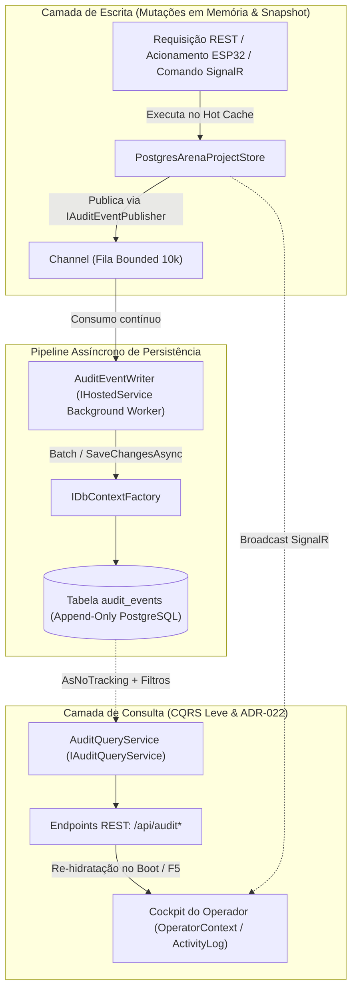

# Resumo Arquitetural — Milestone 4C
## Operational Audit Trail & Lightweight Event Sourcing (CQRS Leve)

> **Projeto:** Arena Voice / Arena de Inovação  
> **Fase:** Fase 4 — Platform Reliability & Data Resilience  
> **Marco:** Milestone 4C — Operational Audit Trail & Event Sourcing Leve  
> **Status:** ✅ HOMOLOGADO E CONCLUÍDO  
> **Data de Homologação:** 16 de Novembro de 2026  
> **Regressão Consolidada:** 609 testes em 12 suítes automatizadas (100% de aprovação, 0 falhas)

---

## 1. Visão Geral da Arquitetura 4C

O **Milestone 4C** implementa a esteira imutável de **Trilha de Auditoria Operacional (Audit Trail)** e **Event Sourcing Leve** da plataforma Arena Voice. Seu propósito é garantir que cada mutação de domínio (criação e edição de eventos, ativação e conclusão de projetos, transições de estado do pitch, congelamento/ajuste de cronômetros autoritativos, votos de cadeiras e resets) seja registrada como um rastro imutável append-only no PostgreSQL sem comprometer a latência sub-milissegundo da Minimal API e do SignalR.

Adicionalmente, fecha o ciclo ponta a ponta trazendo a re-hidratação durável da linha do tempo do operador (`ActivityLog`), garantindo sobrevivência integral do histórico funcional a atualizações de página (`F5`).

---

## 2. Diagrama Arquitetural de Fluxo de Dados (CQRS Leve)

---

## 3. Componentes Estruturais Entregues

### 3.1. Schema Relacional e Entidade Imutável (`audit_events`)
* Tabela relacional append-only indexada por `occurred_at DESC`, `event_type`, `aggregate_type`, `aggregate_id`, `project_id` e `arena_event_id`.
* Suporte nativo a payloads e estados anteriores/posteriores via colunas `JSONB`.
* Chave estrangeira reflexiva e isolamento contra exclusões acidentais.

### 3.2. Fila Assíncrona de Alta Vazão (`System.Threading.Channels`)
* Instância singleton `BoundedChannel<AuditEventRecord>` dimensionada para 10.000 itens com estratégia `BoundedChannelFullMode.Wait` e `SingleReader = true`.
* `AuditEventPublisher` desacopla a resposta HTTP da gravação em disco: o tempo de resposta das rotinas críticas do pitch e cadeiras permanece inalterado.
* `AuditEventWriter` background service persiste de forma robusta e resiliente em background.

### 3.3. Segregação de Visibilidade e CQRS de Consulta (ADR-022)
* Camada de leitura implementada em [`AuditQueryService`](file:///c:/Users/ANDREROC/Documents/arena-voice-poc/backend/Services/AuditQueryService.cs).
* Ocultação padrão de eventos técnicos de infraestrutura (`RecoveryCheckpointCreated`, ~38% do volume de escritas, e `ActiveSessionUpdated`).
* Suporte completo a filtros de domínio, paginação padrão e parâmetro `includeTechnical=true` para auditoria e SRE.

### 3.4. Re-hidratação no Frontend e Mapper de Domínio
* Módulo [`auditApi.js`](file:///c:/Users/ANDREROC/Documents/arena-voice-poc/frontend/src/api/auditApi.js) centraliza as chamadas REST com parametrização ADR-022.
* Módulo [`auditMapper.js`](file:///c:/Users/ANDREROC/Documents/arena-voice-poc/frontend/src/utils/auditMapper.js) converte `AuditEventDto` para modelos ricos do [`ActivityLog.jsx`](file:///c:/Users/ANDREROC/Documents/arena-voice-poc/frontend/src/components/operator/ActivityLog.jsx).
* O [`OperatorContext.jsx`](file:///c:/Users/ANDREROC/Documents/arena-voice-poc/frontend/src/contexts/OperatorContext.jsx) unifica o snapshot inicial do banco com eventos recebidos via SignalR em tempo real, preservando a linha do tempo completa após recargas de navegador (`F5`).

---

## 4. Métricas e Homologação Consolidada

* **Suítes de Testes Integradas:** 12 suítes automatizadas.
* **Total de Testes:** 609 asserções verdes (0 falhas, 0 regressões).
* **Mutações Auditadas:** 100% dos fluxos de evento, projeto, júri, pitch, timer e hardware cobertos.
