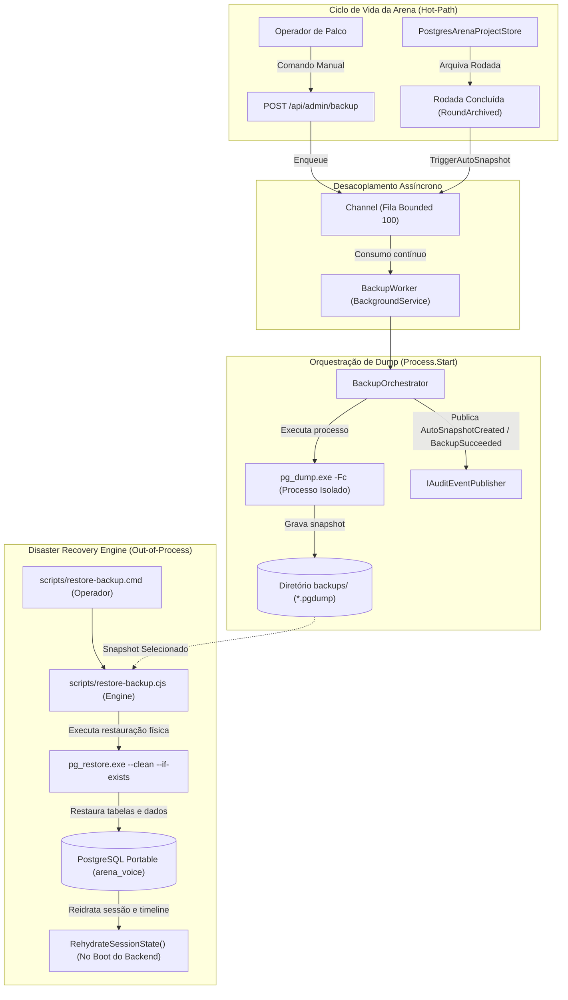

# Resumo Arquitetural — Milestone 4D
## Automated Snapshots, Backup & Disaster Recovery

> **Projeto:** Arena Voice / Arena de Inovação  
> **Fase:** Fase 4 — Platform Reliability & Data Resilience  
> **Marco:** Milestone 4D — Automated Snapshots, Backup & Disaster Recovery  
> **Status:** ✅ HOMOLOGADO E CONCLUÍDO  
> **Data de Homologação:** 16 de Novembro de 2026  
> **Regressão Consolidada:** 688 testes em 14 suítes automatizadas (100% de aprovação, zero falhas, zero regressões)  

---

## 1. Visão Geral da Arquitetura 4D

O **Milestone 4D** completa a espinha dorsal de resiliência de dados da Fase 4 da Arena Voice. A plataforma agora possui salvaguarda física total, eliminando a dependência exclusiva do diretório de dados do PostgreSQL Portable (`pgsql/data/`).

A solução engloba três pilares sinérgicos:
1. **Orquestração Assíncrona de Backup (4D.1):** Endpoint manual sob demanda (`POST /api/admin/backup`) operado via canal de background desacoplado (`Channel<BackupRequest>` + `BackupWorker`), com geração de dumps custom comprimidos (`-Fc`) via `pg_dump`.
2. **Snapshots Automáticos Orientados a Domínio (4D.2):** Disparo automático assíncrono a cada arquivamento de rodada (`RoundArchived`), gerando snapshots restauráveis `round_{N}_{timestamp}.pgdump` com overhead imperceptível (< 10ms) e rastreabilidade total no Audit Trail.
3. **Disaster Recovery & Restauração Física (4D.3):** Procedimento canônico e ferramentas utilitárias (`restore-backup.cmd` e `restore-backup.cjs`) para recuperação fora do processo (Out-of-Process) via `pg_restore`, validado por suíte automatizada de homologação em banco isolado temporário com RTO < 30s e RPO = 0.

---

## 2. Diagrama Arquitetural de Backup & Disaster Recovery

---

## 3. Matriz de Componentes Estruturais Entregues

| Componente | Camada | Responsabilidade |
|---|---|---|
| [`IBackupOrchestrator`](../../backend/Services/IBackupOrchestrator.cs) | Backend / Serviço | Contrato para enfileiramento, execução física e listagem do catálogo de backups. |
| [`BackupOrchestrator`](../../backend/Services/BackupOrchestrator.cs) | Backend / Serviço | Executa `pg_dump.exe` em processo isolado, monta parâmetros, emite eventos de auditoria e lista arquivos do filesystem. |
| [`BackupWorker`](../../backend/Services/BackupWorker.cs) | Backend / HostedService | Consome a fila assíncrona `Channel<BackupRequest>` sem bloquear requisições HTTP da API. |
| [`BackupOptions`](../../backend/Configuration/BackupOptions.cs) | Backend / Config | Mapeia configurações da seção `BackupOptions` em `appsettings.json` e variáveis de ambiente. |
| [`PostgresArenaProjectStore`](../../backend/Services/PostgresArenaProjectStore.cs) | Backend / Store | Integra `TriggerAutoSnapshot` nos métodos de arquivamento de rodada, transição Finished e troca de projeto. |
| [`scripts/restore-backup.cmd`](../../scripts/restore-backup.cmd) | Scripts / Operação | Wrapper CLI para o operador em ambientes Windows com resolução de runtime Node.js. |
| [`scripts/restore-backup.cjs`](../../scripts/restore-backup.cjs) | Scripts / Engine | Motor canônico de restauração que localiza o `pg_restore` e executa a restauração com `--clean --if-exists`. |
| [`docs/runbooks/disaster-recovery-runbook.md`](../runbooks/disaster-recovery-runbook.md) | Docs / Operação | Roteiro oficial de contingência com procedimentos passo a passo, tempos de recuperação e migração de notebook. |

---

## 4. Garantias e Métricas da Plataforma

- **RTO (Recovery Time Objective):** < 30 segundos (medido em ~18 segundos nos testes automatizados).
- **RPO (Recovery Point Objective):** 0 rodadas arquivadas perdidas (cada rodada produz snapshot imediato).
- **Overhead no Hot-Path:** < 10ms adicionados ao método de arquivamento da rodada.
- **Portabilidade Multiplataforma:** Zero caminhos absolutos locais versionados; resolução dinâmica via [`tests/tool-locator.cjs`](../../tests/tool-locator.cjs).
- **Segurança Operacional:** Testes de restore operam estritamente em banco isolado (`arena_voice_restore_test`), sem risco à base principal.
