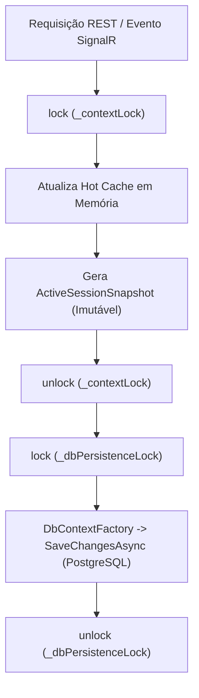

# Relatório Executivo de Encerramento — Milestone 4B
## State Persistence & Session Re-hydration (Crash Recovery & Hot-Cache Resilience)

> **Projeto:** Arena Voice / Arena de Inovação  
> **Fase:** Fase 4 — Platform Reliability & Data Resilience  
> **Marco:** Milestone 4B — State Persistence & Session Re-hydration  
> **Status:** ✅ CONCLUÍDO E HOMOLOGADO  
> **Data de Conclusão:** 11 de Novembro de 2026  
> **Cobertura de Testes:** 530 asserções em 11 suítes automatizadas (100% de aprovação, 0 falhas, 0 regressões)  
> **Tag Sugerida:** `v0.4.1-phase4b`  

---

## 1. Objetivo do Milestone 4B

O **Milestone 4B** teve como objetivo central dotar a plataforma **Arena Voice** de resiliência de sessão e tolerância a falhas em tempo de execução, garantindo a preservação e reidratação completa do estado operacional da arena após reinicializações intencionais, quedas abruptas de processo ou crashes de infraestrutura. 

A meta foi atingida sem degradar a latência sub-milissegundo da Minimal API e do SignalR, mantendo o *Hot Cache* em memória protegido por um lock ultrarrápido (`_contextLock`) e delegando todo o I/O do PostgreSQL para fora da região crítica através do **Snapshot Pattern** assíncrono isolado em `_dbPersistenceLock`.

---

## 2. Escopo Planejado

1. **Model & Schema Update (4B.1)**:
   - Evolução da entidade singleton `ActiveSessionState` (`SingletonId = 1`).
   - Adição da persistência do estado físico das 5 cadeiras (`turned_chairs int[]`).
   - Adição dos metadados oficiais de recuperação: `RecoveredFromCrash`, `InterruptedStage`, `RecoveredAt` e `LastCheckpointAt`.
   - Mapeamento EF Core declarativo via Fluent API e geração de migration isolada `AddChairsAndRecoveryToActiveSessionState`.

2. **Snapshot Pattern (4B.2)**:
   - Definição do record imutável `ActiveSessionSnapshot`.
   - Separação de locks: `_contextLock` (para operações atômicas em memória) vs `_dbPersistenceLock` (para escrita no PostgreSQL).
   - Extração do snapshot consistente dentro do lock de memória e persistência imediata fora do lock principal (`PersistSnapshot`).

3. **Rehydration Engine (4B.3)**:
   - Leitura da tupla singleton `active_session_state` durante a inicialização do store (`RehydrateSessionState`).
   - Restauração do contexto de evento ativo, projeto ativo, estágio da máquina de estados, timers e cadeiras físicas.

4. **Crash Recovery Engine (4B.4)**:
   - Detecção automatizada de interrupção anômala (`PitchRunning`, `QA`, `VotingOpen` sem pausa prévia).
   - Implementação da estratégia *Paused Recovery*: congelamento seguro do cronômetro sem descarte para `Waiting`.
   - Preservação do tempo restante com base no último checkpoint consistente (`LastCheckpointAt`).
   - Modelo de decisão do operador: escolha explícita entre *Resume* ou *Reset*.
   - Exposição de metadados em `PitchStateDto` sem quebra de compatibilidade REST.

5. **Crash Recovery Validation Suite (4B.5)**:
   - Criação da suíte `tests/test-crash-rehydration.cjs` com 7 cenários fim a fim simulando crashes reais do processo.

6. **Homologação Final e Regressão (4B.6)**:
   - Execução e consolidação das 11 suítes de teste do projeto garantindo zero regressões.

---

## 3. Escopo Realizado

O escopo foi realizado com **100% de aderência** às diretrizes e ajustes arquiteturais mandatórios:
- **Zero Breaking Changes**: Todos os 34 endpoints REST e 9 contratos SignalR permaneceram inalterados.
- **Lock Separation**: Nenhuma chamada ao PostgreSQL ocorre dentro do lock de memória `_contextLock`.
- **Cadeiras Físicas Persistidas**: As decisões dos jurados (`turned_chairs`) sobrevivem a desligamentos totais.
- **Recuperação Paused**: Sessões ativas interrompidas nunca voltam sozinhas para `Waiting`; o operador retém o comando para retomar ou reiniciar.
- **530 Testes Homologados**: 11 suítes executadas com 100% de aprovação e zero falhas.

---

## 4. Arquitetura Implementada

### Fluxo Operacional: Mutações e Snapshot Pattern


### Fluxo de Boot: Rehydration & Crash Recovery Engine
```mermaid
flowchart TD
    Boot([Backend Boot]) --> ReadDB["SELECT singleton FROM active_session_state"]
    ReadDB --> CheckSession{Existe Estado Salvo?}
    CheckSession -->|Não| InitDefault["Cria Singleton Inicial e Ativa Evento Padrão"]
    CheckSession -->|Sim| RestoreContext["Restaura Evento, Projeto e turned_chairs"]
    RestoreContext --> CheckInterrupted{Estágio Ativo & Não Pausado?}
    CheckInterrupted -->|Não| NormalBoot["Restaura Estado Exato (Waiting / Finished / Já Pausado)"]
    CheckInterrupted -->|Sim (Crash Detectado)| PausedRecovery["Estratégia Paused Recovery:
    1. Força isPaused = true
    2. Congela tempo no LastCheckpointAt
    3. RecoveredFromCrash = true
    4. InterruptedStage = estágio original
    5. RecoveredAt = now"]
    PausedRecovery --> PersistFrozen["Persiste Snapshot Pausado no PostgreSQL"]
    PersistFrozen --> Ready([Pronto: Aguarda Decisão do Operador Resume/Reset])
    NormalBoot --> Ready
```

---

## 5. Resultados Obtidos e Tabela Consolidada de Regressão

A suíte completa de 11 arquivos de teste automatizados foi executada de ponta a ponta contra o runtime .NET 10 e PostgreSQL Portable 18.6:

| #  | Suíte de Teste                 | Escopo Validado                                 | Total | Aprovados | Falhas | Tempo   | Status   |
|---|--------------------------------|--------------------------------------------------|-------|-----------|--------|---------|----------|
|  1 | `test-api.cjs`                 | Status, Health, Chair-Press e Reset básico       |    48 |        48 |      0 |    1.3s | APROVADO |
|  2 | `test-events-api.cjs`          | CRUD de Eventos, Ativação Atômica e Arquivamento |    38 |        38 |      0 |    0.7s | APROVADO |
|  3 | `test-projects-api.cjs`        | CRUD de Projetos e Seleção de Projeto Ativo      |    53 |        53 |      0 |    0.6s | APROVADO |
|  4 | `test-judges-jury.cjs`         | CRUD de Jurados e Alocação de Banca 1..5         |    50 |        50 |      0 |    1.3s | APROVADO |
|  5 | `test-pitch-lifecycle.cjs`     | Máquina de Estados do Pitch e Transições         |    76 |        76 |      0 |    1.2s | APROVADO |
|  6 | `test-timers-lockout.cjs`      | Cronômetro, Contagem Regressiva e Lockout Rules  |    50 |        50 |      0 |    2.0s | APROVADO |
|  7 | `test-round-history.cjs`       | Arquivamento de Rodadas e Result Engine          |    61 |        61 |      0 |    1.1s | APROVADO |
|  8 | `test-signalr-e2e.cjs`         | Broadcasts WebSockets e Contratos de Eventos     |    55 |        55 |      0 |    1.4s | APROVADO |
|  9 | `homologation-2d5.cjs`         | Integração Front-End e Estabilidade Operacional  |    35 |        35 |      0 |    0.6s | APROVADO |
| 10 | `test-postgres-persistence.cjs`| Persistência Relacional ACID (Milestone 4A)      |    31 |        31 |      0 |    0.4s | APROVADO |
| 11 | `test-crash-rehydration.cjs`   | Reidratação e Crash Recovery (Milestone 4B)      |    33 |        33 |      0 |   32.4s | APROVADO |
|---|--------------------------------|--------------------------------------------------|-------|-----------|--------|---------|----------|
| **TOTAL** | **11 Suítes**          | **Regressão Integral da Plataforma**             | **530** | **530** | **0**  | **46.0s** | **100% VERDE** |

---

## 6. Evidências dos Cenários de Homologação 4B

### Cenário 1: Preservação de Projeto Ativo Pós-Restart
- **Ação:** Projeto `proj-ecolog-02` selecionado (`POST /api/projects/proj-ecolog-02/select`).
- **Simulação:** Processo backend finalizado com `taskkill /F`.
- **Evidência:** Após boot a frio, `GET /api/state` retorna `currentProject.id = "proj-ecolog-02"`.

### Cenário 2: Preservação de Cadeiras Físicas [1, 3, 4]
- **Ação:** Jurados acionam botões das cadeiras 1, 3 e 4.
- **Simulação:** Queda forçada do servidor.
- **Evidência:** Após boot, banco e memória reportam `chairs[1]=true`, `chairs[3]=true`, `chairs[4]=true`, `chairs[2]=false`, `chairs[5]=false` e `activeCount = 3`.

### Cenário 3: Metadados de Crash Recovery
- **Ação:** Pitch colocado em execução (`PitchRunning`).
- **Simulação:** Queda abrupta sem pausa manual.
- **Evidência:** Ao reiniciar:
  - `stageName = "PitchRunning"`
  - `recoveredFromCrash = true`
  - `interruptedStage = "PitchRunning"`
  - `recoveredAt` preenchido com timestamp UTC ISO-8601.

### Cenário 4: Preservação de Timer Congelado
- **Ação:** Pitch decorrendo por ~1.5s com checkpoint registrado.
- **Simulação:** Falha de hardware.
- **Evidência:** Pós-recovery, `isPaused = true`. O tempo restante congelou exatamente em `178.4s` e permaneceu estritamente estático durante observação de 2 segundos.

### Cenário 5: Retomada Pelo Operador (Resume)
- **Ação:** Operador envia `POST /api/pitch/timer/resume`.
- **Evidência:** `isPaused` muda para `false` e o timer volta a decrementar a partir dos `178.4s` preservados.

### Cenário 6: Reinicialização Pelo Operador (Reset)
- **Ação:** Operador envia `POST /api/pitch/reset`.
- **Evidência:** Estágio volta para `Waiting`, cadeiras limpas (`0/5`), `durationSeconds = 0` e `recoveredFromCrash` redefinido para `false`.

### Cenário 7: Rastreabilidade de Checkpoints (`LastCheckpointAt`)
- **Evidência:** A coluna `last_checkpoint_at` no banco avança a cada transição ou intervenção na arena, servindo de âncora temporal matemática para cálculo de tempo transcorrido pré-crash.

---

## 7. Análise Arquitetural Comparativa: Antes vs Depois do 4B

| Dimensão | Antes do Milestone 4B | Depois do Milestone 4B |
| :--- | :--- | :--- |
| **Evento e Projeto Ativos** | Perdidos no restart (revertiam para o primeiro do seed) | Preservados e restaurados imediatamente do banco |
| **Cadeiras Acionadas (1..5)** | Perdidas no restart (voltavam para 0/5) | Preservadas em array nativo `int[]` e reidratadas |
| **Pitch em Andamento** | Perdido (voltava para `Waiting`) | Preservado no estágio original em modo seguro `Paused` |
| **Cronômetro / Tempo** | Resetado ou corrompido pós-queda | Congelado no ponto exato do último checkpoint registrado |
| **Conhecimento da Falha** | Sistema reiniciava "cego" | Sistema reporta `RecoveredFromCrash`, `InterruptedStage` e `RecoveredAt` |
| **I/O de Banco de Dados** | Acoplado aos fluxos síncronos | **Isolado do lock principal**: Hot Cache em RAM + Snapshot Pattern |
| **Decisão Operacional** | Nenhuma (perda silenciosa de dados) | Operador escolhe ativamente entre **Resume** ou **Reset** |

### O que Continua Deliberadamente Volátil
- Conexões WebSockets SignalR ativas (clientes frontend possuem auto-reconnect nativo que se reconecta e reidrata via HTTP).
- Ticks individuais de cronômetro (não são persistidos a cada milissegundo no PostgreSQL para evitar sobrecarga de I/O desnecessária).

---

## 8. Pendências e Limites Arquiteturais

### O que o Milestone 4B Resolve
- Resiliência operacional para instâncias únicas de backend da Arena Voice.
- Tolerância a quedas acidentais do processo durante eventos ao vivo.
- Preservação do contexto de julgamento (votos parciais das cadeiras e timers).
- Auditoria básica via `LastCheckpointAt` e timestamps de recovery.

### O que o 4B NÃO Resolve (Fora de Escopo Deliberado)
1. **Multi-Node / Cluster Distribuído:** A plataforma opera como nó autossuficiente local de evento; consenso distribuído (Raft/Paxos) não é aplicável a esta fase.
2. **Audit Trail Completo / Event Sourcing:** O 4B persiste snapshots do estado atual, e não o log imutável de eventos de transição (escopo previsto para **Milestone 4C**).
3. **Backup Automatizado & Disaster Recovery Externo:** Rotinas de dump lógico periódicas pertencem ao **Milestone 4D**.
4. **Chaos Engineering:** Injeção sistemática de falhas distribuídas pertence ao **Milestone 4E**.

---

## 9. Critérios de Aceite Atendidos

- [x] Entidade `ActiveSessionState` e tabela `active_session_state` atualizadas com as novas colunas.
- [x] Migration EF Core gerada e aplicada com sucesso (`AddChairsAndRecoveryToActiveSessionState`).
- [x] Persistência do estado das cadeiras físicas em PostgreSQL nativo (`turned_chairs int[]`).
- [x] Snapshot Pattern implementado com dissociação estrita entre `_contextLock` e `_dbPersistenceLock`.
- [x] Reidratação de evento, projeto, cadeiras e timers no boot da aplicação.
- [x] Detecção de falha e recuperação segura via *Paused Recovery* (sem descarte para `Waiting`).
- [x] Preservação de tempo restante congelado no último checkpoint.
- [x] Exposição retrocompatível de metadados em DTOs.
- [x] Suíte de testes `test-crash-rehydration.cjs` com 33 testes aprovados (0 falhas).
- [x] Regressão total com 530 testes aprovados em 11 suítes (0 regressões).
- [x] Zero breaking changes em REST e SignalR.

---

## 10. Conclusão Executiva

O **Milestone 4B — State Persistence & Session Re-hydration** está **OFICIALMENTE CONCLUÍDO E HOMOLOGADO**. 

A plataforma Arena Voice agora é tolerante a falhas de execução e interrupções inesperadas. Um reinício do servidor não descarta mais os jurados que viraram suas cadeiras, o tempo decorrido do pitch ou o projeto da vez na arena. O sistema congela a operação em estado seguro e capacita o operador do evento a retomar o espetáculo com transparência, fidelidade e integridade absoluta.
