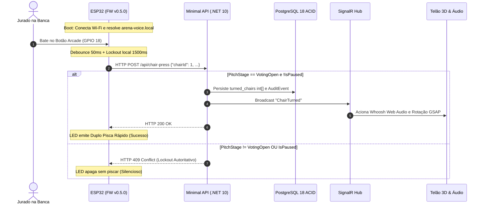

# FW-01: Especificação da Baseline de Firmware v0.5.0
## Subsistema de Hardware da Banca de Jurados (ESP32)

> **Marco:** FW-01 (Firmware Baseline v0.5.0)  
> **Status:** ✅ CONCLUÍDO E HOMOLOGADO  
> **Decisão de Referência:** [ADR-028: Firmware Architecture & Hardware Integration Strategy](../decision-records/ADR-028-firmware-architecture-hardware-integration.md)  
> **Conformidade de Domínio:** ADR-001 (Backend Authoritative), ADR-013 (Voting Lockout), ADR-016 (Offline-First)

---

## 1. Objetivo do Marco FW-01

O objetivo do marco **FW-01** é substituir o protótipo inicial de bancada por uma implementação de firmware de nível industrial, modular e estritamente alinhada à arquitetura da plataforma Arena Voice. 

O firmware atua como a **ponte eletromecânica de soberania dos jurados**, convertendo a descida mecânica do botão arcade em um evento transacional HTTP na rede local com latência garantida inferior a $25\text{ ms}$, sem introduzir lógica de negócio no microcontrolador.

---

## 2. Arquitetura Modular Adotada

Para evitar acoplamentos e preparar o firmware para a evolução das Fases 6 e 7 sem necessidade de reescrita, o código foi dividido em 7 módulos lógicos desacoplados na pasta `firmware/`:

```text
firmware/
├── config.h               # Constantes técnicas de hardware, timeouts e defaults
├── config_secrets.h.example # Template de credenciais e parâmetros locais do dispositivo
├── DeviceIdentity.h       # Struct de identidade, leitura de MAC e serialização JSON
├── LedController.h        # IHM visual de 4 estados não-bloqueante via millis()
├── NetworkManager.h       # Gerenciamento Wi-Fi, cliente mDNS e fallback determinístico
├── ButtonController.h     # Debounce por millis() e trava de segurança anti-repulsão
├── HttpTransport.h        # Transporte REST atômico com política Fail-Fast (<= 1s)
├── Telemetry.h            # Stubs de heartbeat e métricas para a Fase 7B
└── sketch.ino             # Ponto de entrada canônico (setup/loop integrados)
```

### Justificativa Técnica da Modularização em Cabeçalhos (`.h`):
No ecossistema Arduino/ESP32, cabeçalhos locais com implementações inline/classes são compilados diretamente pelo toolchain `xtensa-esp32-elf-g++` com otimização em tempo de compilação (*dead-code elimination* e *inline expansion*). Isso elimina overhead de chamadas de função mantendo a legibilidade e manutenibilidade do código.

---

## 3. Componentes Implementados

### 3.1. `DeviceIdentity` (Identificação e Rastreabilidade)
* **Estrutura:** Registra `chairId` (1 a 5), `deviceTag` (`CHAIR-01`), `firmwareVersion` (`v0.5.0`), `hardwareRevision` (`DEV_KIT_V4_ARCADE`) e `macAddress` físico lido do rádio Wi-Fi.
* **Payload HTTP Enriquecido:**
  ```json
  {
    "chairId": 1,
    "seatNumber": 1,
    "source": "CHAIR-01",
    "firmware": "v0.5.0",
    "mac": "24:6F:28:AB:CD:EF"
  }
  ```
  O backend consome diretamente `chairId` e `source`, gravando-os no Audit Trail da Fase 4.

### 3.2. `ButtonController` (Debounce Não-Bloqueante & Lockout Local)
* **Pino Oficial:** `GPIO 18` conectado ao terminal Normal Aberto (NO) do microswitch, com fechamento para o terra (`GND`).
* **Pull-Up Interno:** Ativação de `INPUT_PULLUP` no ESP32 (~45 kΩ).
* **Debounce:** Janela temporal de 50 ms por comparação `millis()`, detectando estritamente a borda de descida (`HIGH -> LOW`).
* **Lockout Local Anti-Repulsão (1.500 ms):** Impede novos disparos se o jurado segurar o botão ou repousar o braço sobre a bancada.

### 3.3. `NetworkManager` (Resolução mDNS & Fallback Determinístico)
* **Prioridade 1:** Descoberta via **mDNS** (`arena-voice.local` na porta UDP 5353 com timeout de 2.500 ms).
* **Prioridade 3:** Chaveamento automático para **`BACKEND_FALLBACK_IP`** (`192.168.43.100`) em caso de timeout de mDNS ou bloqueio de multicast.
* **Cache em RAM:** O IP resolvido fica memorizado na memória RAM; o momento do clique consome o IP diretamente da RAM em $< 0.1\text{ ms}$.
* **Invalidação de Cache:** Se ocorrerem 2 falhas consecutivas de rede, o cache é invalidado e uma nova consulta mDNS é disparada.

### 3.4. `HttpTransport` (Fail-Fast Within Window)
* **Proibição de Fila:** Votos nunca são guardados em buffer persistente (Flash/SPIFFS).
* **Calibração Temporal:** Timeout por tentativa de **350 ms** e backoff curto de **100 ms**, garantindo que as tentativas caibam estritamente dentro da janela cênica.
* **Janela Estrita ($\le 1.000\text{ ms}$):**
  * Tentativa 1: Imediata ao clique (até 350 ms);
  * Tentativa 2: Retry após backoff de 100 ms (até 350 ms);
  * Tentativa 3: Se ainda houver tempo dentro da janela de 1.000 ms;
  * Se persistir a falha: aborta, aciona LED de erro e o operador utiliza o **Bypass Manual no Cockpit (Fase 7A)**.
* **Tratamento Semântico:**
  * `200 OK`: Voto registrado ➔ `led.triggerSuccess()` (duplo pisca);
  * `409 Conflict`: Rejeitado por Lockout ➔ `led.triggerOff()` (apaga sem piscar);
  * `400 Bad Request` / `500 Server Error`: Registrado em serial sem retries indevidos.

### 3.5. `LedController` (IHM de 4 Estados Temporizada)
Opera via máquina de estados baseada em `millis()` no pino `GPIO 2`:
* **Piscando Rápido (2 Hz):** Conectando ao Wi-Fi ou buscando mDNS;
* **Solid ON:** Transmissão HTTP em andamento;
* **Duplo Pisca Rápido (Double-Blink):** Confirmação cênica de voto aceito (`HTTP 200 OK`);
* **Apagado:** Standby de prontidão ou Lockout (`HTTP 409 Conflict`);
* **3 Piscas Longos:** Erro persistente de link / rede inacessível.

### 3.6. `TelemetryManager` (Stubs da Fase 7B)
Estrutura pronta para envio de liveness, RSSI e uptime, mantida inativa através da diretiva `#define ENABLE_TELEMETRY 0` com zero overhead de CPU ou rádio na Fase 5.

---

## 4. Fluxo Operacional Ponta a Ponta



---

## 5. Limitações Conhecidas

1. **Dependência de Multicast UDP:** Em redes corporativas com bloqueio de pacotes mDNS, a resolução por nome falha; contudo, o **fallback determinístico para IP estático** entra em ação automaticamente sem travar a inicialização.
2. **Faixa de Rádio:** O rádio do ESP32 DevKit V4 é exclusivamente **2.4 GHz** (incompatível com redes de 5 GHz).

---

## 6. Próximos Passos no Roadmap de Firmware

* **Marco FW-02:** Validação física de bancada com 1 cadeira real e teste de carga concorrente com as 5 cadeiras físicas simultâneas;
* **Marco FW-03:** Homologação de rede de palco com roteador dedicado e checklist operacional de 5 minutos;
* **Marco FW-04:** Ativação da telemetria (`ENABLE_TELEMETRY 1`) no início da Fase 7B.
