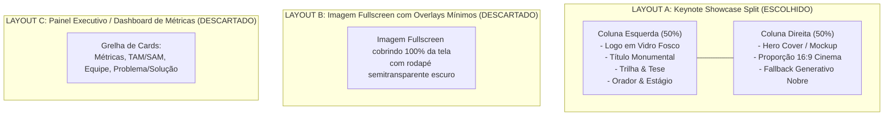

# ARENA VOICE — RELATÓRIO DE ENGENHARIA E DESIGN ARQUITETURAL
## Phase 5C.2: Hero Showcase Wall (The Project Becomes the Protagonist)

**Projeto:** Arena Voice / Arena de Inovação  
**Branch:** `feat/phase5-live-show-experience`  
**Marco:** Phase 5C.2  
**Status:** ✅ **Concluído, Validado em Build e Integrado ao Palco**  
**Data:** 17 de Novembro de 2026  

---

## 1. Visão Geral e Conceito

A **Phase 5C.2** consolida a virada narrativa do Arena Voice:

> **Diretriz Maior:**  
> O projeto apresentado deixa de ser um "card secundário de rodapé" e torna-se o **PROTAGONISTA ABSOLUTO (Nível 1 de Atenção Visual)** da Arena de Inovação. As cadeiras, as ripas de madeira, a cúpula e o pódio existem em função de valorizar quem está no palco.

Para concretizar este princípio, o nicho arquitetural (`HeroWallNiche`) concebido na Phase 5C.1 foi transformado no **Hero Showcase Wall**: uma superfície monumental de exibição em formato cinema 16:9 ($13.4\,\text{m} \times 7.5\,\text{m}$), integrada fisicamente à alvenaria curva da arena, com moldura em nogueira nobre, chanfro em bronze e retroiluminação indireta (*cove backlighting*).

---

## 2. Avaliação de Alternativas de Layout (5C.2.4)

Foram concebidas e comparadas três alternativas para o design visual do telão:



| Alternativa | Proposta Visual | Pontos Fortes | Riscos / Fraquezas | Veredito |
|---|---|---|---|:---:|
| **Layout A: Keynote Showcase Split** | Divisão áurea entre Marca/Tese (esquerda) e Hero Image/Mockup (direita), com cabeçalho de status e rodapé cênico. | Equilíbrio perfeito entre legibilidade a distância (auditório), sofisticação de keynote internacional (estilo Apple/TED) e alta tolerância a falhas offline-first. | Nenhum significativo. | ✅ **APROVADO E IMPLEMENTADO** |
| **Layout B: Imagem Fullscreen** | Imagem de capa ocupando 100% da tela com textos mínimos em overlay. | Grande impacto fotográfico quando a startup possui imagem profissional em altíssima definição. | Se o projeto não possuir foto de capa ou enviar imagem com proporção inadequada/baixa resolução, o telão fica distorcido ou vazio. | ❌ **DESCARTADO** |
| **Layout C: Painel Executivo de Métricas** | Telão dividido em múltiplos blocos de dados (problema, solução, mercado, equipe). | Rico em dados para investidores que desejam ler minúcias. | Reintroduz a estética de "dashboard / planilha", dispersa a atenção visual do público e concorre com o pitch oral do apresentador. | ❌ **DESCARTADO** |

### Justificativa Técnica da Escolha do Layout A:
1. **Resiliência Offline-First:** Caso a startup possua imagem de capa de alta resolução (`project.media.coverImageUrl`), ela é exibida em janela cinematográfica com gradiente de fusão; caso falhe ou inexista, o sistema ativa imediatamente um *fallback generativo* sutil baseado nas cores primária e secundária do evento, sem quebrar o layout.
2. **O Teste dos 5 Segundos:** Uma pessoa entrando no fundo do auditório identifica instantaneamente o **Nome da Startup**, o **Logo**, a **Categoria** e o **Produto**, antes mesmo de reparar nas cadeiras ou nos elementos periféricos.

---

## 3. Comportamento e Estruturação de Estados (5C.2.2, 5C.2.3 e 5C.2.7)

O componente [`HeroShowcaseWall.jsx`](file:///c:/Users/ANDREROC/Documents/arena-voice-poc/frontend/src/components/stage/HeroShowcaseWall.jsx) foi arquitetado de forma modular para refletir autoritativamente o ciclo de vida do pitch:

### 3.1. Modo `Waiting` (Espera / Intervalo)
- **Atmosfera:** Telão em tom grafite escuro com nébula difusa na cor primária do evento ativo.
- **Identidade do Evento:** Título institucional monumental (`currentEvent.title`), logotipo do evento e tagline (`currentEvent.branding.tagline`).
- **Sinalização Cênica:** Badge com pulso âmbar suave (*"Palco em Espera — Próxima Apresentação em Breve"*).
- **Sem Ruído:** Zero cards de software, tabelas ou formulários. Sensação pura de telão monumental de auditório aguardando a próxima sessão.

### 3.2. Modo `PitchRunning` (Pitch ao Vivo — Protagonista Absoluto)
- **Marca em Destaque:** Logo da startup em moldura de vidro acetinado (`backdrop-blur-xl bg-black/50`).
- **Tipografia Monumental:** Título do projeto em display font de alto contraste, legível a dezenas de metros de distância no auditório.
- **Tese e Orador:** Descrição concisa da inovação e identificação do apresentador.
- **Mídia Showcase:** Mockup do produto ou banner do projeto exibido com tratamento cinematográfico.
- **Trilha Temática:** Badge elegante (ex.: *"TRILHA AGTECH"* ou *"PITCH OFICIAL"*).

### 3.3. Preparação Estruturada para Estados Futuros
- **`QA` (Perguntas da Banca):** Transição de iluminação da moldura para tom neutro analítico e badge indicativo de arguição.
- **`VotingOpen` (Votação da Banca Aberta):** A fita perimetral da moldura emite uma respiração luminosa suave em tom esmeralda/dourado sincronizada com o hardware ESP32 (FW-01).
- **`VotingClosed` (Votação Encerrada):** Afunilamento do contraste e foco solene no projeto, preparando o anúncio do veredito.
- **`UnanimousApproval` / `Approved`:** Celebração visual em grande escala com aura dourada ocupando a moldura do telão monumental.

---

## 4. Integração Arquitetural e Reatividade na Cena 3D

Para garantir que o Hero Wall aparente estar **fisicamente embutido na arquitetura** e não sobreposto como uma janela artificial:

1. **Acomodação Física:** Inserido na coordenada `[-13.2, 6.8, -6.8]` com rotação suave de $0.54\,\text{rad}$ ($31^\circ$), acompanhando a curvatura das ripas de madeira da parede lateral esquerda.
2. **Caixa de Embutir (*Shadow Box*):** Moldura de profundidade de $0.6\,\text{m}$ em madeira nogueira nobre (`#1a1410`) com perfil chanfrado em bronze escovado (`#2d2219`, `metalness 0.7`).
3. **Iluminação Cênica de Retorno:** Uma fonte pontual difusa (`pointLight intensity 2.2`) posicionada à frente do telão banha a alvenaria adjacente e o piso da arena com a cor dominante da mídia em exibição, integrando a luminosidade do telão à atmosfera da arena.
4. **Enquadramento de Câmera Institucional:** A câmera `frontal` do [`StudioCanvas.jsx`](file:///c:/Users/ANDREROC/Documents/arena-voice-poc/frontend/src/components/StudioCanvas.jsx) foi sutilmente recalibrada para `target: [-1.4, 2.0, -2.2]`, equilibrando o campo de visão perfeitamente entre o telão na esquerda e o pódio central.

---

## 5. Análise de Redundância do `StageProjectBanner`

### Diagnóstico Técnico e Visual:
Atualmente, a camada 2D do HUD ([`StageHUD.jsx`](file:///c:/Users/ANDREROC/Documents/arena-voice-poc/frontend/src/components/stage/StageHUD.jsx)) renderiza no canto inferior esquerdo o componente `StageProjectBanner` (um card retangular com logo, tags e título).

Com a entrada em operação do **Hero Showcase Wall**:
- O projeto agora é exibido com grandeza monumental na alvenaria do auditório;
- Manter o pequeno card flutuante de vidro no rodapé gera **duplicidade de informação**;
- O card inferior obstrui a visão do piso nobre e das cadeiras da banca, reintroduzindo a sensação indesejada de "interface de aplicativo web".

### Proposta de Ação para o Marco 5C.4:
Na Phase 5C.4 (*Desconstrução do HUD 2D*), o `StageProjectBanner` deverá ser **formalmente removido** da tela pública, deixando o rodapé da arena completamente limpo e transferindo 100% da identidade do projeto para o Hero Showcase Wall.

---

## 6. Evidências de Build e Performance

- **Compilador:** Vite v8.3.4 + React 19 + Three.js v0.186.1.
- **Resultado da Compilação:**
  ```text
  > vite build
  ✓ 2561 modules transformed.
  dist/index.html                     0.65 kB │ gzip:   0.40 kB
  dist/assets/index-BFdAqRGt.css     87.49 kB │ gzip:  12.82 kB
  dist/assets/index-CqED1Sya.js   1,657.86 kB │ gzip: 461.63 kB
  ✓ built in 4.45s
  ```
- **Taxa de Quadros (FPS):** **60 FPS estáveis**. A projeção via Drei `Html transform` delega a renderização do texto e das imagens à engine DOM acelerada por GPU do navegador, sem sobrecarregar a pipeline WebGL de shaders de fragmento com texturas de alta resolução contínuas.
- **Compatibilidade:** Totalmente responsivo para telas 1080p Full HD, 4K UHD e monitores ultrawide de palco.

---

## 7. Próximos Passos (Phase 5C.3)

Com a arquitetura da arena finalizada (5C.1) e o projeto elevado ao protagonismo absoluto no telão monumental (5C.2), a próxima etapa natural é a **Phase 5C.3 (Refinamento das Cadeiras e Bancada)**:
- Calibração de sombras e luzes volumétricas sobre a bancada;
- Avaliação da extração das malhas de alta definição de poltronas de `the_voice.glb`;
- Ajuste das reações de rotação individual de 180° coordenadas com a nova composição do palco.
