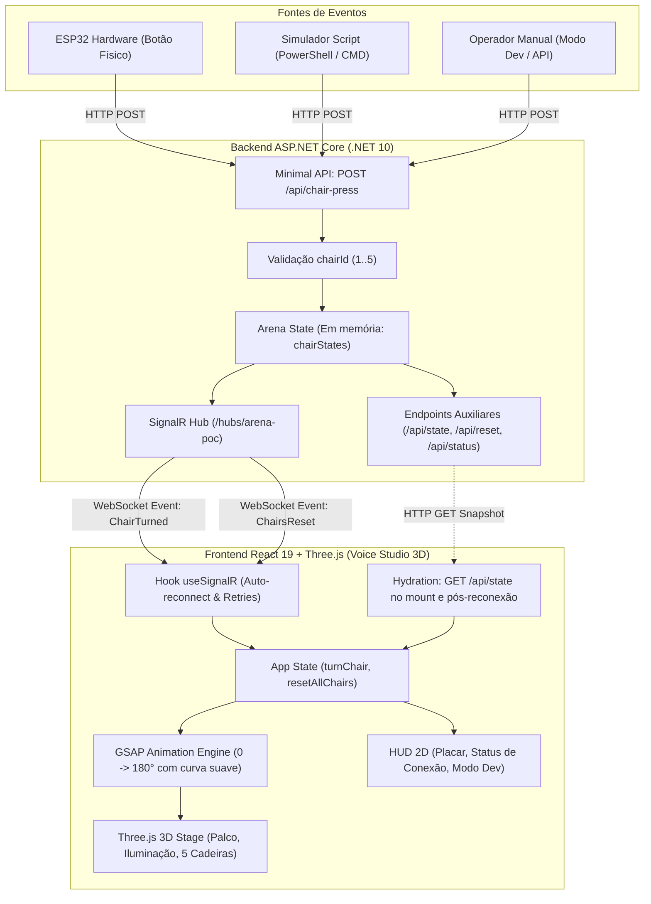
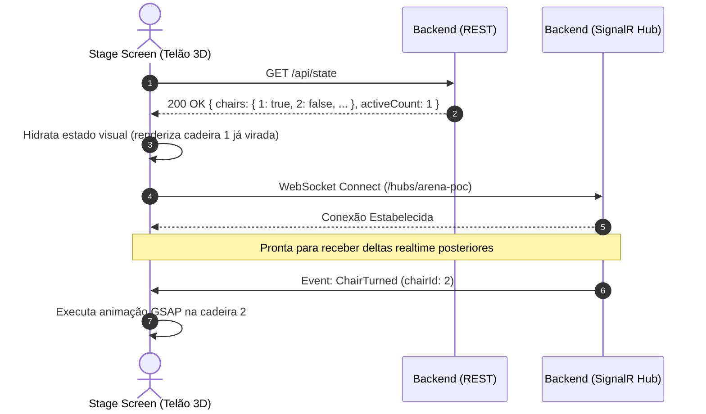
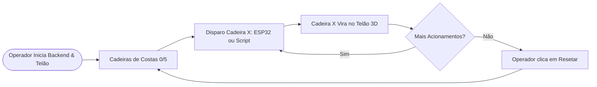
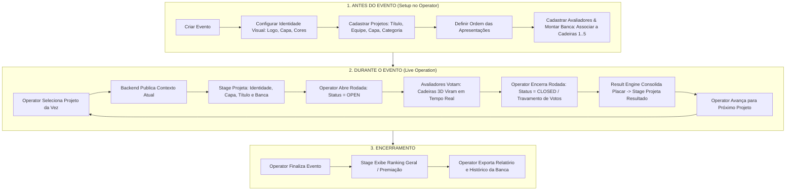

# ROADMAP ARENA VOICE / ARENA DE INOVAÇÃO
## Versão 2.0 — Roadmap V2: Show-Ready & Production-Ready First

> **Classificação:** Documento Mestre de Produto e Arquitetura  
> **Status:** Fase 1, Fase 2 e Fase 3 Concluídas e Homologadas (`v0.3.0-phase3`)  
> **Cobertura Automatizada:** 497 verificações em 10 suítes de testes (100% aprovadas, zero falhas, zero regressões)  
> **Data de Atualização:** Novembro de 2026  
> **Público-alvo:** Desenvolvedores, arquitetos de software, product engineers e operadores de evento

---

## Sumário Executivo

O **Arena Voice** é uma plataforma interativa em tempo real projetada para bancas de avaliação e apresentação de projetos/MVPs corporativos. Inspirada na dinâmica cênica e emocional de formatos como *The Voice* e *Shark Tank*, a plataforma permite que uma comissão de avaliadores independentes decida o destino de um pitch em tempo real. Cada decisão vira uma cadeira digital e ativa uma cena 3D imersiva projetada em telão (*Voice Studio 3D*).

### Novo Contexto de Produto e Princípio de Reutilização
O Arena Voice **NÃO é um sistema exclusivo da "Arena de Inovação"**. A *Arena de Inovação* representa apenas uma possível configuração e caso de uso da plataforma. O produto foi concebido como uma **plataforma configurável e reutilizável** para múltiplos contextos corporativos compatíveis:
- **Arena de Inovação** (avaliação de MVPs e projetos internos);
- **Demo Days** (apresentação de startups e squads de aceleração);
- **Pitch Days** (bancas de seleção e alocação de investimento);
- **Hackathons** (julgamento final de protótipos desenvolvidos);
- **Mostras de MVPs e feiras de tecnologia corporativa**.

**Regra de Reutilização:** O produto **não deve exigir alteração de código-fonte** para mudar o nome do evento, os projetos participantes, as equipes, as categorias, a ordem de apresentação, a identidade visual (logos, capas, cores) ou os jurados. Todas essas variáveis são tratadas como **configuração e dados da plataforma**, administradas via painel operacional.

> [!IMPORTANT]
> **Síntese Arquitetural e de Experiência (Princípio Transversal):**  
> - **Operator** opera o evento.  
> - **Stage** apresenta o evento ao público.  
> - **Backend** executa as regras de negócio e mantém o estado oficial.  
> - **Infraestrutura** conecta as partes (comunicação, transporte e persistência).  
> *APIs, protocolos de rede, mecanismos de transporte, modelos de armazenamento e detalhes de implementação permanecem encapsulados nas camadas técnicas e não fazem parte da linguagem padrão das interfaces do produto.*

Este documento é a referência única e central do projeto para:
1. **Onboarding Técnico:** Permitir a qualquer desenvolvedor clonar o repositório, subir os serviços, executar os testes e entender a espinha dorsal já validada.
2. **Roadmap de Produto e Engenharia (Versão 1.1):** Traçar a evolução progressiva da plataforma em 10 fases pequenas, incrementais e rigorosamente testáveis, organizadas em macroblocos funcionais, sem descartar código em funcionamento e sem introduzir complexidade prematura.

---

## 1. Visão do Arena Voice

O Arena Voice transforma bancas tradicionais de inovação corporativa — tipicamente frias e centradas em planilhas manuais — em experiências dinâmicas, memoráveis e altamente visuais:
- **Tensão Cênica e Dramática:** Jurados decidem durante ou logo após a apresentação.
- **Feedback Sensorial Imediato:** Cada decisão aciona a rotação da cadeira 3D correspondente no telão com iluminação dinâmica e efeitos de palco.
- **Desacoplamento de Entradas:** O sistema aceita votos vindos de botões físicos arcade (com microcontroladores ESP32 em trilha de hardware paralela), interfaces web ou consoles manuais de operação.
- **Multi-Evento por Design:** O mesmo software atende a diferentes programas e edições com identidades visuais distintas.

---

## 2. Problema que a Plataforma Resolve

| Problema Antigo / Banca Tradicional | Solução do Arena Voice |
| :--- | :--- |
| Avaliação burocrática e postergada para formulários pós-apresentação. | Decisão em tempo real com reação instantânea no palco/telão. |
| Baixo engajamento da plateia e dos apresentadores. | Atmosfera lúdica e cênica inspirada em programas de televisão consolidados. |
| Dependência de infraestruturas complexas de nuvem e internet estável em eventos. | Solução leve, autocontida, com operação em rede local (offline-first). |
| Fragilidade a oscilações de rede durante a dinâmica. | Arquitetura resiliente de dupla via: SignalR (push de eventos) + REST Snapshot (reidratação e reconciliação automática). |
| Customização por código para cada novo evento ou feira. | Plataforma configurável: evento, projetos, branding e banca definidos operacionalmente. |

---

## 3. Conceitos Principais e Princípio Arquitetural Operator + Stage

A arquitetura do Arena Voice adota como princípio basilar a separação estrita de responsabilidades entre duas superfícies conectadas a um backend autoritativo:

```text
                  ┌─────────────────────────────────┐
                  │        BACKEND ASP.NET          │
                  │   Mantém o Estado Oficial       │
                  │   Intermedeia a Sincronização   │
                  └────────┬───────────────┬────────┘
                           │ REST          │ SignalR
             ┌─────────────┘               └─────────────┐
             ▼                                           ▼
┌─────────────────────────┐                 ┌─────────────────────────┐
│     OPERATOR SCREEN     │                 │      STAGE SCREEN       │
│  "Configura e Opera"    │                 │   "Apresenta ao Público"│
│                         │                 │                         │
│ • Setup do Evento       │                 │ • Telão 3D Voice Studio │
│ • Gestão de Projetos    │                 │ • Identidade do Evento  │
│ • Gestão da Banca       │                 │ • Capa & Dados do Pitch │
│ • Controle da Rodada    │                 │ • Cadeiras & Placar     │
│ • Estado da Arena       │                 │ • Efeitos & Resultados  │
└─────────────────────────┘                 └─────────────────────────┘
```

> [!IMPORTANT]
> **Fluxo Conceitual Obrigatório:**  
> $\text{Operator} \longrightarrow \text{Backend} \longrightarrow \text{Application State} \longrightarrow \text{Stage}$  
> **NÃO existe comunicação direta Operator $\rightarrow$ Stage.** O backend continua sendo a única fonte oficial da verdade sobre a qual ambas as experiências se reconciliam via infraestrutura autoritativa.

1. **OPERATOR (Configura e Opera):**  
   É o **dashboard administrativo e operacional único e expansível** da plataforma. Ao longo das Fases 1 a 4, evolui progressivamente para administrar todo o ciclo de vida do evento através de linguagem pura de produto: verificar a prontidão do sistema e telão, criar eventos, configurar branding, cadastrar projetos, organizar a ordem das apresentações, montar a banca de jurados, associar avaliadores às cadeiras, abrir rodadas, acompanhar votos e avançar pitches. Detalhes de rede e APIs não fazem parte de seu vocabulário normal.
2. **STAGE (Apresenta ao Público):**  
   É a **experiência pública cinematográfica**. O Stage é uma superfície puramente contemplativa: prioriza identidade do evento, branding, projeto atual, equipe, conteúdo visual, banca (quando apropriado), estado público da dinâmica, cadeiras 3D, placar, resultados, ranking e experiência cênica.  
   *Regra Restritiva de Exibição:* No Stage **não devem aparecer** status de API, SignalR, WebSockets, IP, porta, endpoints, logs, Modo Dev, botões de reset, controles administrativos, debugging ou mensagens técnicas. Se o Stage estiver funcionando corretamente, o público não precisa saber absolutamente nada sobre a infraestrutura técnica que o sustenta.
3. **Cadeira Lógica (`chairId` de 1 a 5):** Posição física e lógica independente de avaliação no palco.
4. **Avaliador vs. Cadeira (`Evaluator != Chair`):** Um avaliador é uma pessoa (identidade); a cadeira é uma posição física/lógica no palco (1 a 5). A plataforma associa uma pessoa a uma cadeira durante a sessão sem fundir seus conceitos.
5. **Arena State / Application State:** Estado mantido no backend referente às cadeiras, rodadas, projeto ativo e evento.
6. **Acionamento (`Chair Press`):** Evento primário que comanda a virada de uma cadeira específica.
7. **Reset:** Ação executada pelo operador ou pelo fluxo do jogo para retornar as cadeiras à posição inicial antes do próximo pitch.

### 3.1. Princípio de UX: Abstração da Infraestrutura Técnica

Este princípio transversal se aplica a **todas as fases da plataforma** e rege o design e o comportamento de `/operator` e `/stage`:

> [!IMPORTANT]
> **A Regra Central:**  
> *"A interface deve comunicar o estado e as ações do produto, não os protocolos utilizados internamente para realizá-los."*  
> O Arena Voice deve ser percebido pelo usuário como um **PRODUTO** (uma experiência imersiva de condução e espetáculo de bancas corporativas), e **NUNCA** como uma ferramenta de desenvolvimento, painel de APIs, Swagger visual ou console de infraestrutura.

#### A. Separação Rigorosa dos Quatro Papéis
1. **OPERATOR:** Configura e opera o evento (gestão da sessão, banca, pitches e fluxo da dinâmica).
2. **STAGE:** Apresenta o evento ao público (experiência cênica, telão 3D e placar, sem botões de controle nem dados técnicos).
3. **BACKEND:** Executa as regras de negócio, valida transições de estado e mantém a verdade oficial do sistema.
4. **INFRAESTRUTURA:** Realiza comunicação, transporte, sincronização e persistência.

```text
Operator Screen (Cockpit Operacional)
    │ (intenções e ações de negócio: resetArena(), openRound())
    ▼
Camada de Aplicação / Serviços de Frontend
    │ (requisições de comando e consulta de snapshot)
    ▼
Backend / Regras de Negócio / Estado Oficial
    │ (processamento autoritativo e emissão de eventos)
    ▼
Infraestrutura de Comunicação (SignalR / WebSockets / HTTP)
    │ (transporte transparente de dados)
    ▼
Stage Screen (Telão Público 3D)
```

**Regra de Ouro:** A interface **não deve conhecer ou apresentar detalhes internos da infraestrutura** apenas porque eles existem tecnicamente.

#### B. O Que NÃO Deve Aparecer na Interface Operacional Comum (`/operator` e `/stage`)
- **Termos de protocolos de rede:** `SignalR`, `WebSocket`, `SSE`, `TCP`, `HTTP`.
- **URLs, rotas ou endpoints técnicos:** `POST /api/chair-press`, `GET /api/state`, `POST /api/reset`, `/hubs/arena-poc`, etc.
- **Códigos de status HTTP como elemento primário de UX:** `HTTP 200`, `HTTP 409`, `HTTP 400`, `500 Internal Server Error`.
- **Nomes técnicos de eventos internos SignalR:** `ChairTurned`, `CurrentProjectChanged`, `RoundResultComputed`, `ChairsReset`.
- **Variáveis de controle de conexão:** `reconnectVersion`, `connectionId`, sockets abertos, contadores de handshake.
- **JSONs crus ou payloads técnicos:** Blocos de JSON expostos na interface operacional comum.
- **Nomes de componentes de código ou de frameworks:** Three.js, GSAP, React, Vite, .NET, ASP.NET Core.
- **IPs e portas de rede como métrica central de produto:** `192.168.1.100:5000` ou `localhost:5173` (reservados exclusivamente a ferramentas de diagnóstico técnico).
- **Stack traces, mensagens cruas de exceção ou logs técnicos não tratados.**

#### C. Linguagem de Produto: Vocabulário Operacional
A interface deve falar a linguagem do evento e do negócio:

| Em vez de (Vocabulário Técnico / Infraestrutura) | Usar na Interface (Linguagem de Produto e Operação) |
| :--- | :--- |
| `SignalR Connected` / `WebSocket Connected` | **"Sistema Operacional"**, **"Telão Conectado"**, **"Comunicação Ativa"** |
| `SignalR Reconnecting` / `Reconnection retry #2` | **"Reconectando ao telão..."**, **"Tentando restabelecer comunicação..."** |
| `Backend offline` / `Connection refused` | **"Sistema indisponível. Tentando reconectar..."** |
| `Endpoint POST /api/reset chamado (200 OK)` | **"Arena Resetada"**, **"Cadeiras Retornadas à Posição Inicial"** |
| `POST /api/chair-press chairId: 4` | **"Cadeira 4 Acionada"**, **"Voto Registrado: Cadeira 4"** |
| `Event RoundStarted dispatched` | **"Votação Aberta"** |
| `Event RoundClosed dispatched` | **"Votação Encerrada"** |
| `HTTP 409 Conflict: round is closed` | **"A votação já está encerrada"** (feedback de regra de negócio) |
| `HTTP 400 Bad Request: invalid chairId` | **"Cadeira não reconhecida no sistema"** |
| `reconnectVersion: 3` | **"Estado Sincronizado"** |
| `Payload JSON de projeto recebido` | **"Dados do Projeto Atualizados"**, **"Ficha do MVP"** |
| `ChairAssignmentsUpdated` | **"Composição da Banca Atualizada"** |

#### D. Tradução de Estados e Tratamento de Falhas
- **Conexão ativa com o backend:** "Sistema Pronto" / "Operacional".
- **Comunicação com o telão ativa:** "Telão Sincronizado".
- **Falha temporária de comunicação:** "Tentando reconectar..." / "Falha de comunicação com o sistema".
- **Ação bloqueada por regra de negócio:** Notificação contextual clara (ex: *"Não é possível votar enquanto a rodada estiver fechada"*).
- **Erro inesperado:** Mensagem amigável com opção direta de tentar novamente, sem despejar stack traces na tela.

#### E. Informação Acionável: O Foco do Operator
A tela do operador deve responder de forma clara e visual a quatro perguntas fundamentais:
1. **O que está acontecendo agora?** (ex: *"Projeto Alpha em apresentação"*, *"Votação aberta há 01:45"*, *"3 de 5 votos recebidos"*).
2. **O que o operador pode fazer agora?** (ex: botões claros *"Abrir Votação"*, *"Encerrar Votação"*, *"Próximo Projeto"*, *"Resetar Arena"*).
3. **Qual é o estado do palco?** (ex: representação visual das 5 cadeiras: *"Cadeiras viradas: 1, 3 e 5"*).
4. **Quem está avaliando?** (ex: *"Banca do Bloco: Jurado A (Cadeira 1), Jurado B (Cadeira 2)..."*).

#### F. Abstração da Camada de Transporte
A camada visual do Operator e do Stage invoca intenções de negócio através de métodos de serviço:
- `resetArena()`, `openRound()`, `closeRound()`, `selectProject(projectId)`, `assignEvaluator(chairId, evaluatorId)`.
Como esses métodos trafegam os dados (se via `fetch`, `axios`, WebSockets do SignalR ou políticas de retry) é detalhe da camada de serviço/infraestrutura, completamente invisível para os componentes React de tela.

#### G. Diagnóstico Técnico Separado da Operação
O diagnóstico técnico permanece como necessidade de suporte e engenharia, mas deve ficar **completamente separado da experiência operacional principal**.
Se futuramente houver necessidade de diagnóstico técnico dentro da aplicação, essa capacidade deverá ser separada do dashboard operacional do evento e planejada na fase apropriada (seja via logs do backend, DevTools, observabilidade externa, painel técnico apartado ou outras ferramentas). O cockpit operacional principal do evento permanece 100% voltado ao produto e ao espetáculo.

---

## 4. Glossário

- **ESP32:** Microcontrolador com Wi-Fi embutido (2.4 GHz) utilizado em protótipos de botões físicos (trilha de hardware paralela).
- **Minimal API (.NET 10):** Estrutura de backend HTTP de alta performance e baixo consumo de recursos em C#.
- **SignalR:** Biblioteca do ASP.NET Core para comunicação bidirecional em tempo real (baseada em WebSockets).
- **Re-hydration / Reconciliação:** Procedimento em que o frontend consulta `GET /api/state` e alinha sua cena 3D ao estado real do backend.
- **Dev Mode:** Modo temporário de testes no frontend do Marco 1 que habilitava cliques diretos na tela.
- **`chairId`:** Identificador canônico oficial (1..5).
- **`seatNumber`:** Identificador legado aceito exclusivamente por retrocompatibilidade histórica.
- **Branding:** Conjunto de elementos visuais que personalizam o evento (logos, cores primárias/secundárias, capas).
- **Media:** Ativos visuais vinculados a projetos e avaliadores (fotos, capas, logotipos).

---

## 5. Arquitetura Atual Validada (Marco 1)

A espinha dorsal em operação obedece ao seguinte fluxo:



---

## 6. Componentes Existentes no Repositório

```text
arena-voice-poc/
├── .env.example               # Template de variáveis de ambiente para ferramentas portáteis
├── .env                       # Arquivo local (não versionado) com caminhos locais de executáveis
├── README.md                  # Documentação rápida de execução e pinout
├── docs/
│   ├── README.md              # Índice mestre da documentação
│   ├── architecture.md        # Arquitetura geral, motores e contratos
│   ├── roadmap.md             # Documento mestre de produto e arquitetura
│   ├── hardware.md            # Pinout, debounce e protocolo de Lockout
│   ├── network.md             # Guia de configuração de rede e hotspot Wi-Fi
│   ├── decision-records/      # Catálogo formal de ADRs (ADR-001 a ADR-015)
│   └── archives/              # Acervo histórico, retrospectivas e auditorias
├── backend/                   # Backend em ASP.NET Core .NET 10
│   ├── ArenaVoicePocBackend.csproj
│   ├── Program.cs             # Minimal API, Hub SignalR e Estado em Memória
│   └── Hubs/
│       └── ArenaPocHub.cs     # Definição do Hub SignalR
├── frontend/                  # Aplicação React 19 + Vite 8
│   ├── index.html
│   ├── package.json
│   ├── vite.config.js
│   ├── public/
│   │   ├── studio.glb         # Modelo 3D opcional para estúdio
│   │   └── favicon.svg
│   └── src/
│       ├── App.jsx            # Orquestrador de estado e sincronização
│       ├── components/
│       │   ├── Chair.jsx      # Mesh 3D e animações GSAP de cada cadeira
│       │   ├── HUD.jsx        # Camada 2D de interface, placar e status
│       │   ├── StudioCanvas.jsx # Configuração R3F Canvas, Câmera e OrbitControls
│       │   └── StudioScene.jsx  # Palco procedural, luzes e posições das cadeiras
│       └── services/
│           └── useSignalR.js  # Gerenciador de ciclo de vida WebSocket e resiliência
├── firmware/                  # Código ESP32 para protótipo de hardware
│   ├── config.h               # Configurações de pinos e tempos de debounce
│   ├── config_secrets.h.example # Template de credenciais de Wi-Fi
│   └── sketch/sketch.ino      # Código C++ Arduino para leitura com debounce
├── scripts/                   # Scripts multiplataforma (Windows .cmd e .ps1)
│   ├── start-backend.*        # Inicia backend com detecção automática do SDK
│   ├── start-frontend.*       # Inicia frontend com detecção automática do Node/NPM
│   └── simulate-esp32.*       # Dispara requisição simulada via HTTP POST
└── tests/                     # Baterias de testes automatizados E2E
    ├── test-api.cjs           # Validação da REST API e regras de estado (48 verificações)
    └── test-signalr-e2e.cjs   # Validação de ponta a ponta com SignalR (46 verificações)
```

---

## 7. Backend em Detalhes

Implementado em `backend/Program.cs` e `backend/Hubs/ArenaPocHub.cs`:
- **Binding de Rede:** Escuta em `0.0.0.0` por padrão ou respeita as variáveis de ambiente `BACKEND_HOST` e `BACKEND_PORT`.
- **CORS Permissivo:** Permite qualquer origem e cabeçalhos com `AllowCredentials()`, viabilizando o consumo local por WebSockets e navegadores locais.
- **Log de Auditoria no Terminal:** A cada acionamento, imprime no console o IP de origem, data/hora local em milissegundos e a cadeira acionada.
- **Detecção de IPv4 Local:** Na inicialização, descobre e lista no console todas as interfaces de rede IPv4 locais da máquina.

---

## 8. Frontend e Voice Studio 3D

Construído sobre **React 19**, **Three.js** e **React Three Fiber (R3F)** com **GSAP 3.15**:
1. **Separação R3F / DOM:** O canvas 3D ocupa 100% da viewport em camada de fundo (`z-0`), enquanto o HUD 2D é renderizado em sobreposição com `pointer-events-none`.
2. **Animações GSAP Desacopladas:** No componente `frontend/src/components/Chair.jsx`, a rotação da cadeira é aplicada diretamente no objeto Three.js via `groupRef.current.rotation.y`:
   - Estado `isTurned === false`: Cadeira virada de costas para o palco (`baseRotY`). Refletor azul de baixa intensidade (5) e botão vermelho apagado.
   - Estado `isTurned === true`: Cadeira gira 180° (`Math.PI`), refletor passa para vermelho intenso (intensidade 35) e o material emissivo do botão central ganha brilho luminoso.
3. **Fallback Procedural:** O estúdio tenta carregar `/studio.glb` caso presente; se o arquivo não estiver disponível, renderiza um palco procedural completo com anéis de luz e tubos de LED sem quebrar a execução.

---

## 9. Contratos REST

Auditados em `backend/Program.cs`:

| Método | Endpoint | Parâmetros / Payload | Resposta de Sucesso | Status Code | Descrição |
| :--- | :--- | :--- | :--- | :--- | :--- |
| `POST` | `/api/chair-press` | `{"chairId": 1}` | `{"accepted": true, "chairId": 1, "message": "...", "serverTime": "..."}` | `200 OK` | Endpoint canônico primário de acionamento de cadeira. |
| `POST` | `/api/support` | `{"seatNumber": 1}` | `{"accepted": true, "seatNumber": 1, "chairId": 1}` | `200 OK` | Endpoint retrocompatível (mantém suporte a protótipos anteriores). |
| `GET` | `/api/state` | *Nenhum* | `{"chairs": {"1": true, "2": false, ...}, "activeCount": 1}` | `200 OK` | Retorna o snapshot atual completo do Arena State. |
| `POST` | `/api/reset` | *Nenhum* | `{"message": "Todas as cadeiras foram resetadas.", "chairs": {...}}` | `200 OK` | Reseta todas as cadeiras para `false` e emite `ChairsReset` via SignalR. |
| `GET` | `/api/status` | *Nenhum* | `{"status": "ONLINE", "service": "...", "port": 5000, "timestamp": "..."}` | `200 OK` | Health check básico de liveness da API. |

### Regras de Validação:
- Requisições com `chairId` fora do intervalo `[1, 5]` retornam `HTTP 400 Bad Request`.
- Payloads vazios, strings inválidas ou JSON malformado retornam `HTTP 400 Bad Request` sem corromper o estado em memória.
- No payload de `/api/chair-press`, o backend aceita tanto `{"chairId": X}` quanto `{"seatNumber": X}`.

---

## 10. Arena State

O estado reside em memória no backend dentro de uma estrutura `Dictionary<int, bool>`:
```csharp
var chairStates = new Dictionary<int, bool>
{
    { 1, false }, { 2, false }, { 3, false }, { 4, false }, { 5, false }
};
```
- Ao receber acionamento válido, o backend marca `chairStates[id] = true`.
- Ao receber reset, o backend redefine todas as chaves para `false`.
- A propriedade `activeCount` é calculada dinamicamente via `chairStates.Count(c => c.Value)`.

---

## 11. Contratos SignalR

- **Rotas Mapeadas:**
  - Principal: `/hubs/arena-poc`
  - Legada: `/arenaHub`
- **Eventos Transmitidos (Server -> Client):**
  1. `ChairTurned`: `{ chairId: int, timestamp: DateTimeOffset, source: string }`
  2. `ChairSupported` *(legado)*: `{ seatNumber: int, chairId: int }`
  3. `ChairsReset`: *(Sem payload)* Notifica todos os clientes conectados de que a rodada foi zerada.

---

## 12. Snapshot e Realtime (Sincronização Dupla)

Para garantir que o frontend nunca exiba um estado incorreto (por exemplo, ao abrir a página com a rodada em andamento ou atualizar o navegador), o sistema opera em um modelo estrito de duas fases:



---

## 13. Resiliência e Recovery

A camada de rede do frontend (`frontend/src/services/useSignalR.js`) implementa recuperação contra falhas temporárias do backend:
1. **Política de Reconexão Automática Imediata:** `.withAutomaticReconnect([0, 2000, 5000, 10000, 30000])`.
2. **Loop de Tentativas Periódicas (`LONG_RETRY_DELAY = 5000ms`):** Se os retries padrão se esgotarem, o evento `connection.onclose` agenda novas tentativas a cada 5 segundos.
3. **Versão de Reconexão (`reconnectVersion`):** Cada vez que a conexão é restabelecida, um contador de versão é incrementado no hook. O `useEffect` de sincronização do frontend observa essa versão e consulta imediatamente o `GET /api/state`, reconciliando o estado visual automaticamente.

---

## 14. Testes Automatizados Atuais

- `tests/test-api.cjs` (48 PASS / 0 FAIL): Valida status ONLINE, baseline, acionamento sequencial de 1 a 5, rejeição de IDs inválidos com HTTP 400, imunidade a JSON malformado e retrocompatibilidade com `seatNumber` e `/api/support`.
- `tests/test-signalr-e2e.cjs` (46 PASS / 0 FAIL): Conecta via cliente oficial SignalR, dispara acionamentos via HTTP e valida o recebimento individual dos 5 eventos `ChairTurned`, estado consolidado em 5/5, reset via `POST /api/reset`, escuta do broadcast `ChairsReset` e retorno a 0/5.

> [!NOTE]
> As suítes somam **94 verificações automatizadas aprovadas** nos cenários documentados. Não representam cobertura total do sistema, mas atestam a integridade dos contratos essenciais da fundação.

---

## 15. Execução em Ambiente Local (PC Windows Corporativo)

Ambiente compatível com ferramentas portáteis configuradas em `.env`:
```ini
BACKEND_HOST=0.0.0.0
BACKEND_PORT=5000
VITE_BACKEND_URL=http://localhost:5000
VITE_SIGNALR_URL=http://localhost:5000/hubs/arena-poc
# Caminhos opcionais para executáveis portáteis (ou deixe vazio se estiverem no PATH):
GIT_EXE=C:\caminho\para\devtools\portable\git\cmd\git.exe
NODE_EXE=C:\caminho\para\devtools\portable\node\node.exe
NPM_EXE=C:\caminho\para\devtools\portable\node\npm.cmd
DOTNET_EXE=C:\caminho\para\devtools\portable\dotnet\dotnet.exe
```

Comandos de inicialização:
```cmd
scripts\start-backend.cmd
scripts\start-frontend.cmd
node tests/test-api.cjs
node tests/test-signalr-e2e.cjs
```

---

## 16. Execução em GitHub Codespaces / Linux

Em ambientes baseados em nuvem ou contêineres Linux:
```bash
# Terminal 1: Backend (Porta 5000 = API / SignalR)
dotnet run --project backend/ArenaVoicePocBackend.csproj

# Terminal 2: Frontend (Porta 5173 = Aplicação Web)
npm --prefix frontend ci
npm --prefix frontend run dev -- --host 0.0.0.0
```
As portas precisam estar encaminhadas no Codespaces com visibilidade compatível com a política e o cenário de uso.

---

## 17. Limitações Conhecidas no Estado Atual

- **Volatilidade do Estado:** O `chairStates` reside exclusivamente na memória do processo .NET; reinicializações do servidor redefinem o estado para 0/5.
- **Inexistência de Contexto de Sessão e Entidades:** A API ainda não conhece evento, projeto atual, lista de jurados ou tempo de rodada.
- **Acoplamento no Frontend:** Botões de reset e chaveamento de Modo Dev coexistem no mesmo HUD do estúdio 3D (a ser resolvido na Fase 1).
- **Alerta de Tamanho de Chunks:** O Vite emite aviso de chunk principal de 1.542 kB (Three.js/Drei/R3F/GSAP). Em rede local, não há impacto funcional perceptível.

---

## 18. Workflow Atual (Marco 1 / POC)



---

## 19. Workflow Global da Plataforma (Antes e Durante o Evento)

A operação da plataforma divide-se claramente em dois momentos operacionais:



---

## 20. Domínio Consolidado e Modelagem Entregue (Fases 1 a 3)

Ao longo dos Milestones 2A a 3E, as entidades de negócio foram descobertas, refinadas e implementadas diretamente em C# com 466 testes automatizados aprovados:

- **Event:** Agregado raiz da edição com ciclo de vida em 5 estados (Draft, Ready, Active, Finished, Archived), paleta de neons (primaryColor, secondaryColor), metadados e temporização (TimerConfig).
- **Project:** Startup participante com ordem de apresentação, status (Pending, Current, Completed), equipe, categoria e mídias conceituais (LogoUrl, CoverImageUrl).
- **Judge:** Catálogo global corporativo permanente (Id, Name, Company, Role, Specialty, Bio, PhotoUrl, IsActive, Email).
- **EventJuryAssignment:** Mapeamento dinâmico de jurados nas cadeiras físicas 1..5 por evento (EventId, ChairId, JudgeId).
- **RoundHistoryEntry:** Snapshot imutável da rodada arquivada, com Result (Approved/Rejected/Inconclusive), ApprovalMode (Unanimous/Majority/Minority/None), histórico de estágios e lista nominal da banca.
- **ActiveContext:** Singleton thread-safe que orquestra a sessão física ativa na arena (CurrentEvent, CurrentProject, PitchStage, PitchStageStartedAt, IsPaused, TotalPausedSeconds, chairStates).

`mermaid
classDiagram
    class Evento {
        +string Id
        +string Title
        +string Description
        +DateTime Date
        +EventStatus Status
        +BrandingConfig Branding
        +TimerConfig Timers
    }

    class Projeto {
        +string Id
        +string EventId
        +string Title
        +string Description
        +string Team
        +string Category
        +int PresentationOrder
        +ProjectStatus Status
        +string LogoUrl
        +string CoverImageUrl
    }

    class Jurado {
        +Guid Id
        +string Name
        +string Company
        +string Role
        +string Specialty
        +string PhotoUrl
        +bool IsActive
        +string Email
    }

    class AlocacaoBanca {
        +string EventId
        +int ChairId
        +Guid JudgeId
    }

    class EntradaHistoricoRodada {
        +string Id
        +string EventId
        +string ProjectId
        +RoundResult Result
        +RoundApprovalMode ApprovalMode
        +int VoteCount
        +DateTime ArchivedAt
    }

    Evento "1" *-- "many" Projeto
    Evento "1" *-- "5" AlocacaoBanca
    AlocacaoBanca --> Jurado
    EntradaHistoricoRodada --> Projeto
    EntradaHistoricoRodada --> Evento
`

---

## 21. Roadmap Oficial de Evolução (Versão 2.0 — Roadmap V2)

### Princípio Estratégico: Show-Ready & Production-Ready First
O Roadmap V2 reorienta a evolução da plataforma com base em dois pilares inegociáveis para eventos ao vivo: **Resiliência de Dados (Zero Data Loss)** e **Excelência Sensorial de Palco (Som & Espetáculo)**. Decisões burocráticas de formulários quantitativos em celulares de jurados foram postergadas para priorizar a robustez e o impacto cênico da arena física (conforme consagrado nos [ADR-016](decision-records/ADR-016-offline-first-persistence-strategy.md) e [ADR-017](decision-records/ADR-017-platform-reliability-over-feature-expansion.md)).

`	ext
════════════════════════════════════════════════════════════════════════════════
FASES ENTREGUES E HOMOLOGADAS (CONCLUÍDAS)
════════════════════════════════════════════════════════════════════════════════
  ✅ FASE 1: Operator + Stage Foundation (v0.1.0-phase1)
  ✅ FASE 2: Event Setup & Project Management (v0.2.0-phase2)
  ✅ FASE 3: Event Governance, Pitch Dynamics & Jury (v0.3.0-phase3)
  ✅ FASE 4A: Storage Engine & Relational Schema (v0.4.0-phase4a — PostgreSQL Portable, EF Core 10)
  ✅ FASE 4B: State Persistence & Session Re-hydration (v0.4.1-phase4b — Crash Recovery & Snapshot Pattern)
════════════════════════════════════════════════════════════════════════════════
NOVA LINHA EVOLUTIVA OFICIAL (ROADMAP V2)
════════════════════════════════════════════════════════════════════════════════
  │
  ├─► FASE 4: Platform Reliability & Data Resilience
  │     ├─ [x] 4A: Storage Engine & Relational Schema (PostgreSQL Portable 18.6, EF Core 10 & Schema Relacional)
  │     ├─ [x] 4B: State Persistence & Session Re-hydration (Snapshot Pattern, Crash Recovery Paused & TurnedChairs)
  │     ├─ [ ] 4C: Operational Audit Trail & Event Sourcing Leve (AuditEvents & ActivityLog Sync) ◄── [PRÓXIMO MARCO]
  │     ├─ [ ] 4D: Automated Snapshots, Backup & Disaster Recovery (BackupOrchestrator, pg_dump & Auto-Snapshots)
  │     └─ [ ] 4E: Chaos Engineering & Reliability Test Suite (Simulação de kill -9 & 100 Restarts)
  │
  ├─► FASE 5: Live Show Experience & Audio Atmosphere
  │     ├─ 5A: Motor de Áudio Cênico Web Audio API no Telão (/stage)
  │     ├─ 5B: Sincronização Sonora: Whoosh de Rotação, Buzzer e Gongo de Encerramento
  │     └─ 5C: Efeitos de Celebração Cênica: Fanfarra e Iluminação de Unanimidade (5/5)
  │
  ├─► FASE 6: Awards Ceremony, Ranking & Executive Reports
  │     ├─ 6A: Motor de Ranking Oficial (Desempate por Modo de Aprovação e Votos)
  │     ├─ 6B: Telão Cênico de Premiação e Pódio (/stage com visual de celebração)
  │     └─ 6C: Emissão da Ata da Banca (Exportação Executiva em PDF e CSV)
  │
  ├─► FASE 7: Operational Hardening, Contingency & Fleet Telemetry
  │     ├─ 7A: Cockpit de Contingência (Bypass de Voto Manual em 1 Clique na Mesa)
  │     ├─ 7B: Telemetria da Frota de ESP32 (Monitor de Liveness e Status das 5 Cadeiras)
  │     └─ 7C: Runbook Operacional de Produção e Checklist de Ensaio Técnico
  │
  └─► FASE 8 (Módulo Satélite / Complementar): Evaluator Portal & Qualitative Rubrics
        ├─ 8A: Parametrização Opcional de Critérios e Rubricas por Evento
        ├─ 8B: Web App Responsivo do Jurado para Pareceres Complementares
        └─ 8C: Integração Híbrida: Decisão Cênica Soberana + Dossiê Quantitativo
`

---

### Fases Concluídas e Homologadas

#### FASE 1: Operator + Stage Foundation (✅ CONCLUÍDA — 0.1.0-phase1)
- Roteamento isolado entre /stage e /operator.
- Telão cênico 3D limpo e contemplativo.
- Cockpit operacional 2D com placar e status das 5 cadeiras.
- Reset autoritativo ponta a ponta (POST /api/reset e broadcast ChairsReset).

#### FASE 2: Event Setup & Project Management (✅ CONCLUÍDA — 0.2.0-phase2)
- Catálogo de projetos e startups com ordem de apresentação e mídias.
- Cenografia procedural low-poly no Three.js (Arena > Palco > Pódio).
- Theming reativo e neons dinâmicos via GSAP tweens.
- Proteção 409 Conflict contra exclusão de pitch ativo e 191 testes aprovados.

#### FASE 3: Event Governance, Pitch Dynamics & Jury (✅ CONCLUÍDA — 0.3.0-phase3)
- **3A:** Governança com 5 estados (Draft, Ready, Active, Finished, Archived) e ativação atômica.
- **3B:** Máquina de estados do pitch com 6 estágios, rejeição 422 e estado terminal Finished.
- **3C:** Cronômetros autoritativos ancorados em timestamp, pause/resume sem drift e Lockout HTTP 409 Conflict.
- **3D:** Histórico imutável de rodadas (RoundHistoryEntry) e Result Engine em dois níveis (Result e ApprovalMode).
- **3E:** Catálogo de jurados corporativos (Judge), alocação nas cadeiras 1..5 e dock cênico nominal no telão (StageJuryDock).
- Total de **466 verificações automatizadas em 9 suítes (100% verde)**.

---

### Especificação Detalhada das Novas Fases do Roadmap V2

---

### FASE 4: Platform Reliability & Data Resilience (EM ANDAMENTO — 4A e 4B Homologados)
*Blindar a plataforma contra falhas, quedas de energia e perda de dados em eventos ao vivo.*

- **STATUS:** 🚀 4A e 4B CONCLUÍDOS E HOMOLOGADOS (Branch `feat/phase4-data-resilience`)
- **OBJETIVO:** Substituir o armazenamento volátil em memória por persistência local transacional ACID (PostgreSQL Portable via EF Core 10), garantindo reidratação instantânea pós-queda, tolerância a falhas via *Paused Recovery*, trilha de auditoria e backups operacionais via pg_dump.
- **BASELINE ATUAL:** **530 asserções automatizadas em 11 suítes aprovadas (100% verde)**.
- **MARCOS ENTREGUES:**
  - **✅ Milestone 4A — Storage Engine & Relational Schema (v0.4.0-phase4a):**
    - Cluster PostgreSQL Portable 18.6 com Npgsql 10 e EF Core 10.
    - Contexto `ArenaDbContext` mapeando as 6 tabelas relacionais do domínio.
    - Suíte de persistência `test-postgres-persistence.cjs` (31 testes verdes).
  - **✅ Milestone 4B — State Persistence & Session Re-hydration (v0.4.1-phase4b):**
    - Evolução de `ActiveSessionState` com suporte a `turned_chairs int[]`, `recovered_from_crash`, `interrupted_stage`, `recovered_at` e `last_checkpoint_at`.
    - **Snapshot Pattern & Lock Separation:** isolamento estrito entre `_contextLock` (Hot Cache em RAM) e `_dbPersistenceLock` (PostgreSQL I/O).
    - **Crash Recovery Engine:** detecção de quedas e aplicação da estratégia *Paused Recovery* (timer congelado no último checkpoint, sem descarte automático para Waiting).
    - Suíte de reidratação e crash `test-crash-rehydration.cjs` (33 testes verdes).
    - Consolidação de regressão geral com 530 testes verdes em 11 suítes.
- **PRÓXIMO MARCO A SER INICIADO:**
  - **Milestone 4C — Operational Audit Trail & Event Sourcing Leve:**
    - Tabela append-only `AuditEvents` registrando todas as mutações operacionais;
    - Endpoint `GET /api/audit-log` e reidratação do ActivityLog no cockpit após F5.
- **SUBFASES SUBSEQUENTES:**
  - **Milestone 4D — Automated Snapshots, Backup & Disaster Recovery:**
    - BackupOrchestrator: executa pg_dump em processo separado gerando arquivo comprimido com timestamp;
    - Snapshot automático a cada rodada arquivada (`round_N_<timestamp>.pgdump`);
    - Endpoint POST /api/admin/backup acionável pelo operador em 1 clique.
  - **Milestone 4E — Chaos Engineering & Reliability Test Suite:**
    - Suíte automatizada especializada `tests/test-chaos-reliability.cjs`;
    - Simulação de terminação abrupta do processo (kill -9) durante escritas e votações concorrentes;
    - Homologação final da Fase 4.
- **CRITÉRIO DE ACEITE GLOBAL:** Desligar forçadamente o processo .NET e/ou o cluster PostgreSQL durante qualquer momento da operação e reiniciar o servidor sem perda de nenhuma rodada, voto ou configuração.
- **DECISÕES ARQUITETURAIS:** [ADR-016](decision-records/ADR-016-offline-first-persistence-strategy.md), [ADR-017](decision-records/ADR-017-platform-reliability-over-feature-expansion.md), [ADR-018](decision-records/ADR-018-efcore10-npgsql-migrations-portable.md), [ADR-019](decision-records/ADR-019-dbcontext-factory-hybrid-store.md), [ADR-020](decision-records/ADR-020-snapshot-pattern-and-lock-separation.md) e [ADR-021](decision-records/ADR-021-crash-recovery-and-rehydration-strategy.md).

---

### FASE 5: Live Show Experience & Audio Atmosphere
*Elevar o valor sensorial e a dramaticidade cênica do telão 3D através de áudio estéreo imersivo.*

- **STATUS:** 📅 PLANEJADA (Roadmap V2)
- **OBJETIVO:** Integrar um motor de áudio no telão (/stage) via Web Audio API, atrelando efeitos sonoros cinemáticos às mudanças de estado da apresentação e acionamentos da banca.
- **PRÉ-REQUISITOS:** Fase 3 concluída (independe da Fase 4).
- **SUBFASES E ESCOPO:**
  - **Milestone 5A — Web Audio Engine no Stage:** Hook reativo useAudioScene com controle de volume, master mute e desbloqueio inicial de áudio (conformidade com autoplay dos navegadores).
  - **Milestone 5B — Sincronização Sonora com SignalR:** Som de rotação da cadeira (whoosh/catraca metálica dramática no ChairTurned), sinal de alerta sonoro nos últimos 15 segundos do timer e gongo de encerramento da votação (VotingClosed).
  - **Milestone 5C — Efeitos de Clímax Cênico:** Fanfarra comemorativa e iluminação especial de celebração quando o ResultEngine computa Unanimidade (5/5 votos favoráveis).
- **CRITÉRIO DE ACEITE:** Telão executa efeitos sonoros em sincronia com animações GSAP a 60 FPS sem engasgos de áudio ou vídeo.

---

### FASE 6: Awards Ceremony, Ranking & Executive Reports
*Consolidar a apuração do evento com pódio visual no telão e emissão de ata executiva formal.*

- **STATUS:** 📅 PLANEJADA (Roadmap V2)
- **OBJETIVO:** Computar a classificação geral dos pitches apresentados, projetar a cerimônia de premiação no palco e exportar a ata oficial em PDF e CSV para a comissão organizadora.
- **PRÉ-REQUISITOS:** Fase 4 (Persistência) e Fase 3D (Result Engine).
- **SUBFASES E ESCOPO:**
  - **Milestone 6A — Motor de Ranking Oficial:** Algoritmo de classificação baseado nos snapshots do RoundHistoryEntry com desempate por: ApprovalMode (Unanimidade > Maioria) ➔ Total de Votos ➔ Ordem cronológica.
  - **Milestone 6B — Telão Cênico de Premiação e Pódio:** Visualização de encerramento no /stage com revelação do Top 3 / Top 5 das startups apoiadas pela banca.
  - **Milestone 6C — Emissão de Ata da Banca:** Endpoints GET /api/reports/minutes?format=pdf|csv e botão no cockpit "Exportar Ata do Evento", gerando documento executivo pronto para assinatura do comitê.
- **CRITÉRIO DE ACEITE:** Download em 1 clique de relatório PDF completo contendo cabeçalho do evento, relação de projetos, votos nominais de cada jurado e veredito final.

---

### FASE 7: Operational Hardening, Contingency & Fleet Telemetry
*Blindagem operacional de campo e procedimentos de contingência para a mesa técnica.*

- **STATUS:** 📅 PLANEJADA (Roadmap V2)
- **OBJETIVO:** Fornecer ao operador da mesa ferramentas de diagnóstico em tempo real e comandos de bypass manual imediato em caso de falha de hardware das cadeiras.
- **PRÉ-REQUISITOS:** Fases 4, 5 e 6.
- **SUBFASES E ESCOPO:**
  - **Milestone 7A — Cockpit de Contingência (Bypass Manual):** Ação no cockpit "Forçar Voto Manual da Cadeira N" para uso exclusivo em caso de quebra mecânica de botão ou bateria fraca durante o pitch.
  - **Milestone 7B — Telemetria da Frota de ESP32:** Monitor de liveness em background medindo ping e status de conexão Wi-Fi das 5 cadeiras físicas antes do início de cada apresentação.
  - **Milestone 7C — Runbook de Produção e Checklist Pré-Show:** Manual operacional minuto a minuto para alinhamento entre mesa técnica, mestre de cerimônias e direção de palco.
- **CRITÉRIO DE ACEITE:** Operador consegue contornar uma falha física de botão em menos de 3 segundos sem interromper a apresentação.

---

### FASE 8 (Módulo Satélite / Complementar): Evaluator Portal & Qualitative Rubrics
*Módulo opcional para bancas acadêmicas ou eventos que exijam pareceres técnicos detalhados.*

- **STATUS:** 📅 PLANEJADA COMO COMPLEMENTAR (Roadmap V2)
- **OBJETIVO:** Permitir a configuração de critérios de avaliação com notas (ex: Inovação, Viabilidade, Pitch) via portal responsivo para jurados, operando como camada acessória à decisão física soberana da cadeira.
- **PRÉ-REQUISITOS:** Fases 4, 6 e 7 homologadas.
- **ESCOPO:** Formulário web móvel para jurados, agregação de notas e geração de dossiê técnico anexo à ata executiva.

---

## 22. Matriz de Rastreabilidade e Critérios de Conclusão por Fase (Roadmap V2)

| Fase | Foco Principal | Critério de Aceite Inegociável | Teste Chave |
| :---: | :--- | :--- | :--- |
| **Fase 1** | Operator + Stage Foundation | Telão passivo sem controles de mouse; operador controla a arena com linguagem de produto. | Duas abas sincronizadas via SignalR com reset remoto. |
| **Fase 2** | Event Setup & Projects | Operador configura branding e catálogo; telão reflete startup atual e neons dinâmicos. | Alternância de pitches no palco e hidratação REST. |
| **Fase 3** | Pitch Dynamics & Jury | 6 estágios de pitch, timers sem drift, lockout HTTP 409, histórico e jurados nominais. | 466 verificações automatizadas em 9 suítes (100% verde). |
| **Fase 4** | Platform Reliability & Data | Reinício forçado do servidor restaura 100% do estado sem perda de histórico; backup em 1 clique. | 	ests/test-chaos-reliability.cjs (simulação de kill -9). |
| **Fase 5** | Live Show Experience | Som de rotação e efeitos de clímax tocam sincronizados no telão a 60 FPS sem travamentos. | Teste de latência de áudio no Web Audio API com SignalR. |
| **Fase 6** | Ranking & Executive Reports | Ata oficial em PDF/CSV gerada com fidelidade auditável; pódio exibido no telão. | Validação de consistência do ranking e download da ata. |
| **Fase 7** | Hardening & Contingency | Bypass manual de cadeira executado na mesa técnica em caso de falha do ESP32. | Simulação de botão desconectado com contingência manual. |
| **Fase 8** | Evaluator Portal (Opcional) | Pareceres técnicos complementares anexados à ata sem afetar a soberania do botão físico. | Submissão de notas via smartphone em rede local. |

---

## 23. Testes por Fase

Para assegurar a integridade do ecossistema que já conta com **466 verificações automatizadas aprovadas**:
- **Regressão Zero Obrigatória:** Toda nova suíte adicionada em 	ests/ deve ser executada em conjunto com as 9 suítes existentes. Nenhuma fase é homologada sem 100% de testes verdes.
- **Testes de Resiliência no CI/CD:** A suíte de caos da Fase 4 testará inicialização a quente e recuperação de base SQLite em todas as execuções futuras.

---

## 24. Documentação e Governança por Fase

A cada fase entregue:
1. README.md: Atualizar tabela de status e comandos de execução.
2. docs/architecture.md: Atualizar modelos de contrato e diagramas.
3. docs/decision-records/: Registrar os novos ADRs específicos da fase.
4. docs/archives/milestone-history.md: Atualizar status dos marcos entregues.
5. docs/archives/implementation-history.md: Registrar log técnico detalhado de código e testes.

---

## 25. Análise de Riscos e Mitigações em Evento Real

| Risco Técnico / Operacional | Impacto | Probabilidade | Mitigação Arquitetural |
| :--- | :---: | :---: | :--- |
| **Queda de energia no notebook da mesa.** | Crítico | Média | **Fase 4:** SQLite com WAL mode salva cada transação em disco; o boot reidrata o evento intacto em segundos. |
| **Falha de hardware no botão ESP32 durante o pitch.** | Alto | Média | **Fase 7:** Botão de bypass manual no cockpit do operador permite virar a cadeira via software em 1 clique. |
| **Telão mudo durante apresentação importante.** | Médio | Alta | **Fase 5:** Motor Web Audio com fallback procedural e botão de ativação de som visível no HUD. |
| **Saturação de Wi-Fi por celulares do público.** | Alto | Média | A arquitetura **não depende de internet** nem de celulares de terceiros; a rede do evento atende exclusivamente aos 5 ESP32. |

---

## 26. Decisões Estratégicas e ADRs de Referência

1. **[ADR-001: Backend Authoritative](decision-records/ADR-001-backend-authoritative.md):** O servidor como única fonte da verdade.
2. **[ADR-002: Snapshot-First Hydration](decision-records/ADR-002-snapshot-first.md):** Reidratação REST antes de consumir deltas SignalR.
3. **[ADR-011 a ADR-015: Governança, Ciclo do Pitch, Lockout, Histórico e Banca](decision-records/):** Fundações homologadas da Fase 3.
4. **[ADR-016: Estratégia de Persistência Offline-First com PostgreSQL Portable](decision-records/ADR-016-offline-first-persistence-strategy.md):** Decisão formal de armazenamento local transacional in-process.
5. **[ADR-017: Priorização de Confiabilidade sobre Telas Prematuras](decision-records/ADR-017-platform-reliability-over-feature-expansion.md):** Decisão formal do Roadmap V2 priorizando robustez e palco sobre scorecards móveis.

---

## 🎯 PRÓXIMA FASE OFICIAL RECOMENDADA

> [!IMPORTANT]
> **A Próxima Fase a ser desenvolvida é a FASE 4: PLATFORM RELIABILITY & DATA RESILIENCE.**  
> Branch oficial recomendada: eat/phase4-data-resilience  
> Esta etapa elimina o único ponto de falha existencial da plataforma (volatilidade da memória RAM), implementa o banco relacional PostgreSQL Portable local via Npgsql, cria o mecanismo de reidratação pós-queda, a trilha de auditoria operacional e o backup a quente em 1 clique, deixando a Arena Voice 100% blindada para eventos reais.