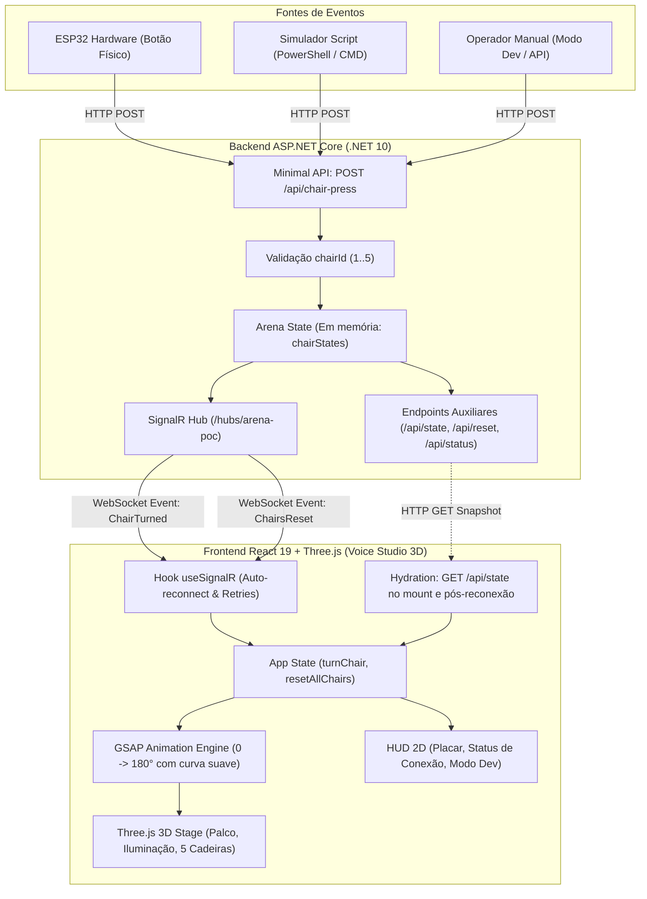
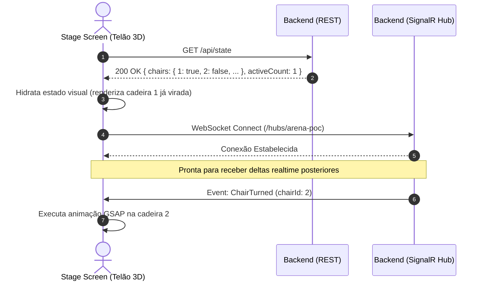
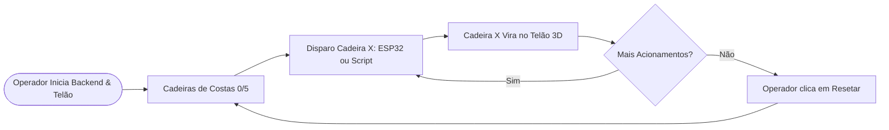
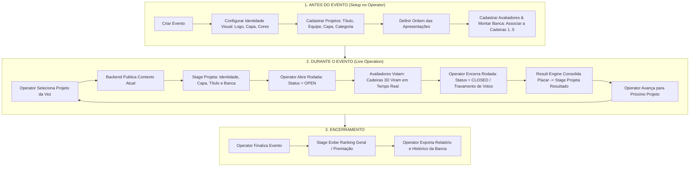
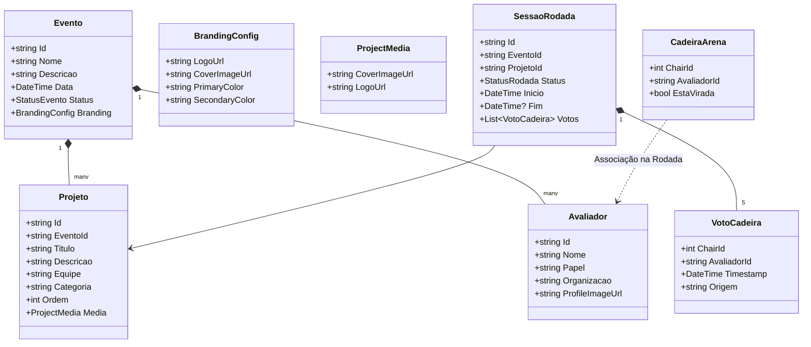

# ROADMAP ARENA VOICE / ARENA DE INOVAÇÃO
## Versão 1.1 — Planejamento Progressivo, Arquitetura e Onboarding Técnico

> **Classificação:** Documento Mestre de Produto e Arquitetura  
> **Status da Fundação:** Marco 1 Concluído (POC funcional validada nos cenários automatizados e manuais documentados)  
> **Data de Atualização:** Outubro de 2026  
> **Público-alvo:** Desenvolvedores, arquitetos de software, product engineers e operadores de evento

---

## Sumário Executivo

O **Arena Voice** é uma plataforma interativa em tempo real projetada para bancas de avaliação e apresentação de projetos/MVPs corporativos. Inspirada na dinâmica cênica e emocional de formatos como *The Voice* e *Shark Tank*, a plataforma permite que uma comissão de avaliadores independentes decida o destino de um pitch em tempo real. Cada decisão vira uma cadeira digital e ativa uma cena 3D imersiva projetada em telão (*Voice Studio 3D*).

### Novo Contexto de Produto e Princípio de Reutilização
O Arena Voice **NÃO é um sistema exclusivo da "Arena de Inovação"**. A *Arena de Inovação* representa apenas uma possível configuração e caso de uso da plataforma. O produto foi concebido como uma **plataforma configurável e reutilizável** para múltiplos contextos corporativos compatíveis:
- **Arena de Inovação** (avaliação de MVPs e projetos internos);
- **Demo Days** (apresentação de startups e squads de aceleração);
- **Pitch Days** (bancas de seleção e alocação de investimento);
- **Hackathons** (julgamento final de protótipos desenvolvidos);
- **Mostras de MVPs e feiras de tecnologia corporativa**.

**Regra de Reutilização:** O produto **não deve exigir alteração de código-fonte** para mudar o nome do evento, os projetos participantes, as equipes, as categorias, a ordem de apresentação, a identidade visual (logos, capas, cores) ou os jurados. Todas essas variáveis são tratadas como **configuração e dados da plataforma**, administradas via painel operacional.

> [!IMPORTANT]
> **Síntese Arquitetural e de Experiência (Princípio Transversal):**  
> - **Operator** opera o evento.  
> - **Stage** apresenta o evento ao público.  
> - **Backend** executa as regras de negócio e mantém o estado oficial.  
> - **Infraestrutura** conecta as partes (comunicação, transporte e persistência).  
> *APIs, protocolos de rede, mecanismos de transporte, modelos de armazenamento e detalhes de implementação permanecem encapsulados nas camadas técnicas e não fazem parte da linguagem padrão das interfaces do produto.*

Este documento é a referência única e central do projeto para:
1. **Onboarding Técnico:** Permitir a qualquer desenvolvedor clonar o repositório, subir os serviços, executar os testes e entender a espinha dorsal já validada.
2. **Roadmap de Produto e Engenharia (Versão 1.1):** Traçar a evolução progressiva da plataforma em 10 fases pequenas, incrementais e rigorosamente testáveis, organizadas em macroblocos funcionais, sem descartar código em funcionamento e sem introduzir complexidade prematura.

---

## 1. Visão do Arena Voice

O Arena Voice transforma bancas tradicionais de inovação corporativa — tipicamente frias e centradas em planilhas manuais — em experiências dinâmicas, memoráveis e altamente visuais:
- **Tensão Cênica e Dramática:** Jurados decidem durante ou logo após a apresentação.
- **Feedback Sensorial Imediato:** Cada decisão aciona a rotação da cadeira 3D correspondente no telão com iluminação dinâmica e efeitos de palco.
- **Desacoplamento de Entradas:** O sistema aceita votos vindos de botões físicos arcade (com microcontroladores ESP32 em trilha de hardware paralela), interfaces web ou consoles manuais de operação.
- **Multi-Evento por Design:** O mesmo software atende a diferentes programas e edições com identidades visuais distintas.

---

## 2. Problema que a Plataforma Resolve

| Problema Antigo / Banca Tradicional | Solução do Arena Voice |
| :--- | :--- |
| Avaliação burocrática e postergada para formulários pós-apresentação. | Decisão em tempo real com reação instantânea no palco/telão. |
| Baixo engajamento da plateia e dos apresentadores. | Atmosfera lúdica e cênica inspirada em programas de televisão consolidados. |
| Dependência de infraestruturas complexas de nuvem e internet estável em eventos. | Solução leve, autocontida, com operação em rede local (offline-first). |
| Fragilidade a oscilações de rede durante a dinâmica. | Arquitetura resiliente de dupla via: SignalR (push de eventos) + REST Snapshot (reidratação e reconciliação automática). |
| Customização por código para cada novo evento ou feira. | Plataforma configurável: evento, projetos, branding e banca definidos operacionalmente. |

---

## 3. Conceitos Principais e Princípio Arquitetural Operator + Stage

A arquitetura do Arena Voice adota como princípio basilar a separação estrita de responsabilidades entre duas superfícies conectadas a um backend autoritativo:

```text
                  ┌─────────────────────────────────┐
                  │        BACKEND ASP.NET          │
                  │   Mantém o Estado Oficial       │
                  │   Intermedeia a Sincronização   │
                  └────────┬───────────────┬────────┘
                           │ REST          │ SignalR
             ┌─────────────┘               └─────────────┐
             ▼                                           ▼
┌─────────────────────────┐                 ┌─────────────────────────┐
│     OPERATOR SCREEN     │                 │      STAGE SCREEN       │
│  "Configura e Opera"    │                 │   "Apresenta ao Público"│
│                         │                 │                         │
│ • Setup do Evento       │                 │ • Telão 3D Voice Studio │
│ • Gestão de Projetos    │                 │ • Identidade do Evento  │
│ • Gestão da Banca       │                 │ • Capa & Dados do Pitch │
│ • Controle da Rodada    │                 │ • Cadeiras & Placar     │
│ • Estado da Arena       │                 │ • Efeitos & Resultados  │
└─────────────────────────┘                 └─────────────────────────┘
```

> [!IMPORTANT]
> **Fluxo Conceitual Obrigatório:**  
> $\text{Operator} \longrightarrow \text{Backend} \longrightarrow \text{Application State} \longrightarrow \text{Stage}$  
> **NÃO existe comunicação direta Operator $\rightarrow$ Stage.** O backend continua sendo a única fonte oficial da verdade sobre a qual ambas as experiências se reconciliam via infraestrutura autoritativa.

1. **OPERATOR (Configura e Opera):**  
   É o **dashboard administrativo e operacional único e expansível** da plataforma. Ao longo das Fases 1 a 4, evolui progressivamente para administrar todo o ciclo de vida do evento através de linguagem pura de produto: verificar a prontidão do sistema e telão, criar eventos, configurar branding, cadastrar projetos, organizar a ordem das apresentações, montar a banca de jurados, associar avaliadores às cadeiras, abrir rodadas, acompanhar votos e avançar pitches. Detalhes de rede e APIs não fazem parte de seu vocabulário normal.
2. **STAGE (Apresenta ao Público):**  
   É a **experiência pública cinematográfica**. O Stage é uma superfície puramente contemplativa: prioriza identidade do evento, branding, projeto atual, equipe, conteúdo visual, banca (quando apropriado), estado público da dinâmica, cadeiras 3D, placar, resultados, ranking e experiência cênica.  
   *Regra Restritiva de Exibição:* No Stage **não devem aparecer** status de API, SignalR, WebSockets, IP, porta, endpoints, logs, Modo Dev, botões de reset, controles administrativos, debugging ou mensagens técnicas. Se o Stage estiver funcionando corretamente, o público não precisa saber absolutamente nada sobre a infraestrutura técnica que o sustenta.
3. **Cadeira Lógica (`chairId` de 1 a 5):** Posição física e lógica independente de avaliação no palco.
4. **Avaliador vs. Cadeira (`Evaluator != Chair`):** Um avaliador é uma pessoa (identidade); a cadeira é uma posição física/lógica no palco (1 a 5). A plataforma associa uma pessoa a uma cadeira durante a sessão sem fundir seus conceitos.
5. **Arena State / Application State:** Estado mantido no backend referente às cadeiras, rodadas, projeto ativo e evento.
6. **Acionamento (`Chair Press`):** Evento primário que comanda a virada de uma cadeira específica.
7. **Reset:** Ação executada pelo operador ou pelo fluxo do jogo para retornar as cadeiras à posição inicial antes do próximo pitch.

### 3.1. Princípio de UX: Abstração da Infraestrutura Técnica

Este princípio transversal se aplica a **todas as fases da plataforma** e rege o design e o comportamento de `/operator` e `/stage`:

> [!IMPORTANT]
> **A Regra Central:**  
> *"A interface deve comunicar o estado e as ações do produto, não os protocolos utilizados internamente para realizá-los."*  
> O Arena Voice deve ser percebido pelo usuário como um **PRODUTO** (uma experiência imersiva de condução e espetáculo de bancas corporativas), e **NUNCA** como uma ferramenta de desenvolvimento, painel de APIs, Swagger visual ou console de infraestrutura.

#### A. Separação Rigorosa dos Quatro Papéis
1. **OPERATOR:** Configura e opera o evento (gestão da sessão, banca, pitches e fluxo da dinâmica).
2. **STAGE:** Apresenta o evento ao público (experiência cênica, telão 3D e placar, sem botões de controle nem dados técnicos).
3. **BACKEND:** Executa as regras de negócio, valida transições de estado e mantém a verdade oficial do sistema.
4. **INFRAESTRUTURA:** Realiza comunicação, transporte, sincronização e persistência.

```text
Operator Screen (Cockpit Operacional)
    │ (intenções e ações de negócio: resetArena(), openRound())
    ▼
Camada de Aplicação / Serviços de Frontend
    │ (requisições de comando e consulta de snapshot)
    ▼
Backend / Regras de Negócio / Estado Oficial
    │ (processamento autoritativo e emissão de eventos)
    ▼
Infraestrutura de Comunicação (SignalR / WebSockets / HTTP)
    │ (transporte transparente de dados)
    ▼
Stage Screen (Telão Público 3D)
```

**Regra de Ouro:** A interface **não deve conhecer ou apresentar detalhes internos da infraestrutura** apenas porque eles existem tecnicamente.

#### B. O Que NÃO Deve Aparecer na Interface Operacional Comum (`/operator` e `/stage`)
- **Termos de protocolos de rede:** `SignalR`, `WebSocket`, `SSE`, `TCP`, `HTTP`.
- **URLs, rotas ou endpoints técnicos:** `POST /api/chair-press`, `GET /api/state`, `POST /api/reset`, `/hubs/arena-poc`, etc.
- **Códigos de status HTTP como elemento primário de UX:** `HTTP 200`, `HTTP 409`, `HTTP 400`, `500 Internal Server Error`.
- **Nomes técnicos de eventos internos SignalR:** `ChairTurned`, `CurrentProjectChanged`, `RoundResultComputed`, `ChairsReset`.
- **Variáveis de controle de conexão:** `reconnectVersion`, `connectionId`, sockets abertos, contadores de handshake.
- **JSONs crus ou payloads técnicos:** Blocos de JSON expostos na interface operacional comum.
- **Nomes de componentes de código ou de frameworks:** Three.js, GSAP, React, Vite, .NET, ASP.NET Core.
- **IPs e portas de rede como métrica central de produto:** `192.168.1.100:5000` ou `localhost:5173` (reservados exclusivamente a ferramentas de diagnóstico técnico).
- **Stack traces, mensagens cruas de exceção ou logs técnicos não tratados.**

#### C. Linguagem de Produto: Vocabulário Operacional
A interface deve falar a linguagem do evento e do negócio:

| Em vez de (Vocabulário Técnico / Infraestrutura) | Usar na Interface (Linguagem de Produto e Operação) |
| :--- | :--- |
| `SignalR Connected` / `WebSocket Connected` | **"Sistema Operacional"**, **"Telão Conectado"**, **"Comunicação Ativa"** |
| `SignalR Reconnecting` / `Reconnection retry #2` | **"Reconectando ao telão..."**, **"Tentando restabelecer comunicação..."** |
| `Backend offline` / `Connection refused` | **"Sistema indisponível. Tentando reconectar..."** |
| `Endpoint POST /api/reset chamado (200 OK)` | **"Arena Resetada"**, **"Cadeiras Retornadas à Posição Inicial"** |
| `POST /api/chair-press chairId: 4` | **"Cadeira 4 Acionada"**, **"Voto Registrado: Cadeira 4"** |
| `Event RoundStarted dispatched` | **"Votação Aberta"** |
| `Event RoundClosed dispatched` | **"Votação Encerrada"** |
| `HTTP 409 Conflict: round is closed` | **"A votação já está encerrada"** (feedback de regra de negócio) |
| `HTTP 400 Bad Request: invalid chairId` | **"Cadeira não reconhecida no sistema"** |
| `reconnectVersion: 3` | **"Estado Sincronizado"** |
| `Payload JSON de projeto recebido` | **"Dados do Projeto Atualizados"**, **"Ficha do MVP"** |
| `ChairAssignmentsUpdated` | **"Composição da Banca Atualizada"** |

#### D. Tradução de Estados e Tratamento de Falhas
- **Conexão ativa com o backend:** "Sistema Pronto" / "Operacional".
- **Comunicação com o telão ativa:** "Telão Sincronizado".
- **Falha temporária de comunicação:** "Tentando reconectar..." / "Falha de comunicação com o sistema".
- **Ação bloqueada por regra de negócio:** Notificação contextual clara (ex: *"Não é possível votar enquanto a rodada estiver fechada"*).
- **Erro inesperado:** Mensagem amigável com opção direta de tentar novamente, sem despejar stack traces na tela.

#### E. Informação Acionável: O Foco do Operator
A tela do operador deve responder de forma clara e visual a quatro perguntas fundamentais:
1. **O que está acontecendo agora?** (ex: *"Projeto Alpha em apresentação"*, *"Votação aberta há 01:45"*, *"3 de 5 votos recebidos"*).
2. **O que o operador pode fazer agora?** (ex: botões claros *"Abrir Votação"*, *"Encerrar Votação"*, *"Próximo Projeto"*, *"Resetar Arena"*).
3. **Qual é o estado do palco?** (ex: representação visual das 5 cadeiras: *"Cadeiras viradas: 1, 3 e 5"*).
4. **Quem está avaliando?** (ex: *"Banca do Bloco: Jurado A (Cadeira 1), Jurado B (Cadeira 2)..."*).

#### F. Abstração da Camada de Transporte
A camada visual do Operator e do Stage invoca intenções de negócio através de métodos de serviço:
- `resetArena()`, `openRound()`, `closeRound()`, `selectProject(projectId)`, `assignEvaluator(chairId, evaluatorId)`.
Como esses métodos trafegam os dados (se via `fetch`, `axios`, WebSockets do SignalR ou políticas de retry) é detalhe da camada de serviço/infraestrutura, completamente invisível para os componentes React de tela.

#### G. Diagnóstico Técnico Separado da Operação
O diagnóstico técnico permanece como necessidade de suporte e engenharia, mas deve ficar **completamente separado da experiência operacional principal**.
Se futuramente houver necessidade de diagnóstico técnico dentro da aplicação, essa capacidade deverá ser separada do dashboard operacional do evento e planejada na fase apropriada (seja via logs do backend, DevTools, observabilidade externa, painel técnico apartado ou outras ferramentas). O cockpit operacional principal do evento permanece 100% voltado ao produto e ao espetáculo.

---

## 4. Glossário

- **ESP32:** Microcontrolador com Wi-Fi embutido (2.4 GHz) utilizado em protótipos de botões físicos (trilha de hardware paralela).
- **Minimal API (.NET 10):** Estrutura de backend HTTP de alta performance e baixo consumo de recursos em C#.
- **SignalR:** Biblioteca do ASP.NET Core para comunicação bidirecional em tempo real (baseada em WebSockets).
- **Re-hydration / Reconciliação:** Procedimento em que o frontend consulta `GET /api/state` e alinha sua cena 3D ao estado real do backend.
- **Dev Mode:** Modo temporário de testes no frontend do Marco 1 que habilitava cliques diretos na tela.
- **`chairId`:** Identificador canônico oficial (1..5).
- **`seatNumber`:** Identificador legado aceito exclusivamente por retrocompatibilidade histórica.
- **Branding:** Conjunto de elementos visuais que personalizam o evento (logos, cores primárias/secundárias, capas).
- **Media:** Ativos visuais vinculados a projetos e avaliadores (fotos, capas, logotipos).

---

## 5. Arquitetura Atual Validada (Marco 1)

A espinha dorsal em operação obedece ao seguinte fluxo:



---

## 6. Componentes Existentes no Repositório

```text
arena-voice-poc/
├── .env.example               # Template de variáveis de ambiente para ferramentas portáteis
├── .env                       # Arquivo local (não versionado) com caminhos locais de executáveis
├── README.md                  # Documentação rápida de execução e pinout
├── docs/
│   ├── roadmap.md             # Documento mestre de arquitetura e roadmap oficial (v1.1)
│   ├── software-foundation-audit.md # Auditoria oficial de encerramento do Marco 1
│   ├── architecture.md        # Documentação técnica inicial de arquitetura
│   ├── hardware.md            # Pinout e debounce do protótipo ESP32
│   ├── network.md             # Guia de configuração de rede e hotspot Wi-Fi
│   └── archive/               # Documentações arquivadas de marcos anteriores
├── backend/                   # Backend em ASP.NET Core .NET 10
│   ├── ArenaVoicePocBackend.csproj
│   ├── Program.cs             # Minimal API, Hub SignalR e Estado em Memória
│   └── Hubs/
│       └── ArenaPocHub.cs     # Definição do Hub SignalR
├── frontend/                  # Aplicação React 19 + Vite 8
│   ├── index.html
│   ├── package.json
│   ├── vite.config.js
│   ├── public/
│   │   ├── studio.glb         # Modelo 3D opcional para estúdio
│   │   └── favicon.svg
│   └── src/
│       ├── App.jsx            # Orquestrador de estado e sincronização
│       ├── components/
│       │   ├── Chair.jsx      # Mesh 3D e animações GSAP de cada cadeira
│       │   ├── HUD.jsx        # Camada 2D de interface, placar e status
│       │   ├── StudioCanvas.jsx # Configuração R3F Canvas, Câmera e OrbitControls
│       │   └── StudioScene.jsx  # Palco procedural, luzes e posições das cadeiras
│       └── services/
│           └── useSignalR.js  # Gerenciador de ciclo de vida WebSocket e resiliência
├── firmware/                  # Código ESP32 para protótipo de hardware
│   ├── config.h               # Configurações de pinos e tempos de debounce
│   ├── config_secrets.h.example # Template de credenciais de Wi-Fi
│   └── sketch/sketch.ino      # Código C++ Arduino para leitura com debounce
├── scripts/                   # Scripts multiplataforma (Windows .cmd e .ps1)
│   ├── start-backend.*        # Inicia backend com detecção automática do SDK
│   ├── start-frontend.*       # Inicia frontend com detecção automática do Node/NPM
│   └── simulate-esp32.*       # Dispara requisição simulada via HTTP POST
└── tests/                     # Baterias de testes automatizados E2E
    ├── test-api.cjs           # Validação da REST API e regras de estado (48 verificações)
    └── test-signalr-e2e.cjs   # Validação de ponta a ponta com SignalR (46 verificações)
```

---

## 7. Backend em Detalhes

Implementado em `backend/Program.cs` e `backend/Hubs/ArenaPocHub.cs`:
- **Binding de Rede:** Escuta em `0.0.0.0` por padrão ou respeita as variáveis de ambiente `BACKEND_HOST` e `BACKEND_PORT`.
- **CORS Permissivo:** Permite qualquer origem e cabeçalhos com `AllowCredentials()`, viabilizando o consumo local por WebSockets e navegadores locais.
- **Log de Auditoria no Terminal:** A cada acionamento, imprime no console o IP de origem, data/hora local em milissegundos e a cadeira acionada.
- **Detecção de IPv4 Local:** Na inicialização, descobre e lista no console todas as interfaces de rede IPv4 locais da máquina.

---

## 8. Frontend e Voice Studio 3D

Construído sobre **React 19**, **Three.js** e **React Three Fiber (R3F)** com **GSAP 3.15**:
1. **Separação R3F / DOM:** O canvas 3D ocupa 100% da viewport em camada de fundo (`z-0`), enquanto o HUD 2D é renderizado em sobreposição com `pointer-events-none`.
2. **Animações GSAP Desacopladas:** No componente `frontend/src/components/Chair.jsx`, a rotação da cadeira é aplicada diretamente no objeto Three.js via `groupRef.current.rotation.y`:
   - Estado `isTurned === false`: Cadeira virada de costas para o palco (`baseRotY`). Refletor azul de baixa intensidade (5) e botão vermelho apagado.
   - Estado `isTurned === true`: Cadeira gira 180° (`Math.PI`), refletor passa para vermelho intenso (intensidade 35) e o material emissivo do botão central ganha brilho luminoso.
3. **Fallback Procedural:** O estúdio tenta carregar `/studio.glb` caso presente; se o arquivo não estiver disponível, renderiza um palco procedural completo com anéis de luz e tubos de LED sem quebrar a execução.

---

## 9. Contratos REST

Auditados em `backend/Program.cs`:

| Método | Endpoint | Parâmetros / Payload | Resposta de Sucesso | Status Code | Descrição |
| :--- | :--- | :--- | :--- | :--- | :--- |
| `POST` | `/api/chair-press` | `{"chairId": 1}` | `{"accepted": true, "chairId": 1, "message": "...", "serverTime": "..."}` | `200 OK` | Endpoint canônico primário de acionamento de cadeira. |
| `POST` | `/api/support` | `{"seatNumber": 1}` | `{"accepted": true, "seatNumber": 1, "chairId": 1}` | `200 OK` | Endpoint retrocompatível (mantém suporte a protótipos anteriores). |
| `GET` | `/api/state` | *Nenhum* | `{"chairs": {"1": true, "2": false, ...}, "activeCount": 1}` | `200 OK` | Retorna o snapshot atual completo do Arena State. |
| `POST` | `/api/reset` | *Nenhum* | `{"message": "Todas as cadeiras foram resetadas.", "chairs": {...}}` | `200 OK` | Reseta todas as cadeiras para `false` e emite `ChairsReset` via SignalR. |
| `GET` | `/api/status` | *Nenhum* | `{"status": "ONLINE", "service": "...", "port": 5000, "timestamp": "..."}` | `200 OK` | Health check básico de liveness da API. |

### Regras de Validação:
- Requisições com `chairId` fora do intervalo `[1, 5]` retornam `HTTP 400 Bad Request`.
- Payloads vazios, strings inválidas ou JSON malformado retornam `HTTP 400 Bad Request` sem corromper o estado em memória.
- No payload de `/api/chair-press`, o backend aceita tanto `{"chairId": X}` quanto `{"seatNumber": X}`.

---

## 10. Arena State

O estado reside em memória no backend dentro de uma estrutura `Dictionary<int, bool>`:
```csharp
var chairStates = new Dictionary<int, bool>
{
    { 1, false }, { 2, false }, { 3, false }, { 4, false }, { 5, false }
};
```
- Ao receber acionamento válido, o backend marca `chairStates[id] = true`.
- Ao receber reset, o backend redefine todas as chaves para `false`.
- A propriedade `activeCount` é calculada dinamicamente via `chairStates.Count(c => c.Value)`.

---

## 11. Contratos SignalR

- **Rotas Mapeadas:**
  - Principal: `/hubs/arena-poc`
  - Legada: `/arenaHub`
- **Eventos Transmitidos (Server -> Client):**
  1. `ChairTurned`: `{ chairId: int, timestamp: DateTimeOffset, source: string }`
  2. `ChairSupported` *(legado)*: `{ seatNumber: int, chairId: int }`
  3. `ChairsReset`: *(Sem payload)* Notifica todos os clientes conectados de que a rodada foi zerada.

---

## 12. Snapshot e Realtime (Sincronização Dupla)

Para garantir que o frontend nunca exiba um estado incorreto (por exemplo, ao abrir a página com a rodada em andamento ou atualizar o navegador), o sistema opera em um modelo estrito de duas fases:



---

## 13. Resiliência e Recovery

A camada de rede do frontend (`frontend/src/services/useSignalR.js`) implementa recuperação contra falhas temporárias do backend:
1. **Política de Reconexão Automática Imediata:** `.withAutomaticReconnect([0, 2000, 5000, 10000, 30000])`.
2. **Loop de Tentativas Periódicas (`LONG_RETRY_DELAY = 5000ms`):** Se os retries padrão se esgotarem, o evento `connection.onclose` agenda novas tentativas a cada 5 segundos.
3. **Versão de Reconexão (`reconnectVersion`):** Cada vez que a conexão é restabelecida, um contador de versão é incrementado no hook. O `useEffect` de sincronização do frontend observa essa versão e consulta imediatamente o `GET /api/state`, reconciliando o estado visual automaticamente.

---

## 14. Testes Automatizados Atuais

- `tests/test-api.cjs` (48 PASS / 0 FAIL): Valida status ONLINE, baseline, acionamento sequencial de 1 a 5, rejeição de IDs inválidos com HTTP 400, imunidade a JSON malformado e retrocompatibilidade com `seatNumber` e `/api/support`.
- `tests/test-signalr-e2e.cjs` (46 PASS / 0 FAIL): Conecta via cliente oficial SignalR, dispara acionamentos via HTTP e valida o recebimento individual dos 5 eventos `ChairTurned`, estado consolidado em 5/5, reset via `POST /api/reset`, escuta do broadcast `ChairsReset` e retorno a 0/5.

> [!NOTE]
> As suítes somam **94 verificações automatizadas aprovadas** nos cenários documentados. Não representam cobertura total do sistema, mas atestam a integridade dos contratos essenciais da fundação.

---

## 15. Execução em Ambiente Local (PC Windows Corporativo)

Ambiente compatível com ferramentas portáteis configuradas em `.env`:
```ini
BACKEND_HOST=0.0.0.0
BACKEND_PORT=5000
VITE_BACKEND_URL=http://localhost:5000
VITE_SIGNALR_URL=http://localhost:5000/hubs/arena-poc
GIT_EXE=C:\Users\ANDREROC\Documents\devtools\portable\git\cmd\git.exe
NODE_EXE=C:\Users\ANDREROC\Documents\devtools\portable\node\node.exe
NPM_EXE=C:\Users\ANDREROC\Documents\devtools\portable\node\npm.cmd
DOTNET_EXE=C:\Users\ANDREROC\Documents\devtools\portable\dotnet\dotnet.exe
```

Comandos de inicialização:
```cmd
scripts\start-backend.cmd
scripts\start-frontend.cmd
node tests/test-api.cjs
node tests/test-signalr-e2e.cjs
```

---

## 16. Execução em GitHub Codespaces / Linux

Em ambientes baseados em nuvem ou contêineres Linux:
```bash
# Terminal 1: Backend (Porta 5000 = API / SignalR)
dotnet run --project backend/ArenaVoicePocBackend.csproj

# Terminal 2: Frontend (Porta 5173 = Aplicação Web)
npm --prefix frontend ci
npm --prefix frontend run dev -- --host 0.0.0.0
```
As portas precisam estar encaminhadas no Codespaces com visibilidade compatível com a política e o cenário de uso.

---

## 17. Limitações Conhecidas no Estado Atual

- **Volatilidade do Estado:** O `chairStates` reside exclusivamente na memória do processo .NET; reinicializações do servidor redefinem o estado para 0/5.
- **Inexistência de Contexto de Sessão e Entidades:** A API ainda não conhece evento, projeto atual, lista de jurados ou tempo de rodada.
- **Acoplamento no Frontend:** Botões de reset e chaveamento de Modo Dev coexistem no mesmo HUD do estúdio 3D (a ser resolvido na Fase 1).
- **Alerta de Tamanho de Chunks:** O Vite emite aviso de chunk principal de 1.542 kB (Three.js/Drei/R3F/GSAP). Em rede local, não há impacto funcional perceptível.

---

## 18. Workflow Atual (Marco 1 / POC)



---

## 19. Workflow Global da Plataforma (Antes e Durante o Evento)

A operação da plataforma divide-se claramente em dois momentos operacionais:



---

## 20. Domínio Futuro e Modelagem Progressiva

### Princípio da Modelagem Progressiva
**NÃO devemos esperar até a Fase 7 para começar a pensar nas entidades**.  
As entidades de domínio são descobertas e utilizadas progressivamente no software:
- **Fase 2:** Introduz `Event` e `Project` (com branding e mídias).
- **Fase 3:** Introduz `Round` (máquina de estados: `PENDING -> OPEN -> CLOSED`).
- **Fase 4:** Introduz `Evaluator` e `ChairAssignment` (desacoplamento avaliador vs. cadeira).
- **Fase 5:** Introduz `Vote` e `RoundResult` (regras e consolidação).
- **Fase 7:** **Consolida, revisa e formaliza o modelo de dados completo** antes da escolha da persistência.
- **Fase 8:** Implementa a persistência oficial baseada no modelo consolidado.

### Imagens e Conteúdo Visual (Necessidade Conceitual de Produto)
O produto reconhece imagens e ativos visuais como necessidades essenciais desde a Fase 2:
- **`Event`:** `branding` (`logo`, `coverImage`, `primaryColor`, `secondaryColor`).
- **`Project`:** `media` (`coverImage`, `logo`).
- **`Evaluator`:** `profileImage`.

> [!NOTE]
> Os campos de mídia representam uma **necessidade conceitual do produto**. O mecanismo definitivo de armazenamento (sistema de arquivos local, BLOB storage, URLs externas, etc.) permanece **em standby (TBD)** e será decidido no momento técnico apropriado, sem antecipação prematura.



---

## 21. Roadmap Oficial de Evolução (Versão 1.1)

```text
MARCO 1 — SOFTWARE FOUNDATION / VALIDATION (CONCLUÍDO)
   │
   ▼
════════════════════════════════════════════════════════════════
MACROBLOCO: EVENT SETUP & LIVE OPERATION (FASES 1 A 4)
O mesmo workflow operacional construído progressivamente
════════════════════════════════════════════════════════════════
   │
   ├─► FASE 1: Operator + Stage Foundation (CONCLUÍDA)
   │
   ├─► FASE 2: Event Setup + Project Management (PRÓXIMA FASE RECOMENDADA)
   │
   ├─► FASE 3: Live Round Operation / Game State
   │
   └─► FASE 4: Evaluator & Jury Management
   │
   ▼
════════════════════════════════════════════════════════════════
MACROBLOCO: GAME INTELLIGENCE & SCENIC EXPERIENCE (FASES 5 E 6)
════════════════════════════════════════════════════════════════
   │
   ├─► FASE 5: Game Rules + Result Engine
   │
   └─► FASE 6: Experiência Cênica Avançada
   │
   ▼
════════════════════════════════════════════════════════════════
MACROBLOCO: DOMAIN CONSOLIDATION & PERSISTENCE (FASES 7 E 8)
════════════════════════════════════════════════════════════════
   │
   ├─► FASE 7: Modelo de Dados Definitivo (Consolidação do Domínio)
   │
   └─► FASE 8: Persistência Oficial (Tecnologia TBD)
   │
   ▼
════════════════════════════════════════════════════════════════
MACROBLOCO: ANALYTICS & PRODUCTION HARDENING (FASES 9 E 10)
════════════════════════════════════════════════════════════════
   │
   ├─► FASE 9: Histórico, Ranking e Relatórios
   │
   └─► FASE 10: Hardening e Preparação Operacional
```

---

### MARCO 1: Software Foundation / Software Validation
*Fundação físico-digital e resiliência de software.*
- **STATUS:** CONCLUÍDO (validado nos cenários automatizados e manuais documentados).
- **EVIDÊNCIAS:** 48 verificações aprovadas em `test-api.cjs`, 46 verificações aprovadas em `test-signalr-e2e.cjs`, build de frontend aprovado e documento de auditoria `docs/software-foundation-audit.md`.

---

### MACROBLOCO: EVENT SETUP & LIVE OPERATION (FASES 1 A 4)
> **Princípio de Construção do Operator:** Ao longo das Fases 1 a 4, constrói-se conceitualmente um **único dashboard operacional expansível**, e não aplicações administrativas independentes ou fragmentadas. A fundação de tela criada na Fase 1 cresce de forma contínua e incremental, recebendo os módulos de cadastro de eventos/projetos (Fase 2), controle de rodada (Fase 3) e montagem de banca (Fase 4).

---

### FASE 1: Operator + Stage Foundation (CONCLUÍDA)
*Criar a fundação das duas superfícies principais da plataforma (`/operator` e `/stage`).*

- **STATUS:** CONCLUÍDA
- **OBJETIVO:** Estabelecer a separação física e de responsabilidades entre o telão público (`/stage`) e o painel operacional (`/operator`), criando uma base arquitetural expansível que receberá os módulos das fases seguintes sem necessidade de reconstrução.
- **ENTREGAS REALIZADAS E VALIDADAS:**
  - ✅ **Roteamento React Router 7:** Superfícies isoladas em `/stage` e `/operator`, com `/` redirecionando para `/stage`.
  - ✅ **Telão Cênico 3D Sanitizado (`/stage`):** Renderização limpa do Voice Studio 3D com `StageHUD` contemplativo, placar consolidado ao vivo e sem controles manuais ou termos de infraestrutura.
  - ✅ **Cockpit Operacional da Mesa (`/operator`):** Dashboard 2D ergonômico com `OperatorHeader` (status semântico *"Sistema Pronto"*), `ScoreBoard` (X/5 com barra segmentada), `ChairGrid` (monitoramento das 5 cadeiras) e `ActivityLog` (linha do tempo de eventos).
  - ✅ **Reset Autoritativo Ponta a Ponta:** Botão "Resetar Arena" no Operator com loading state e proteção contra duplo clique, despachando `POST /api/reset` ao backend, que emite o broadcast SignalR `ChairsReset` sincronizando ambas as telas.
  - ✅ **Sincronização Dupla e Resiliência:** Snapshot REST (`GET /api/state`) para hidratação e reconciliação automática pós-reconexão (`reconnectVersion`) + Realtime SignalR (`/hubs/arena-poc`).
  - ✅ **Expurgo de Código Legado:** Remoção completa de `HUD.jsx`, `isDevMode`, `toggleChairManual`, `turnAllChairs`, `lastEvent` e ouvintes de raycasting no Three.js.
  - ✅ **Limpeza do Pipeline 3D:** Remoção da prop órfã `toggleChair` e otimização da performance de renderização no palco.
- **EVIDÊNCIAS DE TESTES:**
  - `tests/test-api.cjs`: **48 PASS / 0 FAIL** (100% de conformidade REST).
  - `tests/test-signalr-e2e.cjs`: **46 PASS / 0 FAIL** (100% de conformidade Realtime/Reset).
  - Frontend Build (Vite 8): **Exit Code 0** (compilação limpa em ~3s).
- **DOCUMENTAÇÃO:**
  - `README.md` e `docs/architecture.md` plenamente atualizados com a arquitetura de duas superfícies, diagramas de sequência e fluxos autoritativos.
- **PRÓXIMA FASE RECOMENDADA:**
  - **FASE 2: Event Setup + Project Management**.

---

### FASE 2: Event Setup + Project Management (EM ANDAMENTO: 2A e 2B Concluídos)
*Permitir que o Arena Voice configure diferentes eventos e seus projetos sem alterar código.*

- **STATUS:** EM ANDAMENTO (Milestones 2A e 2B Concluídos e Homologados; 156 testes aprovados)
- **OBJETIVO:** Tornar a plataforma reutilizável e dinâmica, permitindo cadastrar eventos e seus respectivos projetos/MVPs com identidade visual, equipe e mídias, exibindo o projeto ativo no telão sob comando do operador.
- **PRÉ-REQUISITOS:** Fase 1 concluída (`v0.1.0-phase1`).
- **ESCOPO:**
  - Operator Screen (Painel Operacional):
    - Interface para cadastrar e editar projetos participantes e ficha do MVP;
    - Ordenação visual da sequência de apresentações;
    - Ação operacional "Colocar no Palco" para selecionar o projeto ativo da vez.
  - Stage Screen (Telão Público):
    - Exibe a identidade visual do evento (logo, cores);
    - Banner/card visual com o projeto atualmente selecionado (título, equipe, categoria, imagem de capa).
  - Modelagem em memória no backend (Camada de Aplicação):
    - `Event`: `id`, `name`, `description`, `date`, `status`, `branding` (`logo`, `coverImage`, `primaryColor`, `secondaryColor`), `settings`.
    - `Project`: `id`, `eventId`, `title`, `description`, `team`, `category`, `order`, `status`, `media` (`coverImage`, `logo`).
  - Endpoints REST (Camada Técnica):
    - `GET /api/events/current` e `PUT /api/events/current`: configuração do evento ativo.
    - `GET /api/projects`: listagem dos projetos participantes.
    - `POST /api/projects`: cadastro e edição de projetos.
    - `POST /api/projects/current`: define o projeto selecionado para apresentação no palco.
  - Evento SignalR (Infraestrutura de Transporte):
    - `CurrentProjectChanged { id, title, team, category, coverImage, branding }`.
- **FORA DO ESCOPO:** Ciclo de vida da rodada (abrir/fechar votação), banco de dados relacional, infraestrutura definitiva de armazenamento de arquivos/BLOBs.
- **IMPLEMENTAÇÃO (CAMADA TÉCNICA ENCAPSULADA):**
  - Repositório em memória para eventos e projetos no backend.
  - Campos de mídia conceituais modelados como referências URI/URL.
  - Camada de serviço de frontend consome os endpoints sem expor URLs nos componentes de visualização.
  - Atualização do Stage para exibir a identidade do evento e dados do projeto ativo.
- **WORKFLOW:**
  1. Operador cadastra a edição do evento (ex: "Demo Day Inovação 2026") com sua identidade e cadastra os 10 projetos participantes.
  2. Operador ordena a fila de pitches.
  3. Operador clica em "Colocar no Palco" no Projeto Alpha.
  4. O Stage projeta instantaneamente a identidade do evento e a capa com título e equipe do Projeto Alpha.
- **TESTES:**
  - Testes de endpoints REST de cadastro e seleção de projeto.
  - Validação de sincronização em tempo real via SignalR no Stage Screen.
- **CRITÉRIO DE ACEITE:** O operador troca de projeto no painel operacional e o telão atualiza as informações públicas instantaneamente, mantendo os dados após recarga de página via snapshot.
- **DOCUMENTAÇÃO:** Especificação dos contratos de Evento e Projeto em `docs/architecture.md`.
- **RISCOS:** Sobrescrita acidental de projeto em exibição. (Mitigado com diálogo de confirmação simples no Operator).
- **DEPENDÊNCIAS:** Fase 1.

---

### FASE 3: Live Round Operation / Game State
*Transformar o Operator na central ao vivo da dinâmica do projeto que está no palco.*

- **OBJETIVO:** Controlar a janela oficial de avaliação do pitch respondendo a "O que está acontecendo agora com este projeto?" através dos estados de rodada `PENDING -> OPEN -> CLOSED`.
- **PRÉ-REQUISITOS:** Fase 2 concluída.
- **ESCOPO:**
  - Operator Screen (Cockpit Operacional):
    - Ações operacionais claras: "Preparar Apresentação", "Abrir Votação", "Encerrar Votação", "Avançar Próximo";
    - Cronômetro de tempo de pitch e indicador em tempo real da contagem de votos;
    - Feedback amigável de regra de negócio caso ocorra tentativa de voto fora da janela ("A votação já está encerrada").
  - Stage Screen (Telão Público):
    - Exibe badge de status cênico ("AGUARDANDO PITCH", "VOTAÇÃO ABERTA", "VOTAÇÃO ENCERRADA");
    - Congelamento visual do placar ao encerrar a rodada.
  - Máquina de estados da rodada em memória no backend (Camada de Aplicação):
    - `PENDING`: Projeto posicionado no palco, votação aguardando início.
    - `OPEN`: Pitch em andamento, votos de cadeira aceitos.
    - `CLOSED`: Tempo de votação encerrado, novos acionamentos bloqueados.
  - Regra de bloqueio no backend (Camada Técnica): `POST /api/chair-press` só aceita virar cadeira se o status da rodada for estritamente `OPEN`. Em `PENDING` ou `CLOSED`, a requisição é rejeitada com `HTTP 409 Conflict`.
  - Endpoints REST (Camada Técnica):
    - `POST /api/rounds/prepare`: vincula projeto e define status `PENDING`.
    - `POST /api/rounds/start`: abre a votação (`OPEN`).
    - `POST /api/rounds/close`: encerra a votação (`CLOSED`) e congela o placar.
  - Eventos SignalR (Infraestrutura de Transporte):
    - `RoundPrepared`, `RoundStarted`, `RoundClosed`.
- **FORA DO ESCOPO:** Motor de regras de resultado (Result Engine), pontuações numéricas, desempates, banco de dados.
- **IMPLEMENTAÇÃO (CAMADA TÉCNICA ENCAPSULADA):**
  - Classe `RoundCoordinator` gerenciada como singleton em memória no backend.
  - Interceptação de `POST /api/chair-press` para validação de estado antes de alterar `chairStates`.
  - Serviços de frontend encapsulam as chamadas REST em métodos semânticos (`openRound()`, `closeRound()`).
- **WORKFLOW:**
  1. Operador seleciona o Projeto Beta e clica em "Preparar Apresentação" (`PENDING`).
  2. Apresentador inicia a fala; operador clica em "Abrir Votação" (`OPEN`).
  3. Durante o pitch, jurados acionam suas cadeiras (1..5) e elas viram no telão 3D.
  4. Fim do tempo; operador clica em "Encerrar Votação" (`CLOSED`).
  5. Acionamentos tardios são bloqueados pelo backend com aviso amigável ao operador; o resultado fica congelado na tela.
  6. Operador clica em "Avançar Próximo", limpando o palco para a próxima apresentação.
- **TESTES:**
  - Teste automatizado tentando votar antes da abertura (deve retornar 409).
  - Teste de voto com rodada aberta (deve retornar 200).
  - Teste de voto após encerramento (deve retornar 409).
- **CRITÉRIO DE ACEITE:** Nenhuma cadeira pode virar fora do estado `OPEN`; transições de status da rodada sincronizam com precisão entre Operator e Stage; o operador recebe feedback claro de regras de negócio.
- **DOCUMENTAÇÃO:** Inclusão do diagrama de estados da rodada em `docs/architecture.md`.
- **RISCOS:** Concorrência no milissegundo de fechamento. (Mitigado com bloqueio concorrente em memória via `lock` ou `ConcurrentDictionary`).
- **DEPENDÊNCIAS:** Fase 2.

---

### FASE 4: Evaluator & Jury Management
*Permitir que o Operator administre os avaliadores e monte a banca do evento.*

- **OBJETIVO:** Formalizar o desacoplamento entre quem avalia e onde avalia (`Evaluator != Chair`), permitindo cadastrar os jurados da edição e associá-los dinamicamente às cadeiras 1 a 5 para cada bloco ou rodada.
- **PRÉ-REQUISITOS:** Fase 3 concluída.
- **ESCOPO:**
  - Operator Screen (Painel Operacional):
    - Interface para cadastrar avaliadores (nome, cargo, organização, foto);
    - Painel visual de montagem de banca: ação "Associar avaliador à cadeira 1..5";
    - Remanejamento de jurados entre blocos de apresentação.
  - Stage Screen (Telão Público):
    - Apresenta os dados da banca oficial (nomes, cargos e fotos dos jurados alocados no bloco, conforme design visual do evento).
  - Modelagem em memória no backend (Camada de Aplicação):
    - `Evaluator`: `id`, `name`, `role`, `organization`, `profileImage`.
    - `ChairAssignment`: `chairId` (1..5), `evaluatorId`, contexto de validade.
  - Endpoints REST (Camada Técnica):
    - `GET /api/evaluators` e `POST /api/evaluators`: gestão de jurados cadastrados.
    - `PUT /api/chairs/assignments`: associa jurados às cadeiras físicas/lógicas 1 a 5.
  - Evento SignalR (Infraestrutura de Transporte):
    - `ChairAssignmentsUpdated`.
- **FORA DO ESCOPO:** Aplicativo individual em smartphone para cada jurado votar, banco de dados.
- **IMPLEMENTAÇÃO (CAMADA TÉCNICA ENCAPSULADA):**
  - Gerenciador de banca em memória associando `chairId` a `Evaluator`.
  - Propagação da composição da banca no snapshot `GET /api/state`.
  - Serviços de frontend encapsulam atribuições através do método `assignEvaluator()`.
- **WORKFLOW:**
  1. Antes do evento ou na troca de bloco, o operador monta a banca associando 5 jurados às cadeiras 1 a 5.
  2. O Stage exibe a banca oficial do bloco com nomes, cargos e fotos.
  3. Na apresentação, os votos das cadeiras ficam vinculados nominalmente aos jurados correspondentes.
- **TESTES:**
  - Validação de atribuição com IDs inválidos ou cadeiras duplicadas.
  - Verificação de persistência dos jurados na cena após F5 via snapshot REST.
- **CRITÉRIO DE ACEITE:** A composição da banca reflete com precisão os jurados configurados pelo operador e os votos das cadeiras registram a identidade do jurado correspondente.
- **DOCUMENTAÇÃO:** Especificação das regras de associação de jurados em `docs/architecture.md`.
- **RISCOS:** Nomes muito extensos na interface visual. (Mitigado com truncamento elegante no design).
- **DEPENDÊNCIAS:** Fase 3.

---

### FASE 5: Game Rules + Result Engine
*Transformar os acionamentos de cadeira em um resultado formal e consolidado da rodada.*

- **OBJETIVO:** Processar as decisões dos avaliadores ao fechar a rodada e produzir um `RoundResult` estruturado de acordo com as regras de negócio definidas para o evento.
- **PRÉ-REQUISITOS:** Macrobloco Event Setup & Live Operation (Fases 1 a 4) concluído.
- **ESCOPO:**
  - Definição e implementação do `ResultEngine` no backend.
  - Geração do `RoundResult`:
    - `totalVotos`: quantidade de cadeiras viradas (0 a 5);
    - `aprovado`: booleano indicando aprovação formal;
    - `classificacao`: status descritivo (ex: "Aprovado com Unanimidade", "Aprovado por Maioria", "Reprovado").
  - Evento SignalR: `RoundResultComputed { projectId, roundResult }`.
- **FORA DO ESCOPO:** Persistência em banco de dados, exportação de arquivos CSV/PDF.
- **DECISÕES DE PRODUTO QUE PRECISAM SER DEFINIDAS NESTA FASE:**
  - *O que significa exatamente cada placar (0/5, 1/5, 2/5, 3/5, 4/5, 5/5)?*
  - *Qual é a quantidade mínima de cadeiras viradas para aprovação (ex: 3 de 5)?*
  - *Todos os jurados possuem o mesmo peso de voto ou existem papéis com poder de veto?*
  - *Existe nota numérica complementar além da decisão binária de virar a cadeira?*
  - *O resultado é consolidado apenas no fechamento da rodada (`CLOSED`) ou de forma progressiva?*
  - *Como são tratadas situações de empate ou repescagem?*
  *(Nota: Nenhuma dessas regras deve ser criada no código antes da aprovação formal de produto).*
- **IMPLEMENTAÇÃO:**
  - Classe `ResultEngine` acionada ao fechar a rodada (`POST /api/rounds/close`).
  - Stage passa a apresentar o selo oficial de resultado (Aprovado / Não Aprovado / Unanimidade).
- **WORKFLOW:**
  1. Rodada fecha com 4 cadeiras viradas.
  2. O `ResultEngine` processa os 4 votos contra as regras oficiais do evento.
  3. O backend emite `RoundResultComputed`.
  4. O telão exibe a placa oficial do resultado consolidado.
- **TESTES:**
  - Testes unitários com simulação de 0 a 5 votos validando as saídas do `ResultEngine`.
  - Verificação de emissão correta do evento para o frontend.
- **CRITÉRIO DE ACEITE:** O resultado formal da rodada é gerado e exibido no telão em estrita conformidade com as regras de negócio aprovadas.
- **DOCUMENTAÇÃO:** Especificação formal das regras de negócio do jogo registradas em `docs/game-rules.md`.
- **RISCOS:** Divergência entre a regra programada e a expectativa dos organizadores do evento. (Mitigado por validação prévia com o Product Owner antes de codificar).
- **DEPENDÊNCIAS:** Fases 3 e 4.

---

### FASE 6: Experiência Cênica Avançada (Áudio & Efeitos)
*Elevar o valor sensorial do Voice Studio 3D com efeitos visuais e sonoros impactantes atrelados aos eventos reais do jogo.*

- **OBJETIVO:** Integrar áudio cênico e efeitos visuais no telão atrelados estritamente às mudanças de estado da rodada e ao `ResultEngine`.
- **PRÉ-REQUISITOS:** Fase 5 concluída.
- **ESCOPO:**
  - Sistema de áudio no telão (Web Audio API / Howler):
    - Som dramático de acionamento ao virar cada cadeira individual;
    - Efeito sonoro de suspense durante a rodada aberta;
    - Gongo de encerramento de tempo de pitch;
    - Fanfarra/comemoração especial para aprovação unânime (5/5).
  - Efeitos visuais:
    - Sistema de partículas/confetes 3D no estúdio quando unânime;
    - Iluminação especial e transições de câmera cinemáticas no Three.js;
  - Controle de áudio no `/operator` (mute, controle de volume).
- **FORA DO ESCOPO:** Integração física com mesas de som DMX ou canhões de luz externos.
- **IMPLEMENTAÇÃO:**
  - Hook `useAudioEffects` gerenciado pelo ciclo de eventos do SignalR.
  - Botão de "Desbloquear Áudio" no telão para conformidade com políticas de autoplay dos navegadores.
- **WORKFLOW:**
  1. Operador inicia o telão e clica para habilitar o áudio.
  2. A cada cadeira virada, o som de rotação toca perfeitamente sincronizado com a animação GSAP.
  3. Ao consolidar 5 de 5, o estúdio dispara confetes e iluminação cênica celebratória.
- **TESTES:**
  - Teste de áudio em navegadores distintos (Chrome, Edge, Firefox).
  - Teste de estabilidade de taxa de quadros (60 FPS) durante animações com partículas.
- **CRITÉRIO DE ACEITE:** Áudio e efeitos visuais executam com precisão cênica sem causar engasgos de renderização na cena 3D.
- **DOCUMENTAÇÃO:** Guia de operação de áudio adicionado ao manual do operador.
- **RISCOS:** Políticas rígidas de autoplay de navegadores bloquearem a execução sonora. (Mitigado por ativação explícita de áudio na primeira interação).
- **DEPENDÊNCIAS:** Fases 1 e 5.

---

### FASE 7: Modelo de Dados Definitivo (Consolidação do Domínio)
*Consolidar, revisar e formalizar o modelo de dados completo antes da escolha de persistência.*

- **OBJETIVO:** Formalizar e unificar o esquema de dados completo de todas as entidades já descobertas e utilizadas nas Fases 2 a 5, estabelecendo regras de integridade, imutabilidade e auditoria, sem escolher prematuramente a tecnologia de banco de dados.
- **PRÉ-REQUISITOS:** Fases 2 a 5 concluídas.
- **ESCOPO:**
  - Consolidação e revisão do modelo de entidades:
    - `Event` (`id`, `name`, `description`, `date`, `status`, `branding`, `settings`);
    - `Project` (`id`, `eventId`, `title`, `description`, `team`, `category`, `order`, `status`, `media`);
    - `Evaluator` (`id`, `name`, `role`, `organization`, `profileImage`);
    - `ChairAssignment` (`id`, `roundId`, `chairId`, `evaluatorId`);
    - `Round` (`id`, `projectId`, `startedAt`, `closedAt`, `status`);
    - `Vote` (`id`, `roundId`, `chairId`, `evaluatorId`, `timestamp`, `source`, `rawPayload`);
    - `RoundResult` (`id`, `roundId`, `totalVotes`, `isApproved`, `classificationSummary`);
    - `EventResult` (`id`, `eventId`, `computedAt`, `rankings`).
  - Definição das regras de auditoria, relacionamentos, cardinalidades e retenção de histórico.
- **FORA DO ESCOPO:** Instalação de drivers de banco de dados, execução de scripts SQL ou migrações.
- **IMPLEMENTAÇÃO:**
  - Documentação formal em diagrama Entidade-Relacionamento e consolidação das classes de domínio puro em C#.
- **WORKFLOW:**
  - Revisão técnica da arquitetura confirmando que todas as necessidades de tela e relatórios estão contempladas nas entidades.
- **TESTES:**
  - Validação de integridade do modelo conceitual cobrindo todas as cardinalidades necessárias.
- **CRITÉRIO DE ACEITE:** Modelo de entidades homologado formalmente com todas as chaves e propriedades requeridas pelas fases anteriores.
- **DOCUMENTAÇÃO:** Criação de `docs/data-model.md` contendo o diagrama e dicionário de dados oficial.
- **RISCOS:** Esquecimento de campos essenciais para relatórios futuros. (Mitigado por revisão conjunta com as necessidades da Fase 9).
- **DEPENDÊNCIAS:** Fases 2, 3, 4 e 5.

---

### FASE 8: Persistência Oficial (Tecnologia TBD)
*Implementar a camada de persistência oficial da plataforma com base no domínio consolidado.*

- **OBJETIVO:** Tornar os dados da aplicação persistentes entre reinicializações do servidor, permitindo retomar sessões interrompidas sem perda de histórico.
- **PRÉ-REQUISITOS:** Fase 7 homologada.
- **ESCOPO:**
  - Persistência transparente: nenhuma tela operacional expõe schemas SQL, migrations ou detalhes de tabelas; a experiência do usuário permanece focada exclusivamente no fluxo do evento.
  - Seleção e implementação da tecnologia de persistência mais adequada aos requisitos reais (tecnologia **TBD** após a Fase 7, considerando opções como SQLite autocontido, PostgreSQL, SQL Server ou persistência em arquivos transacionais).
  - Repositórios e mapeamento objeto-relacional ou documental.
  - Carregamento de estado persistido durante a inicialização do backend.
- **FORA DO ESCOPO:** Replicação multi-região, clusters de alta disponibilidade.
- **IMPLEMENTAÇÃO:**
  - Implementação das interfaces de repositório (`IEventRepository`, `IRoundRepository`, etc.).
  - Migrações controladas na inicialização.
- **WORKFLOW:**
  1. Se o processo do backend sofrer uma queda ou reinicialização durante o evento, o sistema recarrega a sessão e histórico intactos.
  2. O telão e o operador reconectam e continuam do exato ponto em que pararam.
- **TESTES:**
  - Teste automatizado com inserção de dados, terminação forçada do processo backend, reinicialização e validação de manutenção do estado completo.
- **CRITÉRIO DE ACEITE:** Nenhuma rodada, voto ou resultado é perdido após encerramento e restart do servidor.
- **DOCUMENTAÇÃO:** Guia de configuração da persistência e instruções de backup registradas em `docs/persistence.md`.
- **RISCOS:** Falha de I/O em disco ou locks concorrentes. (Mitigado com configuração adequada de transações e modo de acesso).
- **DEPENDÊNCIAS:** Fase 7.

---

### FASE 9: Histórico, Ranking e Relatórios
*Consolidar a inteligência analítica do evento: apuração de vencedores e exportação.*

- **OBJETIVO:** Gerar o ranking final de projetos, relatórios consolidados da banca e exportações em formatos interoperáveis (CSV, JSON, PDF).
- **PRÉ-REQUISITOS:** Fases 5 e 8 concluídas.
- **ESCOPO:**
  - Motor de Ranking Geral do Evento (critérios de ordenação por aprovação, votos recebidos, desempate);
  - Tela de Ranking no `/stage` para anúncio solene dos projetos vencedores ao final do evento;
  - Painel de Histórico no `/operator` com busca por projeto e detalhes de votos por jurado; botões de ação operacional "Exportar Resultados" / "Exportar Relatório";
  - Endpoints de exportação (Camada Técnica):
    - `GET /api/reports/event-summary?format=csv`
    - `GET /api/reports/event-summary?format=json`
- **FORA DO ESCOPO:** Painel público de votação popular externa na internet.
- **IMPLEMENTAÇÃO:**
  - Serviços de relatório e exportação no backend.
  - Visualização de pódio/ranking animada no frontend.
- **WORKFLOW:**
  1. Ao término de todas as apresentações, o operador clica em "Consolidar Resultado do Evento".
  2. O telão 3D faz uma transição solene e exibe a tela de premiação/ranking dos projetos.
  3. O operador clica em "Exportar Resultados" e faz o download da planilha oficial de notas para a organização.
- **TESTES:**
  - Teste de consistência do ranking contra cenários com empates e notas variadas.
  - Validação de integridade dos arquivos CSV/JSON baixados.
- **CRITÉRIO DE ACEITE:** O ranking gerado bate com precisão com os votos registrados e as exportações contêm o log de auditoria completo da banca.
- **DOCUMENTAÇÃO:** Especificação dos formatos de relatório em `docs/reporting.md`.
- **RISCOS:** Inconsistência nos critérios de desempate. (Mitigado pela homologação prévia das regras na Fase 5).
- **DEPENDÊNCIAS:** Fases 5 e 8.

---

### FASE 10: Hardening e Preparação Operacional
*Estabilização técnica, segurança e observabilidade para eventos presenciais de missão crítica.*

- **OBJETIVO:** Blindar a plataforma contra falhas operacionais, otimizar consumo de memória e pacotes, e estruturar procedimentos de contingência.
- **PRÉ-REQUISITOS:** Fases 1 a 9 implementadas e integradas.
- **ESCOPO:**
  - Otimização do bundle do frontend (code-splitting dinâmico no Vite para resolver o aviso de chunk grande);
  - Logs estruturados e métricas de latência e consumo de memória;
  - Ferramentas de diagnóstico e observabilidade técnica: endpoints especializados (`/healthz`, `/metrics`) e telemetria estruturada disponibilizados para ferramentas de suporte e monitoramento de infraestrutura, mantidos completamente apartados da interface de operação principal do evento;
  - Tratamento de reconexão de rede Wi-Fi com modo de contingência manual no operador;
  - Manual operacional e checklist de conferência pré-evento (runbook).
- **FORA DO ESCOPO:** Reescrita de arquitetura ou introdução de novas funcionalidades de negócio.
- **IMPLEMENTAÇÃO:**
  - Lazy loading com `React.lazy()` para componentes Three.js pesados.
  - Configuração de logging estruturado no ASP.NET Core (ex: Serilog / OpenTelemetry).
- **WORKFLOW:**
  - Equipe técnica executa o runbook pré-evento, roda os testes de contingência e opera o sistema com confiança operacional.
- **TESTES:**
  - Teste de carga e estresse simulando disparos simultâneos.
  - Simulação de desconexão de cabos de rede e verificação do tempo de restabelecimento.
- **CRITÉRIO DE ACEITE:** Aplicação opera sem degradação de memória em sessões longas e cumpre integralmente o runbook operacional.
- **DOCUMENTAÇÃO:** Publicação do `docs/operational-runbook.md` com checklist de evento.
- **RISCOS:** Instabilidade física no dia do evento (energia ou rede). (Mitigado por procedimentos de contingência claros e no-break recomendado).
- **DEPENDÊNCIAS:** Fases 1 a 9.

---

## 22. Matriz de Rastreabilidade e Critérios de Conclusão por Fase

| Fase | Foco Principal | Critério de Aceite Inegociável | Teste Chave |
| :---: | :--- | :--- | :--- |
| **Fase 1** | Operator + Stage Foundation | Telão roda em tela cheia sem controles de mouse; operador compreende e controla o estado essencial da Arena com linguagem de produto, sem expor protocolos internos. | Duas abas abertas sincronizadas via SignalR com reset remoto. |
| **Fase 2** | Event Setup + Project Management | Operator configura evento/projetos; telão reflete branding e projeto atual selecionado. | Teste de alternância de projetos e hidratação de tela. |
| **Fase 3** | Live Round Operation / Game State | Votos rejeitados com HTTP 409 quando fora do estado `OPEN`. | Disparos de voto antes, durante e após fechamento da rodada. |
| **Fase 4** | Evaluator & Jury Management | Operator monta a banca; cadeiras associam votos nominalmente aos jurados. | Verificação de reidratação dos nomes na cena 3D após F5. |
| **Fase 5** | Game Rules + Result Engine | Resultado consolidado gerado e exibido conforme regras de negócio aprovadas. | Testes unitários com simulação de 0 a 5 votos. |
| **Fase 6** | Experiência Cênica | Áudio e efeitos visuais tocam sincronizados sem queda na taxa de quadros (60 FPS). | Teste em múltiplos navegadores com profiler de desempenho. |
| **Fase 7** | Modelo de Dados Definitivo | Diagrama e classes POCO de domínio homologados formalmente sem gaps. | Revisão de modelo de domínio cobrindo todas as entidades. |
| **Fase 8** | Persistência (TBD) | Reinicialização forçada do backend preserva 100% dos dados e rodadas. | Teste de recuperação de estado após derrubar processo. |
| **Fase 9** | Histórico e Relatórios | Ranking apurado com precisão e relatórios exportados com integridade. | Validação de download de planilhas CSV com log de votos. |
| **Fase 10** | Hardening Operacional | Bundle otimizado e runbook operacional homologado em ensaio geral. | Simulação de estresse de longa duração com checklist. |

---

## 23. Testes por Fase

Para manter a integridade que já atinge 94 verificações automatizadas aprovadas nos contratos REST e SignalR:
- **Novos Testes Automatizados:** Devem ser incorporados na pasta `tests/` a cada fase concluída, mantendo a simplicidade de execução via Node.js nativo.
- **Testes de Regressão Obrigatórios:** Antes de encerrar qualquer fase subsequente, `node tests/test-api.cjs` e `node tests/test-signalr-e2e.cjs` devem continuar retornando 0 falhas.

---

## 24. Documentação por Fase

A cada fase entregue, os seguintes artefatos devem ser mantidos e versionados:
1. `README.md`: Atualizar rotas e comandos de execução.
2. `docs/architecture.md`: Atualizar diagramas de sequência e modelos de contrato.
3. Changelog / Commits semânticos: Preservar as convenções adotadas (`feat:`, `fix:`, `refactor:`, `test:`, `docs:`).

---

## 25. Análise de Riscos e Mitigações

| Risco Técnico / Operacional | Impacto | Probabilidade | Mitigação Arquitetural |
| :--- | :---: | :---: | :--- |
| **Interferência de Wi-Fi no evento** (saturação 2.4 GHz pelos celulares do público). | Alto | Média | O protocolo HTTP POST é leve e possui timeout curto; para ambientes críticos, cabear o operador ou usar roteador dedicado com SSID oculto. |
| **Queda do navegador do telão** durante a apresentação. | Médio | Baixa | A hidratação (`GET /api/state`) restaura a cena 3D instantaneamente após recarga de página. |
| **Bloqueio de CORS ou portas restritas.** | Alto | Baixa | A política de CORS do backend é universal (`SetIsOriginAllowed(_ => true)`) e as portas são parametrizáveis por variáveis de ambiente. |
| **Overengineering prematuro** atrasar as entregas do produto. | Alto | Média | Cumprir rigorosamente a progressão fase a fase, sem introduzir persistência antes da Fase 8. |

---

## 26. Decisões Que Deliberadamente Estão em Standby

As seguintes decisões técnicas permanecem congeladas até as fases competentes:
1. **Mecanismo Definitivo de Armazenamento de Imagens/Mídias:** Adiado para avaliação oportuna (filesystem local, BLOB storage, URLs externas).
2. **Escolha de Banco de Dados Oficial:** Adiada até a Fase 8. O estado em memória atual é suficiente e mais ágil para o desenvolvimento das regras de negócio.
3. **Framework de Autenticação / Identity:** Adiado para a Fase 10. O operador e o telão operam em rede local controlada de evento.
4. **Migração para Nuvem / Microsserviços:** O sistema deve priorizar operação 100% autossuficiente e offline em máquina local no evento.
5. **Otimizações Agressivas de Bundle:** O aviso de chunk > 500 kB é inofensivo em rede local; será tratado na Fase 10.
6. **Replicação de Hardware ESP32:** Manter foco no ecossistema de software. A frente física avança em paralelo.

---

## 🎯 PRÓXIMA FASE RECOMENDADA

> [!IMPORTANT]
> **A Próxima Fase a ser desenvolvida é a FASE 1: OPERATOR + STAGE FOUNDATION.**  
> Esta etapa tem risco baixíssimo para o backend existente, preserva integralmente os testes atuais e resolve imediatamente a separação entre a interface operacional (`/operator`) e o telão do público (`/stage`).
